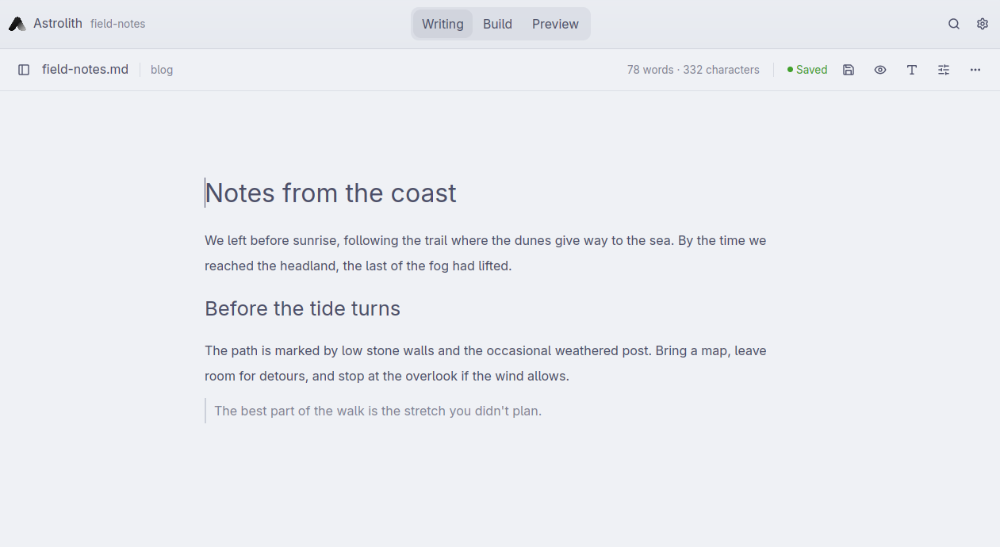

<p align="center">
  <picture>
    <source media="(prefers-color-scheme: dark)" srcset="apps/desktop/assets/astrolith-dark.svg">
    
  </picture>
</p>

<h1 align="center">Astrolith</h1>

<p align="center"><strong>A native desktop editor for Astro sites.</strong></p>

<p align="center">
  <a href="#build-from-source">Get started</a> ·
  <a href="docs/user/guide.md">User guide</a> ·
  <a href="docs/user/keyboard-shortcuts.md">Keyboard shortcuts</a> ·
  <a href="#development">Development</a>
</p>

Open an existing [Astro](https://astro.build/) project and write directly in
its content collections. Edit frontmatter in a form built from the collection
schema, switch to source when you need to change the site, and check the result
in your browser. Your edits live in the project's own files.

**Linux alpha.** Build from source to try it on Wayland or X11. See the
[known limits](docs/user/guide.md#14-linux-limits-and-known-gaps) for the current
platform and packaging status.



## One project, three modes

| Mode | What you can do |
| --- | --- |
| **Writing** | Draft Markdown and MDX on a centered page. Browse collections in the Library, edit frontmatter in Details, and turn on Focus or Typewriter mode. |
| **Build** | Browse the project tree, edit `.astro` and other source files in tabs, and run project commands in an integrated terminal. Installed language servers add diagnostics, completions, and navigation to definitions. |
| **Preview** | Read the current Markdown or MDX draft in a rendered view. To see the page with your site's layout and styles, use the separate Astro preview panel to start the project's dev server and open the route in your browser. |

Switching modes keeps the current document and its unsaved edits.

## Built for Astro content

- **Browse your collections.** Open supported local collections in Astro 5, 6,
  and 7. Filter entries by title or draft status, and use Content Finder to
  open an entry or insert a link to it. Edit Markdown, MDX, and YAML sources.
- **Edit metadata from the schema.** Use fields for dates, references, and
  images, or edit the YAML directly. Form edits preserve surrounding comments,
  quoting, and unknown fields.
- **Insert MDX components.** Build component tags from props Astrolith can
  discover in your project.
- **Keep your drafts.** Autosave detects conflicts with external changes, and
  local recovery snapshots help restore unsaved edits after an interruption.

See the [project compatibility guide](docs/user/guide.md#2-projects-and-collections)
for supported collection configurations.

## Build from source

You need [mise](https://mise.jdx.dev/), the native build dependencies below, and
a graphical Wayland or X11 session with a working Vulkan driver.

<details>
<summary>Linux build dependencies</summary>

**Ubuntu 24.04**

```sh
sudo apt-get update
sudo apt-get install -y gcc g++ clang cmake pkg-config libfontconfig-dev \
  libwayland-dev libxkbcommon-x11-dev libx11-xcb-dev libssl-dev libzstd-dev \
  libvulkan-dev mesa-vulkan-drivers
```

**Arch Linux and CachyOS**

```sh
sudo pacman -S --needed base-devel clang cmake pkgconf fontconfig wayland \
  libxkbcommon libxkbcommon-x11 libx11 libxcb openssl zstd vulkan-headers \
  vulkan-icd-loader
```

Install the Vulkan driver for your GPU, such as `vulkan-radeon`, `vulkan-intel`,
or the distribution's NVIDIA driver.

</details>

From the repository root, run:

```sh
mise install
mise run doctor
mise run dev
```

If mise asks you to trust the configuration, review [mise.toml](mise.toml) and
run `mise trust` in the repository root.

In Astrolith, choose **Open project…** (`Ctrl+Shift+O`) and select the root of
an Astro project with its dependencies installed. Choose a collection in the
Library, then open an entry.

AppImage, `.deb`, and `.rpm` recipes are available for local builds. See the
[Linux packaging notes](packaging/linux/README.md) for commands and verification
status.

## Documentation

- [User guide](docs/user/guide.md)
- [Keyboard shortcuts](docs/user/keyboard-shortcuts.md)
- [Privacy and local data](docs/user/privacy.md)

Astrolith has no account system or telemetry. The privacy guide lists where
preferences and recovery snapshots are stored and when the app makes network
requests.

## Development

Astrolith is written in Rust with GPUI Kit. [mise.toml](mise.toml) pins the
toolchain, and Cargo build and test tasks use the committed lockfile.

```sh
mise run build
mise run check
```

Run `mise run check` before committing. It covers the toolchain, formatting,
lint, build, headless tests, and Astro compatibility fixtures. See the
[development and packaging guide](docs/technical/development.md) and the
[repository guidelines](AGENTS.md).

## License

The repository does not currently declare a project license.
