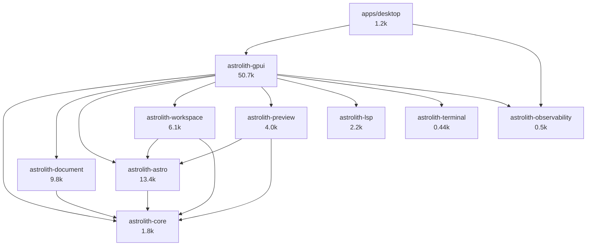

# Astrolith architecture audit

Audit date: 2026-11-05. Repository `dev` @ `326eeec5bcc69d90ea6af6fd50ab8f214b97e4b8`.
Evidence policy: every claim is tagged **Confirmed** (measured or reproduced here),
**Strong** (direct source evidence, `path:line`), or **Hypothesis** (plausible, needs a
runtime check). Detailed per-subsystem evidence lives in `docs/audits/evidence/`.

This document describes what exists, not what was planned. `docs/refactor/ARCHITECTURE.md`
is the project's own (Chinese) architecture statement at baseline `244f3ee`; where it and
the code disagree, this audit follows the code and records the discrepancy.

---

## 1. Baseline facts

| Fact | Value | Source |
|---|---|---|
| Branch / HEAD | `dev` @ `326eeec` | `git rev-parse HEAD` |
| Working tree | clean except untracked `artifacts/` and `astrolith-web-mock/` | `git status` |
| Rust | 1.99.1, edition 2024, resolver 3 | `mise.toml`, `Cargo.toml` |
| Framework | `gpui-kit = "=0.8.1"` over `gpui-pre 0.3.10`, `gpui-component 0.8.1` | `Cargo.toml`, `Cargo.lock` |
| Workspace members | 10 crates | `Cargo.toml` |
| Rust LOC | 92,598 total (51 % in `astrolith-gpui`) | `find` + `wc -l` over `crates/` and `apps/` |
| Automated gate | `mise run check` exit 0: **915 passed, 0 failed, 8 ignored**, 26 test binaries | `artifacts/e2e/audit-baseline-326eeec/check.log` |
| Fixture oracle | `Astro fixture compatibility: PASS` | same log |
| Lockfile | 974 packages, 97 duplicated crate names | `Cargo.lock` (feature-debt evidence D6) |

Test binaries and counts: astro 130 (+13 integration), core 15 (+9), desktop 18, document 151,
gpui 385, lsp 24, observability 3, preview 85, terminal 4, workspace 33 (+3+21+13+8 integration).
`6` of the `8` ignored tests are the workload/gate tests listed in `mise.toml`.

## 2. Crate inventory and dependency direction



No cycles. Direction is `app → ui → services → domain`, with two deliberate
exceptions: `astrolith-workspace` and `astrolith-preview` both depend on
`astrolith-astro` to share collection descriptors, and `astrolith-astro`
performs process execution for `astro sync` (`crates/astrolith-astro/src/schema/generation.rs:568-600`).
**Strong.**

### 2.1 Responsibility matrix

| Crate | Owns | Does not own | Notes |
|---|---|---|---|
| `astrolith-core` | Preferences types, project/entry identity, path safety, `WorkspaceMode` | I/O, UI | 1.8k lines, only `serde` as a dependency. Clean. |
| `astrolith-document` | `DocumentBuffer` (complete source + baseline + revision), projection, YAML patch/serialize, atomic save, recovery, copyedit, WYSIWYG parse | UI state, paths of open documents | Contains 5 of the app's correctness invariants (see §5). |
| `astrolith-astro` | Static discovery, `content.config.ts` parse (tree-sitter TS), schema normalization, component/prop extraction, `astro sync` invocation | UI, file watching | Parses TypeScript twice in the workspace (also `astrolith-document` for MDX preludes). |
| `astrolith-workspace` | Collection index, bounded watcher, file scan, entry operations (create/rename/duplicate/trash), assets | Document text, UI | |
| `astrolith-gpui` | Shell, `ProjectWorkspace`, all views/entities, command registry, settings store, theme, terminal view, preview view, LSP adaptation | — | 51 % of the codebase; see §3. |
| `astrolith-lsp` | JSON-RPC client, server discovery, position mapping | Editor integration | 2.2k lines, protocol-complete for the features it declares. |
| `astrolith-terminal` | PTY child, `vt100` parser, bounded scrollback, revision counter | Rendering, input translation | 435 lines; the cleanest boundary in the workspace. |
| `astrolith-preview` | Dev-server spawn/supervision, readiness, route mapping, browser launch, surface capability | Presentation | Process-group ownership is the most rigorous in the workspace (`process.rs:234-238, 396-405`). |
| `astrolith-observability` | Tracing bootstrap, file sink, panic hook | — | |

### 2.2 Where the code actually lives (LOC hotspots)

| File | Lines | Responsibility count |
|---|---:|---|
| `crates/astrolith-gpui/src/project_discovery.rs` | 13,451 (6,364 test) | 7 distinct concerns (see §4.1) |
| `crates/astrolith-gpui/src/shell.rs` | 7,363 | 18 owned entities, 73-command dispatch, layout persistence |
| `crates/astrolith-gpui/src/editor/session.rs` | 2,081 | document authority, projection, history, LSP attach |
| `crates/astrolith-gpui/src/preferences/mod.rs` | 1,970 | settings UI |
| `crates/astrolith-gpui/src/frontmatter/mod.rs` | 1,540 | form + field entities |
| `crates/astrolith-gpui/src/commands.rs` | 1,489 | registry, keys, menus |

**ARCH-01 (P2, Strong).** `project_discovery.rs` is a god module. `ProjectWorkspace`
has **78 fields** (`project_discovery.rs:696-830`) and **111 `cx.notify()` sites**;
`Shell` has ~70 fields and 18 directly owned entities. The file mixes entry-list
`ListDelegate`, tab strip model, save lifecycle, watcher/index generations, schema and
reference loading, document CRUD, recovery, and a 644-line `Render` implementation.
This is not a style complaint: the six highest-severity correctness defects in the audit
(`DOC-01`…`DOC-06`) all live in the save/watcher/recovery cluster that §4.1 identifies as
extractable.

## 3. Component architecture and state ownership

```mermaid
flowchart TD
  Shell[Shell<br/>window root] -->|owns| Dock[DockArea]
  Shell -->|owns| Document[WorkspacePanel document]
  Shell -->|owns| Navigator[WorkspacePanel navigator]
  Shell -->|owns| Header[DocumentHeader]
  Shell -->|owns| Project[ProjectWorkspace]
  Shell -->|owns| Frontmatter[FrontmatterForm]
  Shell -->|owns| Rendered[RenderedDocument]
  Shell -->|owns| PreviewPanel[PreviewPanel]
  Shell -->|owns| Embedded[EmbeddedPreview]
  Shell -->|owns| TerminalPanel[TerminalPanel]
  Shell -->|owns| Palette / Finder / Builder / Prefs
  Project -->|owns| Sessions[sessions: BTreeMap path → Entity DocumentSession]
  Project -->|owns| List[ListState EntryList]
  Project -->|owns| FileBrowser[FileBrowser]
  Project -->|owns| Store[RecoveryStore]
  Project -->|holds| Document
  Sessions -->|owns| Editor[EditorState]
  Sessions -->|owns| Writer[WriterSurface]
  Sessions -->|owns| Buffer[DocumentBuffer]
  Sessions -->|holds| Lsp[LspState process]
  Writer -.->|weak back-reference| Sessions
```

### 3.1 Authoritative state

There are **five representations of the same document text** (all **Strong**,
`evidence/document-session-save.md:33-49`):

1. `DocumentBuffer.original_text` — saved baseline.
2. `DocumentBuffer.current_text` — **the authority**.
3. `WriterProjection.visible` + segment map — what the editor shows.
4. `EditorState`'s rope — what the user types into.
5. `WriterSurface.source` + `WysiwygDocument` — what the writer paints.

Editor text is a *cache with a documented divergence latch* (`session.refused`).
`session.dirty` is a **duplicate** of `buffer.is_dirty()` and can go stale
(`session.rs:67` vs `session.rs:489-500`): the tab dot can lie while save/quit decisions
are correct, because they read the buffer.

### 3.2 Ownership anomalies

| ID | Finding | Evidence | Level |
|---|---|---|---|
| ARCH-02 | The centre `document` panel has **two writers**: `Shell` (`shell.rs:2965-2985`) and `ProjectWorkspace` (`project_discovery.rs:2799, 2820, 3542, 3737`), with a three-way mutually-exclusive state (`clear_editor` / `show_editor` / `show_source`). | `shell.rs:221, 343` | Strong |
| ARCH-03 | Layout state has **three authorities** (`settings.layouts`, `global_layouts`, `project_scope`) kept coherent by a hand-maintained guard in `persist_global` (`shell.rs:1485-1491`). Any new write path that skips it copies a project layout into the global file. | `shell.rs:267-273` | Strong |
| ARCH-04 | `Shell` **observes** `ProjectWorkspace` (`shell.rs:523-528`), so every project notify (111 sites) re-runs `sync_preview`, `track_active_entry`, `refresh_component_builder`. | same | Strong |
| ARCH-05 | `document` panel state machine is split across two modules; a stray `clear_editor` during a load wipes the other owner's content. No test covers the interleaving. | `panels.rs:176-195` | Strong |
| ARCH-06 | `FrontmatterForm` rebuilds **every field entity** (and its `InputState`) whenever `FrontmatterKey` changes, and that key includes `references_revision` (`project_discovery.rs:1958-1971`). A reference republish discards in-progress input. | `shell.rs:3124-3152` | Strong |

### 3.3 Duplicated state clusters

Eight clusters were identified (**Strong**, `evidence/gpui-shell-render.md#F-2`):
inspector visibility (`shell.inspector_open` mirrored from `DocumentHeader`), workspace
mode (`shell.mode` + `settings.default_mode` + project `last_mode`), layout (three copies),
preferences (`Shell.settings` + `ProjectWorkspace.global_preferences` +
`project_preferences` + store), open tabs (`OpenTab` vector + `sessions` map +
`tab_order`), preview state (`PreviewPanel` + `Shell.preview_sync_key` +
`Shell.preview_unavailable_reason`), chrome auto-hide (`ChromeVisibility` + typed counters),
and dirty flags (`session.dirty` vs `buffer.is_dirty()`).

Not all duplication is a defect — a derived cache with a single writer is fine. The ones
that cost real defects are: `session.dirty`, `Shell.file_status` (never rendered, see
FEAT-05), and the three layout authorities.

## 4. Execution paths

Coverage honesty: the paths below were traced in source; the ones marked *(deep)* were
read line-by-line by the owning sub-audit, the rest were followed by symbol and anchor.
No native window was opened during this audit, so no path is **Confirmed** at runtime
except through the headless test harness.

### 4.1 Project discovery module decomposition

| Concern | Lines | Extracted? |
|---|---|---|
| Entry list UI (`ListDelegate`, rows, menus) | 105-630 | no (needs `Render`) |
| Workspace aggregate + events | 688-960 | — |
| Tab / file-browser / session wiring | 1116-1240 | no |
| Save lifecycle | 1294-1660, 3898-4046 | no (candidate A) |
| Schema / references / components | 1691-2368 | no |
| Asset drop + frontmatter apply | 2369-2470 | no |
| Navigation / definition targets | 2665-2915 | no |
| Project open / switch / quit | 2916-3070, 3898-3936 | no |
| Watcher loop + index publication | 3150-3470, 4433-4625 | no (candidate B) |
| Load admission + session install | 2779-2853, 3470-3690 | **duplicated policy** (candidate D) |
| Recovery | 4047-4315 | no (candidate C) |
| Document CRUD | 5072-6140 | no (candidate E) |
| `Render` | 6225-6868 | no |

These are extraction seams, not a rewrite proposal. Candidates C and D need no new types
and depend only on a store / root.

### 4.2 Startup → first frame *(deep)*

`apps/desktop/src/main.rs` → `gpui_kit::application().with_assets(AllAssets).run` →
`gpui_kit::init` → `astrolith_gpui::open` (`shell.rs:91`):

1. `url_scheme::parse_startup` (synchronous argv work).
2. `single_instance::forward` — **blocking socket connect before any runtime exists**; on
   success the process exits (`shell.rs:98-105`).
3. `runtime::init` — builds a 2-worker Tokio runtime plus globals (`runtime.rs:34-63`).
4. `commands::bind_keys`.
5. Settings load on a blocking lane, then `open_window`, then `Shell::new`, then `begin`.
6. `Shell::new` builds 18 entities and installs every subscription synchronously
   (`shell.rs:310-455`).

No filesystem work happens on the render path at startup; the window is created only after
settings load completes. Cost of the critical path was not measured (**Hypothesis**: the
`single_instance::forward` connect and `AllAssets` registration dominate; both are
sub-millisecond-to-few-millisecond on this machine, needs a `strace -c -f` run).

### 4.3 Keystroke → paint *(deep)*

```
EditorState::replace_text_in_range
  → InputEvent::Change (deferred Effect::Emit)
  → DocumentSession absorb_with_intent           4 full copies + 2 full diffs
  → ProjectWorkspace::note_session_change        coordinator.observe, recovery 500 ms timer
  → Shell::subscribe SessionChanged              sync_preview (keyed), note_typing (O(n) char count)
  → writer.notify() → WorkspacePanel::render → WriterSurface::render
      (whole-document block rebuild + WYSIWYG re-parse)
```

The writer renders the document **twice**: the WYSIWYG block tree and a hidden
full-size `Editor` at `opacity(0.)` (`writer_surface.rs:590-597`).

### 4.4 Project open *(deep)*

`ProjectWorkspace::start` → index request (token `index_request`) → `runtime::blocking` →
`inspect_project` + `scan_collections` → `apply_discovered_index` → sessions reconciled →
`cx.emit(ProjectOpened)` → `Shell` opens project scope (**spawns the terminal PTY
eagerly**, `shell.rs:498-506`), applies mode/layout, reopens last entry.

### 4.5 Mode switch *(deep)*

`Shell::set_mode` → `capture_layout` → close inspector → set mode → `session.set_source_view`
→ `apply_layout` → `sync_center` → `sync_embedded` → persist `last_mode`. No document
reopen, session recreation, or project reload: the session keeps buffer, history, caret,
selection. Verified by `shell::tests::switching_workspace_modes_keeps_one_session_text_selection_and_history`.
The projection is rebuilt and the pinned editor's own undo stack is cleared by `set_value`
(`gpui-base/state.rs:1245`), so the only history is `SourceHistory`.

### 4.6 External modification *(deep)*

watcher batch → `apply_watcher_scan` → per-open-document `read_bounded` + `fingerprint`
compared with `session.disk_fingerprint` → `externally_changed`. See `DOC-01`: the
fingerprint is captured once at session build and never updated.

### 4.7 Preview lifecycle *(deep)*

`PreviewPanel` owns an `AstroPreviewBackend` over a shared `DevServer`; server spawn is
`astro dev --host 127.0.0.1 --port <free>` with process-group ownership
(`process.rs:234-238`); readiness is parsed from stdout/stderr with a 30 s deadline
(`server.rs:719`); generations reject stale results (`lifecycle.rs:1-20`); quit kills the
group inline (`shell.rs:665-670`). There is **no HMR observation** in the app — HMR is
whatever the spawned Astro process does inside the embedded/external page.

### 4.8 Paths enumerated but not deeply read

File create/rename/duplicate/trash command wiring beyond `operations.rs`; the copyedit
tokenizer internals; the component builder's form generation; `update.rs` signature
verification beyond its tests; theme OKLCH conversion math (covered by unit tests);
macOS/Windows platform code (no runtime available).

## 5. Background task and resource ownership

| Task | Owner field | Cancellation | Cleanup |
|---|---|---|---|
| Service futures | `runtime::spawn` → `AbortOnDrop` | dropping the GPUI `Task` aborts the Tokio task | verified by `runtime::tests` |
| Blocking jobs | `ServiceRuntime.blocking_slots` (2 permits) | queued work is dropped; running work keeps its permit | `runtime.rs:105-127` |
| Index request | `index_task` + `index_request`/`published_index_request` | token supersession | `accepts_index_result` |
| Save | `save_tasks` per canonical path + `SaveCoordinator` | stale ticket rejected on completion | one writer per document |
| Recovery | `recovery_task`, `recovery_load_task` | drop | `RecoveryStore` |
| Watcher poll | `watch_task`, 100 ms timer | project switch | `watcher_owner: ServiceWatcher` |
| Schema freshness | 750 ms poll, no stop condition found | — | **WS-09** |
| PTY reader | `astrolith_terminal` OS thread + 16 ms poll task | reader stops on EOF | kill path blocks the UI (BM-12) |
| LSP process | `DocumentSession.lsp` | `kill_on_drop` | one process per active Build document (BM-04) |
| Preview server | `PreviewPanel`/`SharedServer` | generation + `abort` on quit | process group kill |

**ARCH-07 (P2, Strong).** The 100 ms watcher poll acquires a blocking permit and dispatches
`spawn_blocking(drain)` **even when no events exist** (`project_discovery.rs:3172-3190`), so
an idle window with a project consumes 10 blocking-pool dispatches/s from the same 2-permit
lane used by saves and schema sync.

## 6. Error propagation

- Domain errors are typed (`DocumentError`, `WorkspaceError`, `AstroError`, `ClientError`,
  `PreviewError`) and mapped to strings at the GPUI boundary.
- **FEAT-05 (P2, Confirmed).** `Shell.file_status` is assigned at 9 sites
  (`shell.rs:2676-3014`) and **never rendered**; only tests read it. Open, builder and
  scan failures are invisible to the user.
- Save failures produce a status line plus one redacted JSON artifact per episode
  (`save_failure.rs:71-83`).
- `unwrap`/`expect`: 19 `expect`s outside tests, 18 with locally provable invariants,
  one genuine risk (`writer_surface.rs:778`, **Hypothesis**). Zero `todo!`/`dbg!` in
  production code (**Confirmed**).
- Panics are not caught anywhere; a panic in a service task surfaces as
  `Err("task panicked …")` through the runtime bridge (`runtime.rs:112-126`).

## 7. Lifecycle risks

| Risk | Evidence | Level |
|---|---|---|
| Terminal kill joins the reader thread on the UI thread (project switch, restart, quit) | `astrolith-terminal/src/lib.rs:277-293` | Strong (hang is Hypothesis) |
| Terminal children are signalled by pid only; no `killpg`, no reap after `SIGKILL` | same | Strong |
| `astro sync` child has no process-group ownership and holds a blocking permit up to 30 s | `schema/generation.rs:568-600` | Strong |
| LSP children are `SIGKILL`ed on drop with the 2 s grace path unreachable | `client.rs:255, 339-345` | Strong |
| Schema-freshness poll runs forever at 750 ms and re-reads schemas | `project_discovery.rs:1837` | Strong |
| Preview server is not stopped when the preview leaves the screen | `preview/mod.rs:325-333` | Strong |
| Orphaned `xdg-open` children are not reaped | `preview/src/external.rs:44-56` | Strong |

## 8. What is genuinely well-built

Recorded so the roadmap does not regress it:

- `DocumentBuffer` invariants (revision, baseline, stale-ticket rejection) are tested
  directly (`buffer.rs`, 20+ tests) and are the right abstraction.
- Save mechanics: read → compare baseline → `create_new` temp → `fsync` → `rename` →
  dir `fsync`, with a per-canonical-path writer lock (`save.rs:137-266`).
- Single complete-source history covering body **and** hidden frontmatter
  (`session.rs:1848-1936`), with the pinned editor's own stack suppressed.
- `runtime.rs`: cancelling bridge, blocking admission, quit-time flush that survives
  observer abandonment — better than most desktop Rust code.
- ASTRO discovery refuses to guess: unsupported config is a diagnostic, never an empty
  project (`astrolith-astro/src/discovery.rs`).
- Preview process ownership (session/process group, `killpg`, exit watcher, generation
  reconciliation) is the model the terminal should follow.
- Preview capability matrix (`capabilities.rs`) states platform facts instead of pretending
  embedded surfaces exist on Wayland.

## 9. Architecture verdict

**Coherent domain layer, over-centralised UI layer.** The service crates (`document`,
`astro`, `workspace`, `preview`, `lsp`, `terminal`) have clear ownership and testable
invariants. The GPUI crate absorbed application orchestration to the point where one module
(`project_discovery.rs`) owns seven concerns and one entity has 78 fields; correctness
defects cluster exactly there. The fix is extraction along the seams in §4.1 and single
ownership for layout/document-header state — not a rewrite, and not more abstraction.

Open architectural questions that this audit did **not** resolve:

1. Whether `ProjectWorkspace` should be split into three entities (`Index`, `Sessions`,
   `SaveController`) or stay one entity with extracted modules. Both satisfy the seams;
   the second is cheaper and testable today. Recommend the second for phase 5.
2. Whether the centre document panel should be owned by `Shell` only. Evidence favours
   single ownership, but `ProjectWorkspace` needs to install content atomically with
   session activation; a command/event (`SessionActivated { path }`) would remove the
   second writer without new types.
3. Whether LSP should move to project scope. See `build-mode-audit.md` §4.
