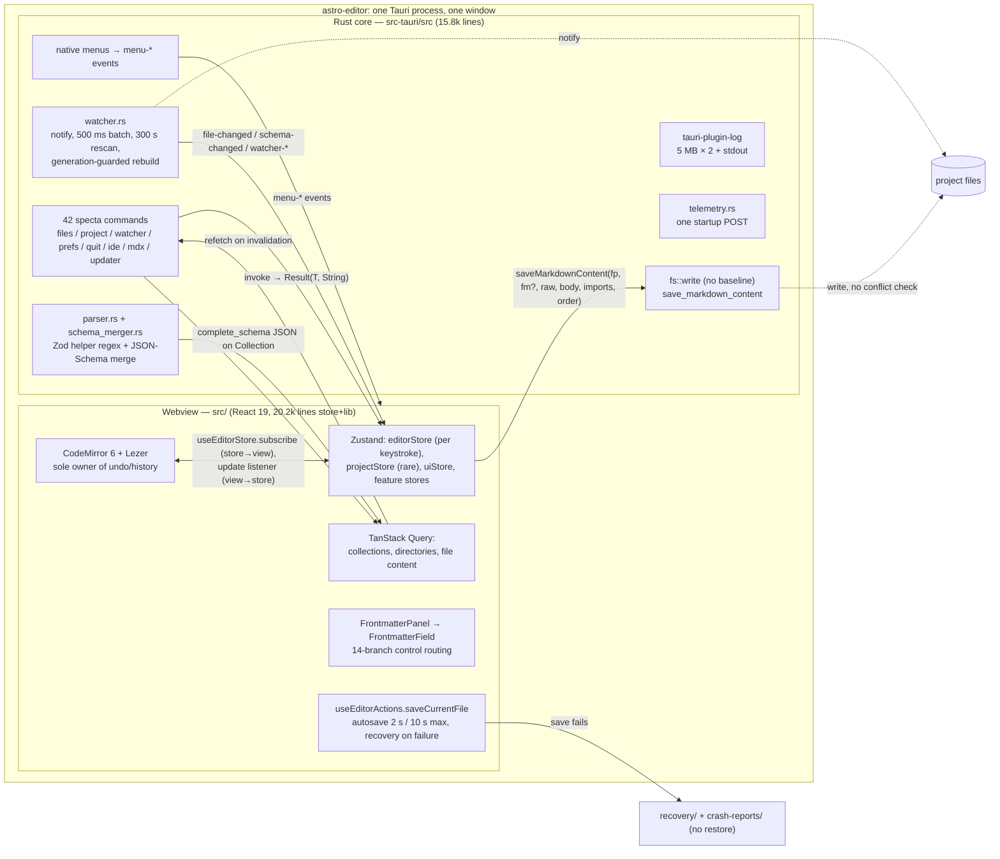

# Astro Editor as a reference: architecture, IPC, schema forms, transferability

Reference tree: `/tmp/astro-editor` @ `3af8e9bf24b03fe42b3dad9bf632aa6109f17294` (Tauri 2 + React 19 + TypeScript 7,
Rust backend `src-tauri/`). Astrolith tree: `/home/maredevi/Projects/Astrolith` @ `326eeec` (`repo:` prefix in this file).

All paths without a prefix are relative to `/tmp/astro-editor`. Evidence levels: **Confirmed** (measured/executed
count or reproduced text), **Strong** (direct source text), **Hypothesis** (needs a runtime check).

## Scope inspected

| Area | Files read (lines) |
|---|---|
| App wiring / IPC | `src-tauri/src/lib.rs` (477, full), `src-tauri/src/bindings.rs` (95, full), `src-tauri/src/main.rs` (20), `src-tauri/src/commands/mod.rs` (12), `src-tauri/src/models/mod.rs` (9), `src/lib/bindings.ts` (270, generated) |
| Project/schema | `src-tauri/src/commands/project.rs` (1144; l.1–60, 183–400), `src-tauri/src/parser.rs` (1566; l.1–120, 136–330), `src-tauri/src/schema_merger.rs` (2220; index + key fns), `src-tauri/src/models/collection.rs` (99, full) |
| Files/save/recovery | `src-tauri/src/commands/files.rs` (2609; l.240–470, 560–640) |
| Watcher | `src-tauri/src/commands/watcher.rs` (382, full) |
| Quit | `src-tauri/src/commands/quit.rs` (179; l.1–120), `src/lib/quit.ts` (60, full) |
| Telemetry/logging | `src-tauri/src/telemetry.rs` (123, full), `src-tauri/src/commands/diagnostics.rs` (11), `src/lib/diagnostics.ts` (~70), `src/lib/recovery/index.ts` (~100) |
| Frontend state | `src/App.tsx` (101), `src/main.tsx` (36), `src/store/projectStore.ts` (500; l.1–120, 176–500), `src/store/editorStore.ts` (232, full), `src/hooks/editor/useEditorActions.ts` (330, full), `src/hooks/useFileChangeHandler.ts` (91, full), `src/hooks/useEditorFileContent.ts` (49, full), `src/hooks/queries/useCollectionsQuery.ts`, `useFileContentQuery.ts` |
| Frontmatter UI | `src/components/frontmatter/FrontmatterPanel.tsx` (203; l.43–129), `fields/FrontmatterField.tsx` (258, full), `fields/FieldWrapper.tsx` (155; l.1–90), `fields/ReferenceField.tsx` (239; l.1–50), `fields/CopyAsSlugLink.tsx` |
| Security/packaging | `src-tauri/tauri.conf.json`, `src-tauri/capabilities/default.json`, `src-tauri/Cargo.toml`, `package.json` |
| Docs (authoritative) | `AGENTS.md` (11.1K), `docs/developer/architecture-guide.md` (8.5K), `editor.md` (7.0K), `schema-system.md` (8.4K), `app-data.md` (6.2K) |
| Astrolith comparison | `repo:crates/astrolith-astro/{discovery,config}.rs`, `schema/{model,parser,helpers,generation}.rs`, `repo:crates/astrolith-preview/{lib,server,process,lifecycle,surface}.rs`, `repo:crates/astrolith-gpui/src/frontmatter/{mod,fields}.rs`, `repo:crates/astrolith-gpui/src/editor/{save_coordinator,session}.rs` (headers/anchor regions), `repo:crates/astrolith-document/{save,projection}.rs`, `repo:crates/astrolith-workspace/src/watcher.rs` (header), `repo:crates/astrolith-core/src/preferences.rs`, `repo:crates/astrolith-observability/src/lib.rs`, `repo:docs/refactor/ARCHITECTURE.md` |

Measured sizes: `src-tauri/src/**/*.rs` = 15,798 lines; `src/{store,lib}/**` = 20,161 lines (tests included);
`collect_commands![]` = **42** commands (`bindings.rs`); distinct Rust→frontend event names = **24** (17 `menu-*`, plus `quit-requested`, `rust-toast`,
`file-changed`, `schema-changed`, `watcher-{rescan,rebuilt,error}`) — **Confirmed**
(grep counts).

## Findings

### 1. Process and IPC model

**AE-01 — One Tauri process, one window, one webview; Rust and React are the only two runtimes.**
`src-tauri/src/lib.rs:42` builds a single `tauri::Builder` with `invoke_handler` (`lib.rs:430`) and a single
`main` window from `tauri.conf.json` (`app.windows[0]`, 1400×900). There is no sidecar process, no local HTTP
API, no second webview. React never talks to the network for app data. Evidence level: **Strong**.
Impact: the *entire* state store lives in webview memory; app restart loses all open-document state
except what auto-save wrote. Astrolith's multi-entity GPUI process model has no counterpart here.

**AE-02 — IPC is request/response commands only, generated end-to-end by tauri-specta; errors are `String`.**
`bindings.rs:12` `generate_bindings()` → `.commands(collect_commands![…])` (42 entries), exported to
`src/lib/bindings.ts` in debug builds (`bindings.rs:4`). Every command is `#[tauri::command] #[specta::specta]`
returning `Result<T, String>`; the TS wrapper `typedError<T, string>` produces
`{status:'ok',data} | {status:'error',error}` so callers never get exceptions (`AGENTS.md`, "Tauri commands";
`src/lib/bindings.ts:12`). Two specta escape hatches are documented at `bindings.rs:16-24`:
`dangerously_cast_bigints_to_number()` and `disable_serde_phases()`. Level: **Strong**.
Impact: a single string error channel means the UI cannot branch on error *kind* (e.g. "not found" vs
"permission denied" vs "conflict"); every failure becomes a toast with a message.

**AE-03 — Rust→frontend is an untyped event bus, and the frontend re-broadcasts it as DOM events.**
24 event names; native menus emit `menu-*` (`lib.rs:344-420`), the watcher emits `file-changed` /
`schema-changed` / `watcher-*` (`watcher.rs:330`, `:293`, `:201`/`:233`/`:256`), quit uses `quit-requested`
(`quit.rs:55`), Rust-originated toasts use `rust-toast` (`project.rs:39`). In React,
`projectStore.startFileWatcher` (`projectStore.ts:190-247`) subscribes with `listen()` and re-dispatches
`file-changed` as a `window` `CustomEvent`, which `useFileChangeHandler` consumes (`useFileChangeHandler.ts:88`).
Level: **Strong**. Impact: two indirections (Tauri event → DOM event → hook) for one signal; payload types are
re-declared by hand on the TS side (`FileChangeEvent` in `useFileChangeHandler.ts:8`), so they can drift from Rust.

**AE-04 — Boundary: Rust owns every filesystem/OS effect; TypeScript owns every editing decision.**
Rust: project scan and collection discovery (`project.rs:190`), JSON-schema load + Zod merge (`project.rs:286`,
`schema_merger.rs:193`), file read/write (`files.rs:273`, `files.rs:286`), file watching (`watcher.rs:116`),
app-data read/write with path confinement (`files.rs:714`, `files.rs:759`), native menus (`lib.rs:155-343`),
IDE launch (`commands/ide.rs:3`), updater release notes (`commands/updater.rs`), clipboard, fonts.
TypeScript: editing buffer, dirty flags, auto-save scheduling (`editorStore.ts:173`), save policy and recovery
(`useEditorActions.ts:70`), settings *resolution and merge* (`src/lib/project-registry/**`), toasts, theme,
image URL resolution, command palette. Level: **Strong**.
Impact: preference semantics live in TS while preference bytes live in Rust — the split that Astrolith
deliberately reversed (`repo:crates/astrolith-core/src/preferences.rs`, typed v1/v2 envelopes).

**AE-05 — Security posture is "the asset protocol may read anything; Rust commands are the boundary".**
`tauri.conf.json` sets `assetProtocol.scope: ["**"]` and a CSP of
`default-src 'self' ipc: http://ipc.localhost; connect-src 'self' https://updateserver.dny.li; img-src 'self' asset: …`.
`architecture-guide.md` ("Security boundaries") states this explicitly. Every file command calls
`utils::path::validate_project_path` first (`utils/path.rs:29`; e.g. `files.rs:273-300`, `create_file` at `:59`,
`delete_file` at `:85`).
Level: **Strong**. Impact: path validation is a per-command ritual, not a type. A new command that forgets
`validate_project_path` silently becomes an arbitrary-file-write primitive reachable from the webview.

### 2. Astro project discovery and content collections

**AE-06 — Discovery is two independent heuristics with a fallback chain, not a parse of the real config.**
`scan_project_with_content_dir` (`project.rs:190`) tries `parse_astro_config` (`parser.rs:81`) which reads
`src/content.config.ts` then legacy `src/content/config.ts` (`parser.rs:86-91`); on `Ok(empty)` **or** `Err`
(a *debug* log, `project.rs:234`, `:259`) it falls back to listing directories under `src/content`
(`project.rs:342`). Level: **Strong**. Impact: a broken or unrecognised config silently degrades to
"every directory is a collection", which is a different product behaviour rather than an error.

**AE-07 — Collection names come from regex + naive brace matching, with a documented refusal to parse Zod.**
`extract_collections_block` matches `export const collections = {` or `collections: {` (`parser.rs:206`), then
`find_matching_closing_brace` counts characters without understanding strings or comments (`parser.rs:39-43`),
after `remove_comments` (`parser.rs:136`) which is a hand-written state machine. `parse_collection_definitions`
(`parser.rs:249`) accepts name lists for Astro 5 style (`export const collections = { blog, notes }`) and
`name: defineCollection(` for the legacy form; each candidate collection is dropped unless the directory
exists (`:278`, `:306`). `is_file_based_collection` (`parser.rs:235`) excludes `file()` loaders via regex.
Level: **Strong** (the file header at `parser.rs:1-12` states the design intent and its limits).
Impact: `const blog = defineCollection({...})` plus `export const collections = { blog }` works; a computed
key, a spread, or a helper function that returns collections does not. Astrolith's tree-sitter parse of
`content.config.ts` (`repo:crates/astrolith-astro/src/config.rs:62`) removes this class of failure and is
strictly the better mechanism.

**AE-08 — Astro version is never detected; only the emitted JSON Schema *shape* is probed.**
No `node_modules/astro/package.json` read, no semver gate anywhere in `src-tauri` or `src` (grep for
`node_modules/astro` finds only the MDX/Starlight component index, `mdx_components/mod.rs:23`).
`parse_json_schema` (`schema_merger.rs:242`) tries Astro 5 (`$ref` + `definitions`, `:245-247`) and then the
flat Astro 6/7 draft 2020-12 root; `non_null_type` (`:570`) handles Zod 4.5's `"type": ["number","null"]`.
Level: **Strong**. Impact: an unsupported Astro version yields a partially-parsed form with no message,
whereas Astrolith rejects the project with a diagnostic
(`repo:crates/astrolith-astro/src/discovery.rs:19`, `:270-352`).

**AE-09 — The JSON schema in `.astro/collections/*.schema.json` is the source of truth, and the app never
produces it.** `load_json_schema_for_collection` (`project.rs:286`) reads
`.astro/collections/<name>.schema.json`; `generate_complete_schema` (`project.rs:303`) merges it with the Zod
helper extraction. No `std::process::Command` anywhere invokes the Astro CLI (`preferences.rs`, `ide.rs`,
`fonts.rs` are the only spawn sites). `schema-system.md` ("The Zod-only fallback") calls a never-run
`astro sync` "the likeliest cause of 'my fields don't show up'". Level: **Strong**.
Impact: first-run UX depends on the user having started their dev server. Astrolith closed this by running
`node <astro entry> sync` itself (`repo:crates/astrolith-astro/src/schema/generation.rs:95`, timeout 30 s at
`:34`, fingerprint-based staleness at `:290` and `:456`).

**AE-10 — Zod parsing is limited to two helpers by explicit decision, and the merge is path-string based.**
`parser.rs:1-12` and `schema-system.md` both say the parser extracts only `image()` and `reference('x')`
positions (`find_helper_calls` `parser.rs:370`, path reconstruction `resolve_field_path` `parser.rs:510`),
because Astro's generator stubs `image` as `z.string()` and flattens reference unions. Fields are flattened
to dot paths (`coverImage.image`) with `parentPath` retained; a helper inside an array-of-objects produces a
path that matches nothing (`schema-system.md`, "Helper paths must match JSON field names").
Level: **Strong**. Impact: silent no-ops for nested arrays; Astrolith's `enhance_astro_fields` emits a
`SchemaDiagnostic` per unresolved helper instead (`repo:crates/astrolith-astro/src/schema/helpers.rs:95`).

**AE-11 — Schema reload is watcher-driven and covers the "folder created later" case explicitly.**
`create_project_watcher` watches the content dir, both config paths, and `.astro/collections/` if it exists
(`watcher.rs:44-104`); `watch_new_schemas_dir` (`watcher.rs:265`) is polled on each event-loop wake and starts
watching the directory once it appears, emitting `schema-changed`. A config file created after watching
started is only picked up by the 5-minute rescan (`schema-system.md`, "Changes reload the form").
Level: **Strong**. Impact: good pattern, incomplete coverage — the reference itself documents the gap.
Astrolith re-derives staleness with a content fingerprint rather than event coverage
(`repo:crates/astrolith-astro/src/schema/generation.rs:290`), which is robust to lost events.

### 3. Dev server

**AE-12 — There is no dev-server management at all: not spawn, not readiness, not ports, not logs,
not shutdown.** Grep for `localhost|127.0.0.1|dev server|iframe|webview` over `src/` and `src-tauri/src/`
returns only the dev-only agent bridge (`agent_bridge/mod.rs:3`, bound to 127.0.0.1), Tauri's own devUrl
(`tauri.conf.json` `build.devUrl`), external-link handling, and the styleguide page. `AGENTS.md` product
principles: "Coder-mode work (… previewing the site) is out of scope". Level: **Confirmed**.

**AE-13 — Consequence: the reference has nothing to teach about `astrolith-preview`'s hard parts.**
Astrolith's preview already owns the concerns this app declined: supervised child with drained bounded
output (`repo:crates/astrolith-preview/src/process.rs:1-19`, `OUTPUT_CAP` 1 MiB), process-group kill on Unix
and kill-on-job-close on Windows (`process.rs:237`, `:484`), readiness by parsing the printed local URL with a
30 s deadline (`server.rs:719`, `:27`), ephemeral port chosen by binding (`server.rs:687`), in-flight
generation reconciliation (`lifecycle.rs:1-20`), and failure text carrying a stderr excerpt
(`server.rs:77-120`). Level: **Strong**. Impact: the only transferable dev-server lesson is negative —
scope discipline (see AE-24).

### 4. Preview and HMR

**AE-14 — Preview presentation does not exist; the app is the writing surface, and "view the site" is a
browser's job.** The only outbound navigation is `opener` plugin calls behind `lib/external-links.ts`
(scheme allow-list, `:18-30`). Level: **Strong**. Impact: no HMR, no scroll preservation problem, no
webview-vs-browser capability matrix — all of which Astrolith carries
(`repo:docs/refactor/ARCHITECTURE.md:115`, embedded webview feature `repo:crates/astrolith-gpui/Cargo.toml:11`,
`repo:crates/astrolith-preview/src/capabilities.rs`). Nothing here is a shortcut Astrolith can take.

**AE-15 — The nearest analogue is the dev-only agent bridge: a token-guarded local HTTP server that evaluates
JS in the webview and snapshots it.** `agent_bridge/mod.rs:29` binds 127.0.0.1 on a preferred port with an
ephemeral fallback, writes `{port, token, pid}` to `agent-bridge.json` (`:3-10`), and `snapshot.rs:17` captures
the WKWebView via `takeSnapshotWithConfiguration` without Screen Recording permission. Debug-only
(`cfg(debug_assertions)`, `lib.rs:140`), stopped on exit (`lib.rs:470-474`). Level: **Strong**.
Impact: an agent-drivable UI is a testability multiplier Astrolith lacks; the mechanism (HTTP + token + eval)
is adaptable to GPUI even though the WKWebView snapshot half is not.

### 5. File watching, external change, save/conflict, undo ownership

**AE-16 — The watcher is the most transferable subsystem in the reference.** One `RecommendedWatcher` per
project in a `Mutex<HashMap<String, WatcherEntry>>` (`watcher.rs:116-137`), a monotonic generation per start
(`NEXT_GENERATION`, `:32`) so a superseded loop exits instead of rebuilding, 500 ms quiet-window batching
(`:38`), a 300 s safety rescan emitting `watcher-rescan` (`:41`, `:201`), and automatic rebuild on channel
disconnect that re-checks generation ownership under the lock before re-inserting (`:205-260`).
Level: **Strong**. Impact: this generation-guard pattern is exactly what Astrolith needs for its own
watcher/index (which uses a 100 ms merge window `repo:crates/astrolith-workspace/src/watcher.rs:25` and
bounded registrations `:23-29`), and it is cheap to adopt because the failure mode (two loops emitting after
a project switch) is a real bug the reference had and fixed (`projectStore.ts:95-98` stops the previous
watcher first, with the comment saying so).

**AE-17 — Save is last-writer-wins; there is no conflict detection and no baseline comparison.**
`save_markdown_content` (`files.rs:286`) validates the path and does a plain `std::fs::write`
(`files.rs:313`); nothing reads the file first to compare. Level: **Strong**.
Contrast: `repo:crates/astrolith-document/src/save.rs:1-21` compares against a `DiskBaseline`, returns
`SaveOutcome::Conflict` without touching the file (`:150`, `:168`), writes atomically (temp + fsync + rename)
and serializes per canonical path.

**AE-18 — External changes lose to a dirty buffer, and own-save echoes are suppressed by a 3 s timestamp.**
`useFileChangeHandler.ts:61` returns early when `isDirty`; `:40` and `:72` ignore events within
`OWN_SAVE_WINDOW_MS = 3000` of the last save; `useEditorFileContent.ts:34` refuses to copy query data into
the store while dirty. Level: **Strong**. Impact: unsaved work is never clobbered (good), but an external
edit to a dirty file is *silently dropped* and will be overwritten at the next auto-save. That is the exact
data-loss window Astrolith's conflict outcome closes. The 3 s heuristic is also unnecessary when a save
returns the written revision.

**AE-19 — Save preserves untouched YAML verbatim and re-serializes only edited frontmatter, in schema field
order.** `useEditorActions.ts:115-121` passes `frontmatter: null, rawFrontmatter` when `isFrontmatterDirty`
is false; `build_ordered_frontmatter` (`files.rs:426`) orders schema fields first, then extras alphabetically;
`normalize_dates` (`files.rs:392`) rewrites `2024-01-15T00:00:00Z` → `2024-01-15`. Level: **Strong**.
Impact: a whole-object re-serialization would destroy comments and key order; Astrolith gets the same
property structurally through its lossless patch contract
(`repo:crates/astrolith-gpui/src/frontmatter/mod.rs:1-12`), which is the stronger form.

**AE-20 — The save round trip must be byte-identical, and this is enforced by tests, not by construction.**
`editor.md` ("The save round trip must be byte-identical") documents a real bug: the save added a trailing
newline and the parser dropped one, so the view jumped every few seconds. Guard tests:
`test_roundtrip_*` and `mdx_corpus_tests` in `files.rs`, corpus in `test/mdx-imports/`. Level: **Strong**
(doc + test names). Impact: the reference solved an architectural weakness with tests; Astrolith's
buffer/projection design (`repo:crates/astrolith-document/src/projection.rs:6-18`: visible text is exactly
the concatenation of visible segments, edits outside a proven segment are refused) prevents the class.

**AE-21 — Undo/redo is owned entirely by CodeMirror history; frontmatter edits are outside it.**
`src/lib/editor/extensions/createExtensions.ts:96` installs `history()`; nothing else provides undo.
Frontmatter fields are plain inputs writing straight into the Zustand store
(`editorStore.ts:148-171`); there is no shared transaction across body and frontmatter, and auto-save can
persist a value while the user's mental undo still expects the previous one. Level: **Strong**.
Impact: inherent to the "store is the document" design. Astrolith inverts it: a complete-source history
owns undo for both body and hidden frontmatter (`repo:crates/astrolith-gpui/src/editor/session.rs:1191-1203`,
`repo:crates/astrolith-gpui/src/editor/session.rs:317`), which is strictly better and is a reason **not** to
copy the reference's Direct Store Pattern wholesale.

**AE-22 — Quit is a two-phase protocol with a bounded answer and a forced fallback.**
`quit.rs:43` emits `quit-requested` and spawns a thread; after `QUIT_TIMEOUT = 5s` (`quit.rs:31`) it quits
anyway, and 3 s later `std::process::exit(0)` (`quit.rs:72-78`). The frontend saves then answers
`quit_app`, or `cancel_quit` plus an "Quit Anyway?" dialog when the save failed (`lib/quit.ts:24-60`).
macOS needs a custom `applicationShouldTerminate:` hook because `RunEvent::ExitRequested` never fires for
Cmd+Q (`quit.rs:1-20`, tauri#9198). Level: **Strong**. Impact: the reference chose "a hang is worse than
losing edits"; Astrolith already chose the opposite and stronger policy — `guard_window_close`
(`repo:crates/astrolith-gpui/src/shell.rs:362-366`) offers save-all / keep-editing / discard
(`repo:crates/astrolith-gpui/src/project_discovery.rs:3858-3901`), never discards while a save is in flight,
and is covered by `saving_and_quitting_flushes_every_dirty_buffer_before_the_window_closes`
(`project_discovery.rs:9064`). Only the *bound* idea transfers: a close request must not be able to hang
forever (the reference's forced exit is the part **not** to copy).

### 6. Frontmatter UX and schema-driven forms (the design Astrolith's FrontmatterForm mirrors)

**AE-23 — Field list = schema order with the mapped title promoted, then schema-less extras alphabetically;
nested objects grouped by `parentPath`; defaults shown as hints only.**
`FrontmatterPanel.tsx:43-94`: schema fields in declaration order with the title field moved first
(`:60-67`), extra frontmatter keys appended sorted and filtered when they are a *parent* of a schema path
(`:73-92`), grouped by `parentPath` for rendering (`:106-120`). Defaults never enter the frontmatter —
`FieldWrapper.tsx:42-46` shows `Default: …` only while the value is empty, with the comment in
`FrontmatterPanel.tsx:50-52` explaining that anything written would be saved. Level: **Strong**.
Astrolith parity: same ordering and title promotion (`repo:crates/astrolith-gpui/src/frontmatter/fields.rs:188-245`),
same "default as hint, never injected" (`fields.rs:125-163` `hint()`).

**AE-24 — Control routing is a first-match chain of ~14 branches with ordering rules that are load-bearing.**
`FrontmatterField.tsx:71-90` states the rules: array references before complex arrays, typed checks before the
title/description mappings, schema-less fields default to string except inferred string arrays. The chain
runs boolean → number/integer → date → enum → array-reference → image-array → complex-array/object (YAML) →
string/number array → image → email/url → reference → title textarea → description textarea → string.
Level: **Strong**. Impact: the reference encodes schema *degradation* as an ordered fallback, so an
unrecognised type becomes a text input. Astrolith encodes it as data (`FieldKind::Unsupported { reason }`,
`repo:crates/astrolith-astro/src/schema/model.rs:110-113`) plus `ControlKind::read_only`, which is more
testable — avoid reintroducing a branch chain in GPUI.

**AE-25 — Metadata presentation: required marker, schema description, and constraint text with exclusive
bounds kept exclusive.** `FieldWrapper.tsx:52-57` renders `*` and the description; `formatMetadata`
(`:68-110`) prints `min–max`, `> n` / `< n` for exclusive bounds, min/max length, pattern and the default.
Level: **Strong**. Astrolith's `hint()` (`fields.rs:140-163`) covers default/min/max/length/pattern but shows
no required marker in the hint itself (required is a `FieldControl` flag, `fields.rs:108`) and does not
distinguish exclusive bounds — worth checking in the UI (see Open questions).

**AE-26 — Special-cased semantic roles: title (large textarea + "Copy as slug"), description (tall textarea),
date/draft used by sorting and badges.** `FrontmatterField.tsx:226-251`;
`CopyAsSlugLink.tsx:11-36` copies `slugFromTitle(title)` to the clipboard, rendering nothing when empty.
Level: **Strong**. Astrolith has the same four roles (`FieldMappings` in
`repo:crates/astrolith-core/src/preferences.rs:711-720`, `FieldRole` in `fields.rs:38`) and the same
copy-as-slug action (`repo:crates/astrolith-gpui/src/frontmatter/mod.rs:604-627`, button at `:1121`). No gap.

**AE-27 — Empty means deleted; clearing a value removes the key and prunes empty parents.**
`editorStore.ts:148-171`: `updateFrontmatterField` treats `null`, `undefined`, `''`, `[]` as removal and calls
`deleteNestedValue`, so the file never gains `title: ''` or `tags: []`. Level: **Strong**.
Astrolith differs deliberately: `apply_scalar_edit` (`fields.rs:647-664`) sets the parsed value, while removal
is explicit via `remove_field` which refuses required fields
(`repo:crates/astrolith-gpui/src/frontmatter/mod.rs:224-238`). Decision needed, not a defect; but note the
reference's rule makes "clear the title" also mean "delete the key", which interacts badly with required
fields (it is possible to delete a required key from the form and only learn on build).

**AE-28 — Reference pickers query other collections' entries by title/id; image fields copy into the assets
tree with a collection subfolder and a relative/absolute path mode.** `ReferenceField.tsx:1-50` +
`useCollectionEntriesQuery`; `copy_file_to_assets` signature carries `collection`, `currentFilePath`,
`useRelativePaths` (`bindings.ts:19`); `ASTRO_PATHS.ASSETS_DIR = 'src/assets'` (`lib/constants.ts`).
Level: **Strong**. Astrolith parity: `ReferenceCatalog` (`fields.rs:34`), `AssetCopyRequest`/`ImagePathMode`
(`frontmatter/mod.rs:21-24`), `repo:crates/astrolith-workspace/src/assets.rs`. No gap found.

**AE-29 — MDX import/ESM prelude is hidden from the writer by parsing with swc, and written back verbatim.**
`mdx_esm/mod.rs:1-13`, `block.rs`, `plan.rs` (1015 lines), corpus snapshot
`test/mdx-imports/files/blocks.txt`, explained in `editor.md` ("MDX imports are hidden, not edited").
Level: **Strong**. Astrolith parity: projection hides frontmatter *and* the proven ESM prelude with a
tree-sitter parse and a 64 KiB bound (`repo:crates/astrolith-document/src/projection.rs:1-37`). No gap.

### 7. Errors, logging, telemetry, crash recovery

**AE-30 — Logging is `tauri-plugin-log` to stdout + a rotated log file, 5 MB × 2, debug level, with the
webview target disabled on Linux for a documented deadlock.** `lib.rs:78-105`: targets Stdout + LogDir,
`level(Debug)`, `level_for("tao"/"wry", Info)`, `max_file_size(5_000_000)`,
`RotationStrategy::KeepSome(2)`; Webview target is `#[cfg(not(target_os = "linux"))]`. Level: **Strong**.
Impact: 5 MB × 2 with a 40 KB default replaced because the default deleted the whole file on rotation —
a concrete lesson about log retention defaults. Astrolith is already better here (daily rotation, JSON
file, non-blocking writer, panic hook: `repo:crates/astrolith-observability/src/lib.rs:1-11`, `:374`).

**AE-31 — Frontend logs through the plugin, never `console`, and release builds keep debug-level logs.**
`AGENTS.md` ("Log through @tauri-apps/plugin-log") + `main.tsx:22-30` global `error`/`unhandledrejection`
handlers that write to the same log. Dev-only console forwarding at `main.tsx:10`. Level: **Strong**.
Impact: unhandled JS rejections become support-visible evidence — trivial, worth mirroring as a GPUI
panic/error path if not already covered (`observability` has a panic hook; UI-thread errors are unverified).

**AE-32 — Telemetry is one startup event, install-UUID keyed, 5 s timeout, skipped in dev and CI, failure is
silent.** `telemetry.rs:29-80` POSTs `{appId, uuid, version, event:"update_check", platform, timestamp}` to
`https://updateserver.dny.li/event`; `get_or_create_uuid` (`:90`) persists `telemetry.json` in app local data;
`lib.rs:117-131` guards on `!cfg!(debug_assertions) && env CI absent` and spawns it non-blocking, logging a
warning on failure. Level: **Strong**. Impact: a defensible minimum (no IP-dependent analytics, no per-feature
events, dev builds never counted).

**AE-33 — There is no crash recovery; recovery files are failed-save dumps with no restore path.**
`app-data.md` ("Recovery files"): written by the `catch` in `saveCurrentFile`
(`useEditorActions.ts:189-220` → `save_recovery_data`, `files.rs:567`) as
`{ts}-{name}.recovery.json` + `.recovery.md`, plus `{ts}-crash.json` (`files.rs:608`); nothing is written on
a real crash, nothing restores them, nothing cleans them up. Level: **Strong** (doc + code agree).
Impact: the real protection is the 10 s maximum auto-save delay (`editorStore.ts:7`, `:173-200`). Any
Astrolith crash-recovery feature must not be modelled on this: it is a UX dead end (files accumulate,
users cannot act on them).

### 8. Architecture comparison (reference vs Astrolith)

| Concern | astro-editor (reference) | Astrolith | Verdict |
|---|---|---|---|
| Runtime shape | 1 process, 1 webview, JS holds all editing state | 1 process, GPUI entities, Rust holds authoritative state | reference model cannot transfer |
| Collection discovery | regex + brace matching on config, directory fallback | tree-sitter parse of `content.config.ts`, unsupported → diagnostic | Astrolith ahead |
| Schema source | `.astro/*.schema.json`, app never runs `astro sync` | app runs `node <astro> sync`, fingerprints staleness | Astrolith ahead |
| Schema model | flat `FieldType` + `subType`/`subReference`, degradation by fallback branch | `FieldKind` incl. `Unsupported{reason}`, `Record`, `Nullable`, `Literal`, constraints, diagnostics | Astrolith ahead |
| Zod helpers | regex walk-back over raw text | tree-sitter, per-field diagnostics | Astrolith ahead |
| Astro version gate | none | installed semver ∈ {5,6,7}, else `Unsupported` | Astrolith ahead |
| Dev server | absent by product decision | supervised, bounded, generation-safe | n/a (reference) |
| Save safety | plain write, dirty-wins, 3 s echo heuristic | baseline compare, `Conflict`, atomic rename, one writer | Astrolith ahead |
| Undo | CodeMirror body only; frontmatter outside history | complete-source history across body + hidden frontmatter | Astrolith ahead |
| Watcher | debounce + rescan + generation-guarded rebuild | merge window + bounded registrations; generation guard worth adopting | **adopt pattern** |
| Quit barrier | save-then-quit, 5 s timeout, then force exit | save-all / keep-editing / discard dialog, blocks while a save is in flight, tested | **Astrolith ahead; only the deadline bound is worth considering** |
| Logging | rotated file, webview target on non-Linux, JS error handlers | tracing, daily JSON rotation, non-blocking, panic hook | Astrolith ahead |
| Crash recovery | failed-save dumps only, no restore | `recovery.rs` exists in document crate (not audited here) | **reject** reference model |
| Frontmatter form | title-first, extras sorted, defaults as hints, required/description/constraints, image/reference/YAML controls, copy-as-slug | same design plus richer kinds, explicit removal semantics, read-only reasons | mirrored and extended; only exclusive-bound wording unchecked |

## Transferable vs not transferable

**Transferable (adopt or adapt):**

1. **Watcher generation guard** (`watcher.rs:32`, `:169-260`) — a monotonic generation per start, checked
   under the registry lock before rebuild/replace, so a stopped watcher's loop exits instead of resurrecting.
2. **A close/quit request must resolve to a save, discard or cancel decision** (`quit.rs:31-70`,
   `lib/quit.ts:24-60`). Astrolith already implements the decision set more strictly; the transferable residue
   is only the *bound* on how long a close may wait before the UI reports a stuck save instead of appearing
   frozen. Do not import the forced `exit(0)`.
3. **Own-save echo suppression by identity rather than by time window** — the reference's 3 s timer
   (`useFileChangeHandler.ts:14`) is the weak form; take the goal (ignore self-inflicted watcher events) and
   implement it with the saved revision/hash Astrolith already has (`repo:crates/astrolith-document/src/save.rs`).
4. **`schema-changed` fan-out that invalidates only the collections query** (`projectStore.ts:204-209`) —
   cheap, precise invalidation; the contrast is its `watcher-rescan` handler which invalidates everything
   (`projectStore.ts:212-219`), a blunt fallback worth keeping only for rescan.
5. **Defaults as hints, never written into files** (`FieldWrapper.tsx:42-46`) — already matched; keep it.
6. **Schema-less/unknown fields stay editable and are appended sorted** (`FrontmatterPanel.tsx:73-94`) —
   verified parity in Astrolith (`fields.rs:188-245`); keep the property when the frontmatter rewrite lands.
7. **Recovery dumps as evidence, not as a feature** (`files.rs:567`, `files.rs:608`) — write the dump, log it,
   but do not build a restore UI on top; the reference's dead-end is the cautionary half.
8. **Dev-only agent bridge** (`agent_bridge/mod.rs:3-55`) — token + localhost + eval-in-UI is adaptable to
   GPUI as an automated UI driver; the WKWebView snapshot half is Tauri-specific.
9. **Log retention defaults chosen deliberately** (`lib.rs:97-104`) — the 40 KB/`KeepOne` default that erased
   its own evidence is a concrete argument for Astrolith's daily rotation.

**Not transferable:**

1. **Tauri/specta IPC surface** (42 commands, string errors, 19 events) — GPUI has direct calls and typed
   errors; re-creating a command bus would add a serialization boundary with no process to cross.
2. **Zustand + TanStack Query split** — a two-store model exists because React re-renders on store writes;
   GPUI entities/`notify` have no equivalent problem, and the reference's own rules (select, never destructure)
   are anti-patterns imported from React's constraints.
3. **Direct Store Pattern** (frontmatter writes straight to the store, `editorStore.ts:148`) — it is the
   reason frontmatter undo lives outside the document history (AE-21). Do not mirror it.
4. **Regex/brace Zod parsing** (`parser.rs:39`, `:206`) — strictly dominated by Astrolith's tree-sitter pass;
   adopting it would be a regression.
5. **Directory-scan collection fallback** (`project.rs:342`) — silently changes product behaviour on a config
   parse failure; Astrolith's explicit `Unsupported` outcome is the correct contract.
6. **Last-writer-wins save + "dirty wins over disk"** (`files.rs:313`, `useFileChangeHandler.ts:61`) — silently
   discards external edits; incompatible with Astrolith's conflict outcome.
7. **Time-window echo suppression** (`OWN_SAVE_WINDOW_MS`) — a heuristic standing in for an identity the
   reference lacked.
8. **Byte-identical round trip enforced by tests** (`editor.md`) — the *goal* transfers, the *mechanism*
   (serialize-then-reparse and compare) is superseded by Astrolith's projection/patch contract.
9. **Failed-save recovery files with no consumer** (`app-data.md`, "Recovery files") — write-only UX debt.
10. **macOS AppKit terminate hook** (`quit.rs:1-20`) — a Tauri/AppKit workaround (tauri#9198); irrelevant to GPUI.
11. **Single-project-at-a-time + registry-by-package-name** (`app-data.md`, "Project IDs") — the reference
    itself records the duplicate-package-name bug; Astrolith should key on canonical root.
12. **The forced `exit(0)` after `QUIT_TIMEOUT`** (`quit.rs:72-78`) — a Tauri workaround for a webview that may
    never answer; in-process GPUI already has the authoritative state and blocks the close
    (`repo:crates/astrolith-gpui/src/project_discovery.rs:3858-3901`).

## Adopt / Adapt and simplify / Defer / Reject (Astrolith, native GPUI)

| Decision | Item | Why |
|---|---|---|
| **Adopt** | Watcher generation guard semantics | Directly fixes a real class of stale-actor bug; implementation-independent (works on `repo:crates/astrolith-workspace/src/watcher.rs`). |
| **Reject** | Force-quit after a 5 s save deadline (`quit.rs:31-78`) | Astrolith's `guard_window_close` (`shell.rs:362`) already keeps the window open on conflict/failure; a timed `exit(0)` would destroy the very state that path protects. |
| **Adopt** | Precise `schema-changed` invalidation | Astrolith already fingerprints (`generation.rs:290`); use the fingerprint delta as the trigger, not a global refresh. |
| **Adapt** | Own-save echo suppression → identity (revision/hash), not a 3 s timer | Reference's heuristic is a symptom of having no baseline; Astrolith has one. |
| **Adapt** | Dev-only agent bridge | Implement as a token-guarded localhost driver for UI automation on GPUI; skip the snapshot half. |
| **Simplify** | Do not port the 14-branch control routing | `FieldKind` + `build_control` already produces a data-driven mapping; keep it exhaustive via match, not ordered `if`s. |
| **Simplify** | Do not port frontmatter metadata formatting verbatim | `hint()` already covers default/min/max/length/pattern; only exclusive-bound display (`> 0`) is missing. |
| **Defer** | Crash/restore UX | Reference proves dumps without restore are dead weight; decide the restore flow before writing files. |
| **Defer** | Multi-project registry semantics | Reference's name-keyed registry has a documented collision bug; Astrolith's project ids should be re-verified before adding "recent projects". |
| **Reject** | Embedded preview reasoning from this reference | It has no preview; Astrolith's capability matrix and process ownership stay as designed. |
| **Reject** | Any IPC/command-bus emulation in GPUI | Adds serialization and string errors for no process boundary. |
| **Reject** | Regex Zod parsing, directory fallback, last-writer-wins save | Each is a regression against an existing Astrolith mechanism. |

## Open questions / not inspected

- Reference's `mdx_components/` (1689 lines) + `prop_types.rs` (1095) — prop extraction via swc for
  React/Vue/Svelte/Astro; Astrolith has an equivalent crate surface (`repo:crates/astrolith-astro/src/components/props.rs`)
  but the two prop models were not diffed. Not required for this ticket's questions.
- `commands/updater.rs` (285) and `commands/preferences.rs` (90): release-notes fetch and "open preferences
  folder" were not read beyond their command signatures.
- Frontmatter UI: whether Astrolith renders a required marker and exclusive numeric bounds (`> 0`) was not
  verified in the rendered UI — only `FieldControl.required` and `hint()` output were read (**Hypothesis**:
  required marker present, exclusive-bound wording absent).
- Reference behavior under macOS-only paths (AppKit terminate hook, WKWebView snapshot) is source-read only;
  no runtime was available, so all such claims are **Strong**, not **Confirmed**.
- Reference auto-save interaction with CodeMirror's own undo grouping after a store→view document replacement
  (`Editor.tsx` replace path) was not exercised; `editor.md` acknowledges the scroll/typewriter consequence
  but not the undo consequence (**Hypothesis**: undo history survives, scroll position does not).
- Astrolith's quit/close path and preview HMR-to-webview plumbing were only sampled (peer audits own them);
  no claim in this file depends on their internals beyond the cited constructors.
