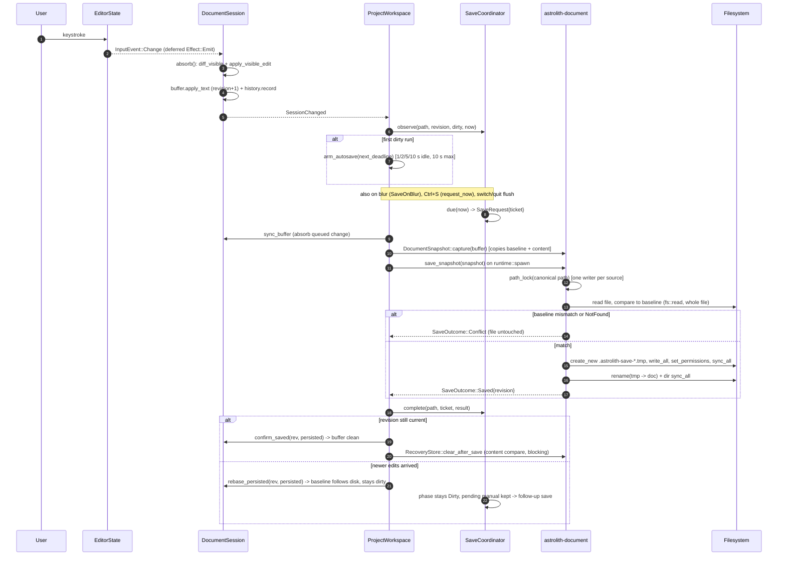

# Document Session, Save, and Large-File State Audit

## Scope inspected

| File | Lines | Read |
| --- | --- | --- |
| `crates/astrolith-gpui/src/editor/session.rs` | 2081 | all prod (1-2048), tests skipped |
| `crates/astrolith-gpui/src/editor/save_coordinator.rs` | 1041 | 1-489 prod, test names only |
| `crates/astrolith-gpui/src/editor/save_failure.rs` | 141 | all |
| `crates/astrolith-gpui/src/file.rs` | 69 | all |
| `crates/astrolith-gpui/src/project_discovery.rs` | 13451 | all session/save/recovery/watcher/load sections + symbol map; tests (7088-13451) sampled only |
| `crates/astrolith-gpui/src/editor/writing_modes.rs` | 12.4K | `refresh_prose`/`refresh_focus`/`centre_cursor` |
| `crates/astrolith-gpui/src/editor/writer_chrome.rs` | 24.7K | `analyze_prose` head |
| `crates/astrolith-gpui/src/editor/writer_surface.rs` | 29.6K | `sync_document`, `Render for WriterSurface` |
| `crates/astrolith-gpui/src/shell.rs` | 7363 | app-quit flush wiring (620-683) |
| `crates/astrolith-document/src/buffer.rs` | 504 | all |
| `crates/astrolith-document/src/projection.rs` | 593 | 1-548 |
| `crates/astrolith-document/src/save.rs` | 576 | 1-303 + test assertions |
| `crates/astrolith-document/src/recovery.rs` | 529 | 1-303 |
| `crates/astrolith-document/src/tokens.rs` | 128 | `token_snapshot` |
| `crates/astrolith-document/src/version.rs` | 35 | all |
| `crates/astrolith-document/src/{parse,serialize,formatting,wysiwyg,copyedit/*}.rs` | 1753/150/957/1209/1398 | entry points and hot spots only |
| `gpui-base-0.8.1/src/input/base/state.rs` | — | `set_value` 1224-1249, `replace` 1305-1320, Change emit 3383/4389/4716 |
| `gpui-pre-0.3.10/src/app/context.rs` | — | `emit` 780-794 (deferred via `Effect::Emit`) |
| `astrolith-workspace/src/watcher.rs` | 700+ | `classify_event` 499-551 |

No build/test/clippy was run (per audit rules); every claim below is source-derived. Levels: **Strong** = direct source evidence, **Confirmed** = measured/counted in this audit, **Hypothesis** = needs a runtime check.

---

## 1. Authoritative state and what a keystroke costs

### 1.1 Five representations of the same text

| # | Representation | Owner | Mutated by |
| --- | --- | --- | --- |
| 1 | `DocumentBuffer.original_text` (complete source baseline) | `session.rs:33` | `confirm_saved`/`rebase_persisted` only (`buffer.rs:243,260`) |
| 2 | `DocumentBuffer.current_text` (**authority**) | `session.rs:33` | `apply_text` (`buffer.rs:225`) |
| 3 | `WriterProjection.visible` + segments | `session.rs:36` | `renew_visible`/re-`project_writer` (`projection.rs:131,264`) |
| 4 | `EditorState.text()` — a `Rope` (`gpui-base/input/base/state.rs:1623`) | pinned editor | every keystroke |
| 5 | `WriterSurface.source` + `WysiwygDocument` | `writer_surface.rs:46,88` | re-parsed in `render` |

`EditorState` is the *only* writable surface; 2 is authoritative. Divergence is legal and latched in two places:

- `refused` (`session.rs:60-62`) — after a rejected visible edit the editor is known-divergent and no absorb may run (`session.rs:1336-1340`).
- `origin` (`session.rs:40`) — **dead**: assigned `false` at `session.rs:210,355,1762,1783` and never `true`. The branch at `session.rs:207-214` is unreachable; the comment there ("this session's own projection rewrite") is wrong because `set_value` sets `emit_events = false` and emits no `Change` at all (`gpui-base/.../state.rs:1235`). `origin` is dead weight (confirmed by exhaustive grep).

`session.dirty` (`session.rs:67`) duplicates `buffer.is_dirty()`. Tab dots read the cache (`project_discovery.rs:1208,1229`), while every save/quit decision reads `buffer.is_dirty()` (`project_discovery.rs:1093-1097`, `1308-1312`, `5097-5101`). The cache can go stale: `wrap_selection_as_link` absorbs at `session.rs:489` and may return `false` at `490-500` without refreshing `dirty` or emitting `SessionChanged`.

### 1.2 Per-keystroke path (Writer mode), with copy count

GPUI defers `cx.emit` (`gpui-pre/src/app/context.rs:780-794` pushes `Effect::Emit`), so the editor's `Change` is delivered after the input handler returns; the session handler then runs the whole block below in one effect drain.

```
EditorState.replace_text_in_range  (input handler)
  -> cx.emit(InputEvent::Change)            [deferred]
  -> DocumentSession::build change closure  (session.rs:197-229)
     1. editor.read(cx).text().to_string()  session.rs:1351   COPY 1  (Rope -> String, N_v)
     2. visible == projection.visible       session.rs:1353   pass    (N_v)
     3. buffer.current_text().to_owned()    session.rs:1357   COPY 2  (N_s)
     4. diff_visible(prev, next)            projection.rs:379 pass x2 (prefix + suffix over N_v)
     5. apply_visible_edit -> String::with_capacity(source.len()+added) projection.rs:363  COPY 3 (N_s)
     6. buffer.apply_text(source)           buffer.rs:225-237  pass (N_s) + replace
     7. buffer.current_text().to_owned()    session.rs:1368   COPY 4  (N_s)
     8. history.record -> source_diff       session.rs:1859/1938  pass x2 (N_s)
     9. projection.renew_visible(visible)   projection.rs:131  moves COPY 1, allocs segments Vec
    10. sync_placeholders / refresh_copyedit (spawns a 150 ms task)   session.rs:1098-1133
    11. refresh_writer                      session.rs:1135-1150
        token_snapshot(visible)             tokens.rs:52       pass + Vec<Range> 16 B/word   ALLOC 5
        fingerprint(visible)                session.rs:2038   pass (full hash)
        presentation.refresh_prose          writing_modes.rs:116 -> analyze_prose (writer_chrome.rs:53) pass + spans ALLOC 6 + collection.set
        presentation.refresh_focus          writing_modes.rs:148 -> cursor_sentence + other_sentences (whole doc)
    12. buffer.is_dirty()                   buffer.rs:215     pass (N_s)
    13. cx.emit(SessionChanged)             session.rs:228   [deferred]
  -> ProjectWorkspace::note_session_change  project_discovery.rs:1294-1318
       revision + is_dirty (pass), coordinator.observe (session.rs:274),
       update_tab_state, surface_session_notice, schedule_recovery (500 ms timer), emit
  -> render: WriterSurface::render          writer_surface.rs:437-449
       projection.visible.clone()                                     COPY 5 (N_v)
       sync_document -> self.source.push_str (COPY 6) + WysiwygDocument::parse (writer_surface.rs:88-94,270)
       focus-mode sentence rescan (writer_surface.rs:456-461)
```

Cost for a document of `N` bytes (N_v visible): **6 full-size allocations** (1,2,3,4,5,6) and **≥10 full-length scans** per keystroke, plus 3 allocations proportional to token/span count, plus 3 task spawns (`copyedit` 150 ms, `recovery` 500 ms, `arm_autosave`). At the 8 MiB document cap that is ~30-50 MiB of allocate/free churn and ~80 MB of byte traffic **per keystroke**, on the UI thread, of which the `WysiwygDocument::parse` and decoration rebuild also happen on the render path. Level: Strong (all sites enumerated); the 8 MiB figure is arithmetic from the caps, not measured.

Build/Source view is strictly worse: `absorb_source` (`session.rs:1380-1413`) calls `project_or_complete` on **every keystroke**, and for MDX that constructs a fresh `tree_sitter::Parser` and parses up to 64 KiB (`projection.rs:500-511`, `PRELUDE_LIMIT` at `projection.rs:28`), then allocates a new visible String (`projection.rs:96-110`). Additionally `sync_lsp_change` clones the complete source per keystroke and sends full text after 150 ms (`session.rs:1652-1665`, `astrolith-lsp/src/client.rs:201`). Level: Strong.

Non-keystroke paths that still copy the whole document: `patch_complete` (`session.rs:1297-1328`, absorb + parse + serialize + re-project per frontmatter form edit), `undo_source`/`redo_source` + `after_history_step` (`session.rs:1192-1256`, absorb + rebuild + re-project), `sync_buffer` at every save/recovery (`session.rs:1258`), `persist_recovery_records` for **all** open sessions (`project_discovery.rs:4102-4122`).

### Findings

**D-01 — Per-keystroke work is O(document) with 6 full copies.** `session.rs:1351,1357,1368`, `projection.rs:363`, `writer_surface.rs:437-449`, `session.rs:1135-1150`. Level: Strong. Impact: typing latency and allocator pressure scale linearly with document size; an 8 MiB document (the accepted cap) is effectively unusable in Writer mode, and the whole document is re-parsed by `WysiwygDocument::parse` on the render path after each keystroke.

**D-02 — Build mode re-parses MDX with a new tree-sitter parser per keystroke.** `session.rs:1380-1411` -> `projection.rs:500-511`. Level: Strong. Impact: per-keystroke parser construction + up to 64 KiB TSX parse; the projection is recomputed even though only the body changed. `renew_visible` (the cheap path) is unavailable in Build because the hidden lead must be re-delimited.

**D-03 — `origin` is dead state and its comment misstates the mechanism.** `session.rs:40,207-214`; `gpui-base/.../state.rs:1236` (`set_value` sets `emit_events=false`). Level: Strong. Impact: maintenance hazard; a future `replace_all`-based rewrite would silently start delivering changes the flag claims to suppress.

**D-04 — `session.dirty` is a hand-maintained copy of `buffer.is_dirty()`.** `session.rs:67`, updated at `446,510,547,1112,1242,1310`; stale after `wrap_selection_as_link` returns early (`session.rs:489-500`). Level: Strong. Impact: tab dirty dot can disagree with the save/quit decision (both save and quit use the buffer, so no data loss; the indicator lies). Level: Low severity.

**D-05 — Token snapshot allocates per word per keystroke.** `tokens.rs:52-68` builds `Vec<Range<usize>>` (16 B/word) on every text change via `refresh_writer` (`session.rs:1136`). Level: Strong. Impact: 800 KB/keystroke for a 50k-word document, discarded immediately (only `words/characters/lines` are read by `line_count`/chrome).

---

## 2. Undo/redo

- Single owner: `SourceHistory` (`session.rs:1848-1936`), a positional `Vec<SourceTransaction>` with a cursor and a 500-entry cap (`session.rs:1878-1881`). Both views and the frontmatter form write to it.
- Editor history is suppressed: `Ctrl/Cmd+Z|Shift+Z|Y` are intercepted before key bindings and `cx.stop_propagation()` (`session.rs:296-320`); the pinned editor's own stack is additionally wiped by `set_value` -> `undo_manager.clear()` (`gpui-base/.../state.rs:1245`) on every rebuild/mode switch, so a missed interception cannot double-undo.
- Typing coalescing: `try_merge` (`session.rs:1894-1920`) merges only pure insertions at a contiguous offset within 900 ms. Deletions, replacements and programmatic edits are one entry each (`HistoryIntent::Atomic`, `session.rs:1798-1803`).
- Frontmatter participates: `apply_frontmatter_edit` -> `patch_complete` records an `Atomic` transaction on the complete source (`project_discovery.rs:2415-2470`, `session.rs:1310-1316`). Undo from Writer mode therefore rewrites **hidden** bytes: the visible text and caret do not move, only the tab's dirty state and the frontmatter form change. There is no separate frontmatter stack (deliberate, documented at `session.rs:44-45`), but the effect is an "invisible undo" — the user pressing Ctrl+Z after a form edit sees nothing happen to the prose.
- Mode switch: `set_source_view` absorbs first (`session.rs:1414-1420`), keeps `SourceHistory`, wipes the editor's stack, maps the caret through the projection, and starts/stops the LSP (`session.rs:1464-1474`). Full-fidelity: no history is lost across Writer<->Build.
- Positional validity: `undo`/`redo` splice at the recorded offset and validate only the bytes they inserted (`session.rs:1817-1839`). Safety rests entirely on strict LIFO order and on clearing the stack when a rewrite happens outside it (`session.rs:1201-1206`). Any drift (e.g. an undo whose recorded `inserted` text happens to reappear at the same offset after an unrelated change) is not detected. Level: Strong; residual risk is Hypothesis (no repro attempted).
- Not covered by history: save/recovery/rename. A successful save does not clear history, so undo after a save makes the buffer dirty again (correct), and `refresh_from_load` — the only "reload from disk" transition — is never called by the app (see §6), so there is no history-vs-load boundary to get wrong.

### Findings

**U-01 — Undo silently rewrites hidden frontmatter from Writer mode.** `session.rs:1192-1211` + `1726-1795`. Level: Strong. Impact: the visible document is unchanged while hidden bytes change; the form panel updates only if its key changed (`FrontmatterKey`, `project_discovery.rs:862-868`). UX/consistency risk, not corruption.

**U-02 — 500-entry history holds document-sized strings for bulk operations.** `session.rs:1878-1881`, `1806-1815` (`removed`+`inserted`). Level: Strong. Impact: worst case (repeated frontmatter serialize / large paste) is 500 × 2 × N; a bounded-but-large hidden allocation per open document.

---

## 3. Save path

### 3.1 Sequence (edit -> disk)



### 3.2 Atomicity and conflict detection

`save_blocking` (`save.rs:137-180`): read whole file -> `baseline.matches` -> `write_atomic`. `write_atomic` (`save.rs:186-235`): `create_new` temp in the target directory, `write_all`, copy permissions from the existing file, `file.sync_all()`, `fs::rename`, best-effort directory `sync_all`. Temp files are unique per process+counter. Serialization is a process-wide async mutex keyed on the **canonicalized** path with a parent-canonicalization fallback (`save.rs:238-266`), so relative/absolute/symlink spellings share one writer.

Windows: an unlinked file or a permission-restricted read is an `Io` error, not a conflict (test `read_error_other_than_missing_is_an_io_error` at `save.rs:343-357`). A deleted file is a conflict and is not recreated (`save.rs:145-152`, test `save.rs:329-341`). Documented residual window: a third-party writer between the read and the rename is not detected (`save.rs:12-18`). Level: Strong.

Permission preservation means a `0444` file is still overwritten (fd opened before `set_permissions`), so a read-only marker does not protect a document. Level: Strong, low impact.

### 3.3 Scheduling, checkpoints, blur, quit

- Delays: `AutosaveDelay` 1/2/5/10 s (`save_coordinator.rs:200-202`), `MAX_CHECKPOINT = 10 s` (`save_coordinator.rs:35`), max window preserved across a run (`start_run`, `153-171`).
- `observe` bumps `last_edit` on every revision change and returns `true`, so `arm_autosave` re-spawns a timer **per keystroke** (`project_discovery.rs:1294-1318`, `1351-1379`).
- Blur: `on_blur` -> `SaveOnBlur` only when dirty (`session.rs:250-260`) -> `save_on_blur` skips while a modal is open and uses `request_now(Automatic)` (`project_discovery.rs:1319-1349`). Because the handler is on the editor's focus handle, moving focus to the frontmatter form or a panel is also a blur -> an autosave on focus changes (intent recorded as "ledger row 44").
- Switch/quit: `start` -> `flush_dirty_buffers` -> `advance_switch` (`project_discovery.rs:2916-2994`); `save_and_quit` -> `flush_dirty_buffers` -> `advance_quit` (`3898-3936`). Both cancel on `Conflict` or `Failed` with a status string. Window close: `guard_window_close` checks `has_dirty` only (`3859-3862`), not `save_coordinator.has_pending()`; a save in flight always implies a dirty buffer, so the dialog still appears.
- App quit: `flush_recovery_on_quit` writes every dirty buffer to the recovery store through `runtime::flush_on_quit` before shutdown (`project_discovery.rs:4135-4160`, `shell.rs:648-665`).
- One writer per document: `SaveCoordinator` keeps one `in_flight: Option<SaveTicket>`; a request during a save becomes `pending` (`save_coordinator.rs:380-421`), and stale tickets are dropped by `complete` (`422-436`). A queued **manual** request is satisfied by a current completion, or left pending when newer edits arrived (`save_coordinator.rs:437-459`), so no Ctrl+S is silently lost.

### 3.4 Error propagation

`SaveResult::Failed` -> `SaveStatus::Failed(msg)` (`save_coordinator.rs:255-270`) and a status line; the first failure of an episode also writes one redacted JSON artifact (`project_discovery.rs:1583-1605`, `save_failure.rs:71-83`) — content-free except the project-relative path, but written with plain `fs::write`+`rename` (no fsync), unlike snapshot saves.

### Findings

**S-01 — A conflict is terminal for that document; there is no resolution path.** `SaveCompletion::Conflict` sets `Phase::Conflict` (`save_coordinator.rs:462-468`), which blocks automatic saves; a manual retry reuses the unchanged `original_text` baseline, so it conflicts again forever (`project_discovery.rs:3953-3985`, `save.rs:163`). The only exit is close+reopen (`project_discovery.rs:3743-3747` text says so), and `remove_session` **deletes the recovery record** for the closed document (`3842-3850`). A user who hits a conflict and follows the UI instruction loses the in-memory edits unless they copy them out. Level: Strong. Impact: high (data-loss-shaped UX), mitigated only by the explicit Discard confirmation in `close_path` (`3760-3781`).

**S-02 — A single global slot drops queued lifecycle actions.** `pending_after_save: Option<PendingAfterSave>` (`project_discovery.rs:777`) is overwritten without checking at `5553`, `5693`, `5823`. If document A is awaiting a save for a Trash and the user requests a Duplicate of B, A's continuation is silently discarded when A's completion arrives (`settle_pending_after_save` path mismatch, `1606-1628`). Level: Strong. Impact: silent no-op for an explicit user action.

**S-03 — Three extra full-document copies per save.** `DocumentSnapshot::capture` copies baseline+content (`save.rs:76-86`), `begin_save` clones `snapshot.content()` into `persisted` for the completion path (`project_discovery.rs:1404-1410`), `save_snapshot` then clones both again before `spawn_blocking` (`save.rs:105-110`). Level: Strong. Impact: memory spike ~4x document per in-flight save; acceptable at 8 MiB but avoidable.

**S-04 — A stale completion returns before re-arming timers or advancing switch/quit.** `project_discovery.rs:1455-1460`. A retarget or a discarded session can leave `pending_quit`/`pending_switch` waiting with no deadline armed. Level: Hypothesis (requires a retarget racing an in-flight save).

**S-05 — `retarget` untracks a document whose save is in flight and leaves the task keyed on the old path.** `save_coordinator.rs:224-232` (entry dropped when `in_flight.is_some()`), `retarget_session` then re-registers via `watch_session` -> `observe` (`project_discovery.rs:5652-5656`, `1294-1296`). The old task still writes the old path; because `write_atomic` renames onto the *old* name, a still-existing old path (copy-then-delete rename, or a failed move) could be written by a second writer with a different lock key. Level: Hypothesis. Impact: low likelihood, potential stray file.

**S-06 — Autosave timers are re-armed per keystroke.** `arm_autosave` sets `autosave_task = None` (cancels) and spawns (`project_discovery.rs:1351-1379`). Level: Strong. Impact: one task allocation/cancel per keystroke; correctness is fine because `last_edit`/`max` are preserved.

---

## 4. `project_discovery.rs` inventory (13,451 lines)

Production: 1-7087 (187 items), tests: 7088-13451 (**6,364 lines**). `ProjectWorkspace` has **78 fields** (`696-830`) — 8 of them `Task` handles and 4 subscription maps.

| Responsibility | Lines | Representative items |
| --- | --- | --- |
| Entry list UI (`ListDelegate`, rows, menus) | 105-630 | `EntryList`, `EntryRow`, `render_item`, `render_section_header` |
| Workspace state aggregate + events | 688-960 | `ProjectWorkspace` (78 fields), `OpenTab`, `SaveAttempt`, `WatcherScan` |
| Tab/file-browser/session wiring | 1116-1240 | `sync_file_browser_root`, `sync_tabs`, `update_tab_state`, `watch_session` |
| Save lifecycle | 1294-1660, 3898-4046 | `note_session_change`, `save_on_blur`, `arm_autosave`, `begin_save`, `finish_save`, `apply_save_completion`, `save_path`, `record_save_failure`, `settle_pending_after_save` |
| Schema / references / components | 1691-2368 | `apply_generated_schemas`, `rebuild_references`, `load_data_references`, `load_collection_schemas`, `load_components`, `corroborated_imports` |
| Asset drop + frontmatter apply | 2369-2470 | `finish_drop`, `apply_frontmatter_edit` |
| Navigation / definition targets | 2665-2915 | `open_definition_target`, `reveal_pending`, `open_project_source` |
| Project open / switch / quit | 2916-3070, 3898-3936 | `start`, `flush_dirty_buffers`, `advance_switch`, `open_project`, `save_and_quit`, `advance_quit` |
| Watcher loop + index publication | 3150-3470 | `start_watcher`, `apply_watcher_scan`, `publish_entries` |
| Load admission + session install | 2779-2853, 3470-3690 | `open_project_source`, `open_entry_inner`, `finish_load`, `activate_session`, `install` |
| Recovery | 4047-4315 | `schedule_recovery`, `persist_recovery_records`, `load_pending_recovery`, `recover_pending`, `flush_recovery_on_quit` |
| Index request tokens + discovery | 4433-4625 | `begin_index_request`, `accepts_index_result`, `start_index_request`, `apply_discovered_index` |
| Sorting / writing modes / copyedit | 4639-5072 | `rebuild_sort_options`, `set_writing_modes`, `apply_copyedit_config` |
| Document operations (CRUD) | 5072-6140 | `submit_create`, `perform_rename`, `retarget_session`, `perform_duplicate`, `perform_trash`, `reveal_entry`, `rescan`, `reconcile_sessions` |
| `Render` | 6225-6868 | 644 lines building the whole three-panel shell |
| Free helpers | 6869-7087 | `supports_frontmatter`, `relative_source`, `project_empty_state`, … |

Seams that should be separate modules (extraction, **no rewrite**):

- **S-A save/lifecycle owner** — `1294-1660` + `3898-4046`; the largest coherent cluster and where 4 of the 6 highest-severity defects live. Inputs: `Entity<DocumentSession>`, coordinator; output: status + completions.
- **S-B watcher + index generations** — `3150-3470` + `4433-4625`. Already has clean token invariants (`index_request`/`published_index_request`) and touches no document content except `externally_changed`.
- **S-C recovery** — `4047-4315`; depends only on sessions and `RecoveryStore`.
- **S-D document load admission** — `2779-2853` + `3479-3690`; today it exists **twice** with divergent policies (see L-02).
- **S-E entry operations** — `5072-6140`; pure `astrolith_workspace::operations` orchestration plus retarget.
- **S-F schema/reference/component loading** — `1691-2368`.
- **S-G list/render** — `105-630` + `6225-6868`; the only part that needs `Render`.

The cheapest first cut is S-C and S-D (no new types needed, both already parameterized by a store/root), then S-A once the `pending_after_save` slot becomes a per-path map (S-02).

---

## 5. Limits, boundaries, and memory per session

| Limit | Value | Site |
| --- | --- | --- |
| Document size (open) | 8 MiB (`read_bounded(limit+1)`) | `project_discovery.rs:3560`, `2831`, `file.rs:20-24` |
| Document lines | 50,000 | `project_discovery.rs:3562`, `2833`, `file.rs:26` |
| Open documents | 32 | `project_discovery.rs:3523` |
| Concurrent loads | 2 | `project_discovery.rs:3517` |
| Loaded-source budget | 32 MiB of **summed `original_text().len()`** | `project_discovery.rs:3528-3536` |
| Image preview | 20 MiB | `editor/image_preview.rs:21` |
| Project watch paths / depth / entries | 100k / 64 / 100k | `astrolith-workspace/src/watcher.rs:25-29` |

Boundary behavior: exactly 8 MiB loads; 8 MiB+1 fails with "File exceeds supported size" (`astrolith-astro/src/discovery.rs:215-222`); the `file.rs` read-only path re-words the same limit ("Readonly files are limited to 8 MiB."). `read_bounded` counts bytes only — a document with 60k short lines passes the byte cap and fails the line cap after being read fully. Line counting (`source.lines().count()`) is an extra full pass at load.

Memory per open session (all entries are Strong, derived from the fields):

| Component | Size | Site |
| --- | --- | --- |
| `buffer.original_text` | N | `buffer.rs:166-175` |
| `buffer.current_text` | N | same |
| `projection.visible` | ~N | `session.rs:36`, `projection.rs:96` |
| `EditorState` Rope | ~N + rope overhead | `gpui-base/.../state.rs:1623` |
| `WriterSurface.source` | N | `writer_surface.rs:88-94` |
| `WysiwygDocument` (blocks + rendered text) | ~N + per-block | `wysiwyg.rs:253-360` |
| `counts.tokens` | 16 B per word | `tokens.rs:52` |
| prose/focus/copyedit decoration ranges | O(words/sentences) | `writing_modes.rs:116-185`, `copyedit/mod.rs` |
| history | ≤500 × (removed+inserted) | `session.rs:1848-1881` |

So a session holds ~5-6 × N plus O(words); the 32 MiB budget sees only 1 × N.

### Findings

**L-01 — The loaded-source budget under-counts real memory by ~5x.** `project_discovery.rs:3528-3536` sums `original_text().len()` only. Four 8 MiB documents (the cap admits 4) report 32 MiB and occupy roughly 150-250 MiB. Level: Confirmed (arithmetic over 5-6 copies) / Hypothesis for the exact RSS. Impact: the guard that is supposed to protect memory does not.

**L-02 — Two load-admission implementations with different policies.** `open_entry_inner` enforces the 32 MiB budget (`3528-3536`); `open_project_source` (definition targets, file dialog) does **not** (`2786-2795`, only 32 sessions + 2 loads). Level: Strong. Impact: the memory guard can be bypassed by opening definitions or files.

**L-03 — Saves are not size-checked, so the app can persist a document it can never reopen.** `write_atomic` (`save.rs:186-235`) has no limit; open (`3560`) and the watcher fingerprint (`3248-3256`) do. A 7.9 MiB document edited past 8 MiB saves fine, then `read_bounded` fails on reopen and returns `None` for the fingerprint, which is read as "changed on disk" forever (`3322-3327`). Level: Strong. Impact: medium; recovery is the only reload path, and recovery content is not re-parsed through the same limits (it is read from the record).

**L-04 — Watcher re-reads and re-hashes every open document on every batch.** `3248-3256` (`read_bounded` + `fingerprint` inside `runtime::blocking`). Level: Strong. Impact: with 4 × 8 MiB docs, every filesystem event burst costs 32 MiB of reads and hashing, and the app itself generates such a burst on every save (see E-01).

---

## 6. External modification, recovery, revision consistency

### 6.1 Sequence (edit -> external change)

```mermaid
sequenceDiagram
  autonumber
  participant FS as Filesystem
  participant NA as notify / CollectionWatcher
  participant WP as start_watcher loop
  participant W as ProjectWorkspace
  participant S as DocumentSession

  Note over S: disk_fingerprint set once at session build = fingerprint(loaded source)
  FS-->>NA: create/modify/rename event (incl. our own save's rename)
  NA->>NA: classify_event: ignore dot-names, .git, node_modules; keep md/mdx/ts/json etc.
  NA->>WP: drain() after 100 ms quiet (WATCH_MERGE_WINDOW)
  WP->>WP: begin_index_request() claims a token
  WP->>FS: blocking: read_bounded(8 MiB) + hash each open session and load
  WP->>W: apply_watcher_scan(token, {index, fingerprints})
  alt token is stale
    W->>W: drop scan (finish_index_request)
  else token current
    W->>S: externally_changed = (disk hash != session.disk_fingerprint)
    W->>W: publish_entries(): index_revision += 1, loads.clear() (cancels in-flight loads)
    W->>W: reconcile_sessions(): close clean sessions missing from the index
    W->>S: tab marker + install() status "Document changed on disk ..."
  end
  Note over S: acknowledgment only on a confirmed save (apply_save_completion sets externally_changed = false)
  Note over S: no reload path exists; the buffer keeps showing the old text
```

### 6.2 Findings

**E-01 — `disk_fingerprint` is never updated, so every saved document is reported as externally changed.** Declared at `session.rs:68`, initialized at `session.rs:171` from the *loaded* source, moved into the struct at `session.rs:367`, read at `project_discovery.rs:3326` — and written nowhere else (exhaustive grep over `crates/` and `apps/`: these four occurrences only). After a save the file holds `current_text`, whose hash differs from the baseline hash, so the next watcher batch sets `externally_changed = true`. The save itself triggers that batch: `write_atomic` renames the temp file onto `doc.md` (`save.rs:228`), `ModifyKind::Name` with the destination path is classified as a relevant change (`astrolith-workspace/src/watcher.rs:506-517`, `524-529`, `545-551`; only dot-prefixed temp names are ignored, `540-543`), and the only reset is the confirmed-save handler (`project_discovery.rs:1518`), which runs *before* the watcher fires. Level: Strong (deterministic from source; a one-save-plus-one-watcher-tick runtime check would make it Confirmed). Impact: high — false conflict banners, a "changed on disk" status on tab activation (`3743-3747`), and a misleading instruction to close/reopen.

**E-02 — External changes to a clean buffer are never loaded.** `DocumentBuffer::refresh_from_load` + `DocumentLoadTicket::accepts` exist (`buffer.rs:290-317`, `265-286`) but are called only from unit tests (grep: `buffer.rs:413,432,494`). No reload command exists (`commands.rs` has only `ReloadCollections`). The UI keeps showing stale text indefinitely; a save then conflicts, entering S-01. Level: Strong. Impact: high; the stale-result machinery is dead code in production.

**E-03 — Recovery restore ignores the record's revision and time and adopts the current disk as baseline.** `RecoveryRecord::capture` stores revision + `modified_unix_secs` (`recovery.rs:51-77`, serialized `268-285`), but `recover_pending` builds the session with `DocumentSession::from_recovered(identity, disk, content, ...)` (`project_discovery.rs:4284`) where `disk` is the *current* file content read at restore time (`4257`) and `content` is the record. `DocumentBuffer::from_unsaved` sets `original_text = disk` and `revision = INITIAL` (`buffer.rs:177-190`). Consequences: (a) the restored buffer loads dirty with a baseline that matches disk, so the next autosave **overwrites** any disk change made after the crashed session without a conflict; (b) the record's revision is discarded, so cross-restart revision ordering is meaningless; (c) the record's mtime is never compared to the file's. Level: Strong. Impact: medium-high lost-update window on crash recovery.

**E-04 — `clear_after_save` is content-based, which is correct.** `recovery.rs:236-266` compares durable content, so a record holding newer unsaved content survives a save of an older revision. Level: Strong (positive finding).

**E-05 — Watcher index publication cancels in-flight loads and can leave a stale status.** `publish_entries` clears `loads` (`project_discovery.rs:3358`), which drops the `Task` handles (GPUI cancels on drop), so a load racing any refresh (including one caused by the user's own save, E-01) never reaches `finish_load`; `self.active` stays on the cancelled path, the document panel is empty and `status` remains "Loading document…" (`3577`). Level: Strong (mechanism) / Hypothesis (user-visible frequency).

**E-06 — External-change detection is content-exact but not convergent.** Because it compares hashes of full content, a file touched without content change is not flagged (good), but a file restored to the loaded content is un-flagged while the session may still hold edits. Level: Strong, informational.

---

## Ranked correctness risks

| # | Risk | Evidence | Level | Severity |
| --- | --- | --- | --- | --- |
| R1 | Every save raises a false "changed on disk" flag on the saving document | `session.rs:171`, `project_discovery.rs:3322-3327`, `save.rs:228`, `watcher.rs:506-517` | Strong | High (trust; leads users into R2) |
| R2 | Conflict/external change has no resolution path; the documented remedy (close+reopen) deletes the recovery record and loses in-memory edits | `save_coordinator.rs:471-476`, `project_discovery.rs:3743-3747`, `3842-3850` | Strong | High (data loss, user-consented but misleading) |
| R3 | Per-keystroke cost is 6 full-document copies + ≥10 passes + WYSIWYG reparse | `session.rs:1351-1370`, `projection.rs:363`, `writer_surface.rs:437-449` | Strong | High (unusable at the 8 MiB cap) |
| R4 | Build-mode keystroke constructs a tree-sitter parser and reparses 64 KiB (MDX) | `session.rs:1380-1411`, `projection.rs:500-511` | Strong | High |
| R5 | Recovery restore rebases onto current disk and ignores the record revision → silent overwrite of post-crash disk edits | `project_discovery.rs:4262-4276`, `buffer.rs:177-190` | Strong | Medium-High |
| R6 | Saves are unsized → can persist a document that can no longer be opened or fingerprinted | `save.rs:186-235` vs `project_discovery.rs:3560,3248-3256` | Strong | Medium |
| R7 | `pending_after_save` single slot silently discards a queued rename/duplicate/trash/close | `project_discovery.rs:783,5553,5693,5823,1606-1628` | Strong | Medium |
| R8 | Two divergent load-admission policies bypass the 32 MiB budget | `project_discovery.rs:3523-3536` vs `2786-2795` | Strong | Medium |
| R9 | 32 MiB budget counts 1 of ~5 copies of each document | `project_discovery.rs:3528-3536` | Strong (arithmetic) | Medium |
| R10 | Recovery rewrites **every** dirty document (full JSON + 2 fsyncs) 500 ms after any change | `project_discovery.rs:4047-4100`, `recovery.rs:151-161`, `save.rs:186-235` | Strong | Medium (I/O + SSD wear; N docs per pause) |
| R11 | Undo of a frontmatter edit is invisible in Writer mode | `session.rs:1192-1211,1726-1795` | Strong | Medium (UX/consistency) |
| R12 | Retarget during an in-flight save untracks the doc and leaves a second writer keyed on the old path | `save_coordinator.rs:224-232`, `project_discovery.rs:5652-5656` | Hypothesis | Low-Medium |
| R13 | Stale completion returns before re-arming timers / advancing switch+quit | `project_discovery.rs:1455-1460` | Hypothesis | Low |
| R14 | `origin` flag is dead; `session.dirty` cache can go stale; first keystroke after a latched refusal + mode switch is dropped | `session.rs:40,207-214,489-500,1336-1340` | Strong | Low |

**Single most important risk:** R1 — the session's `disk_fingerprint` is a load-time constant (`session.rs:171`) compared against live file content on every watcher batch (`project_discovery.rs:3326`), and the app's own save wakes that watcher via `rename`. Every successful save therefore marks its own document as externally modified, which is both a trust-destroying false alarm and the trigger that pushes users into the R2 conflict path where the only offered remedy destroys their unsaved edits.

---

## Open questions / not inspected

- No runtime measurement: keystroke latency, RSS per document, and the E-01 false flag were derived from source, not profiled. A one-save/one-watcher-tick integration test would make E-01 Confirmed.
- `wysiwyg.rs` block parser internals (line-level cost of `WysiwygDocument::parse`) were not profiled; the copy count is from struct fields only.
- `sentences.rs` (`cursor_sentence`/`other_sentences`) complexity is assumed linear; not read beyond signatures.
- `copyedit/classify.rs` and `tokenize.rs` were read only at their entry points; their per-word cost is bounded but not measured.
- The LSP path was inspected only for full-text sync (`session.rs:1652-1665`); `attach_lsp`/diagnostics application (`1527-1606`) were not reviewed.
- `writing_modes.rs` decoration `collection.set` cost inside gpui-base was not inspected.
- Save-failure artifact directory policy (`settings.rs`) and the shell's quit ordering across multiple windows were not traced.
- `apps/desktop` was not inspected; whether it adds another save/quit path is unverified.
