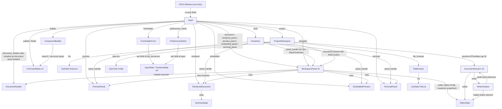

# GPUI shell, render cost and entity ownership

Read-only audit of the `astrolith-gpui` UI layer: who owns which entity, what a
notification actually costs in this GPUI fork, and which render closures do work
proportional to document or project size instead of the visible region.

## Scope inspected

| File | Lines | What was read |
|---|---:|---|
| `crates/astrolith-gpui/src/shell.rs` | 7363 | `open`, `Shell` fields, `new` (entity graph + all subscriptions), `begin`, layout/mode/preview functions (1373-2115), `note_typing`, `build_tab_strip`, `mode_switch`, `set_mode`, `sync_preview`, `sync_center`, `sync_embedded`, `palette_groups`, `refresh_component_builder`, open/save paths, `Render`, `center_layout_for`, `attach_preview_dock`, `debounced_save` |
| `crates/astrolith-gpui/src/layout/panels.rs` | 583 | whole file except tests |
| `crates/astrolith-gpui/src/layout/state.rs`, `layout/mod.rs` | 49 + 2 | whole |
| `crates/astrolith-gpui/src/ui.rs` | 113 | whole |
| `crates/astrolith-gpui/src/theme/{mod,tokens,palettes,metrics,typography}.rs` | 243/66/169/189/163 | `apply`, `palette`, `oklch`, all of `typography`, metric scales |
| `crates/astrolith-gpui/src/preferences/mod.rs` | 1970 | `Render` (1429-1560), field-entity construction (270-340) |
| `crates/astrolith-gpui/src/editor/writer_chrome.rs` | 703 | analysis + `TypedCharacters` + `ChromeVisibility` |
| `crates/astrolith-gpui/src/editor/writer_surface.rs` | 863 | whole file |
| `crates/astrolith-gpui/src/editor/writing_modes.rs` | 343 | `SessionPresentation` (whole) |
| `crates/astrolith-gpui/src/editor/session.rs` | 2081 | struct, `build` subscriptions, change/absorb path, `refresh_*`, `SourceHistory` |
| `crates/astrolith-gpui/src/file_browser.rs` | 517 | whole |
| `crates/astrolith-gpui/src/drag_drop.rs` | 86 | whole |
| `crates/astrolith-gpui/src/project_discovery.rs` | 13451 | `ProjectWorkspace` fields, `new`, `watch_session`/`note_session_change`, `EntryList` delegate, `Render`, recovery, `set_preferences`, `command_availability` |
| `crates/astrolith-gpui/src/editor/{header,rendered}.rs` | 330/226 | `Render` paths, tab model, `set_document` |
| `crates/astrolith-gpui/src/{terminal,preview,frontmatter}` | 754/1007/1540 | `Render` + polling loops + field entity creation |
| pinned: `gpui-pre-0.3.10/src/{view.rs,window.rs}`, `gpui-component-0.8.1/src/{list/list.rs,dock/tab_panel.rs}`, `gpui-base-0.8.1/src/text/{editor_host.rs,document.rs}`, `gpui-base-0.8.1/src/input/base/element.rs` | — | render-caching and virtualization semantics quoted below |

Counts measured with `grep -c`: Shell 33 `cx.notify()` / 2 `cx.emit` / 5
observe+subscribe; `ProjectWorkspace` 111 / 9 / 9; `DocumentSession` 21 / 14 / 0;
`PreviewPanel` 27 / 11 / 0; `WorkspacePanel` 12 / 3 / 0; `TerminalPanel` 7 / 0 / 0;
`FileBrowser` 5 / 1 / 1; `FrontmatterForm` 13 / 5 / 5; `DocumentHeader` 3 / 0 / 1;
`RenderedDocument` 2 / 0 / 0; `PreferencesSheet` 8 / 4 / 3.

## Framework semantics this audit depends on (from the pinned sources)

These four facts decide what "a leaf notify" costs. They are read from source,
not measured:

1. `ViewElement::request_layout` calls `render` unconditionally unless the view
   was mounted with `.cached(style)` (`gpui-pre/src/view.rs:385-424`,
   `request_layout_view` at 468-494). There is no dirty gate on render.
2. The window root is turned back into an element and laid out on **every**
   frame (`gpui-pre/src/window.rs:3720-3721`). `Shell` is the window root
   (`shell.rs:164`), so `Shell::render` runs on every frame — including frames
   caused by a terminal or preview notify.
3. `Context::notify` marks the entity **and every ancestor view** dirty
   (`window.rs:2264-2277` `mark_view_dirty` + `key_dispatch.rs:588-596`
   `view_path_reversed`). Siblings are not marked.
4. The dock mounts only the active panel of each tab group and wraps it in
   `.cached(...)` (`gpui-component-0.8.1/src/dock/tab_panel.rs:797-807`). The
   cached path re-renders only when `dirty_views` contains that entity
   (`view.rs:520-570`).

Net effect: **granularity is per cached panel, not per notify site.** Any
notify anywhere produces a frame in which `Shell::render` + `DockArea::render`
run; only panels that were not marked dirty skip their own render. Therefore
everything `Shell::render` does is "per frame of anything", and everything in
`WorkspacePanel`/`WriterSurface` render is "per keystroke, per panel notify".
`gpui-component`'s list is genuinely virtualized
(`v_virtual_list` at `list/list.rs:564-600`).

---

## Findings

### A. Entity ownership and lifetime (Q1)

**F-1 · Entity graph: 18 entities owned directly by `Shell`, all retained for
the window's lifetime.** `shell.rs:219-308` (fields), `shell.rs:310-455`
(construction). Only the dock holds `Arc<dyn BasePanelView>` handles
(`panel_handle(...)`, `shell.rs:410-441`) so navigator/document/preview/embedded/
rendered/terminal panels are each referenced two or three times (Shell field +
dock panel handle + `set_view`/`set_header` `AnyView`). Nothing is ever dropped
before the window: `Shell` keeps strong `Entity` handles for every one.
**Level: Confirmed (direct source).** Impact: no re-creation cost on mode
switches (good), but every retained entity's state stays alive for the session,
including hidden panels and their subscriptions.

**F-2 · `document` panel has two owners that both write it.** `Shell.document`
(`shell.rs:221`) is passed to `ProjectWorkspace::new(document.clone(), ...)`
(`shell.rs:343`), installed as the centre panel (`center_layout_for`,
`shell.rs:3444-3453`), given a header (`shell.rs:357-360`) and also written by
the workspace (`project_discovery.rs:2799, 2820, 3542, 3737`) and by the shell
(`shell.rs:2965-2985` `show_document`). Same view, two writers plus a
`clear_editor`/`show_editor`/`show_source` trio of mutually exclusive states.
**Level: Strong.** Impact: the panel's state machine is spread over two crates'
worth of code and cannot be reasoned about from one module; a stray write
(e.g. `clear_editor` on a load in flight) wipes the other owner's content.

**F-3 · Document sessions are the only per-document entities, retained in a map
with a hard cap.** `ProjectWorkspace.sessions: BTreeMap<PathBuf,
Entity<DocumentSession>>` (`project_discovery.rs:726`), each session owning
`editor: Entity<EditorState>` and `writer: Entity<WriterSurface>`
(`editor/session.rs:31-33`), the writer holding a *weak* handle back
(`writer_surface.rs:46`). Open is refused past 32 sessions or 32 MiB of retained
source (`project_discovery.rs:3527-3541`). Lifetime ends at `remove_session`
(`project_discovery.rs:3800`) / `close_path` (`:3760`).
**Level: Confirmed.** Impact: memory is bounded but 32 full document models
(`WysiwygDocument`, history, decorations) can be retained at once.

**F-4 · Frontmatter and preferences sheets create a child entity per field.**
`frontmatter/mod.rs:726,739,754,774,793` create `InputState`/`TextareaState`
entities at `set_document` time; `preferences/mod.rs:288-330` does the same when
the sheet is built. `Shell::render` re-runs `set_document` whenever
`active_frontmatter_key()` changes (`shell.rs:3124-3152`), and that key includes
`mappings` and `references_revision` (`project_discovery.rs:1958-1971`), so any
schema/reference refresh destroys and rebuilds every field entity and its input
state.
**Level: Strong.** Impact: per-field entity churn + lost in-progress input on
any reference/schema republication; not a per-frame cost.

### B. Notification topology (Q2)

Hot chain, per keystroke (all confirmed by reading the subscriptions):

1. `EditorState` emits `InputEvent::Change` → session handler
   (`editor/session.rs:200-244`).
2. Handler calls `absorb_with_intent` (O(n) copies, see F-8),
   `sync_placeholders`, `refresh_copyedit`, `refresh_writer`, then
   `cx.emit(SessionChanged)` + `cx.notify()` (`session.rs:238-240`).
3. `ProjectWorkspace` subscribes to `SessionChanged` (`watch_session`,
   `project_discovery.rs:1241-1260`) → `note_session_change` →
   `save_coordinator.observe`, `update_tab_state`, `schedule_recovery`,
   `cx.emit(SessionChanged)`, `cx.notify()` (`:1294-1319`).
4. `Shell` subscribes to the project's `SessionChanged` (`shell.rs:487-494`) →
   `sync_preview` (early-out on unchanged key, `:1969-1989`) + `note_typing`
   (`:1339-1358`, which counts `visible.chars()` — an O(n) UTF-8 walk per
   keystroke).
5. `Shell` also *observes* the whole project (`shell.rs:523-528`): every project
   notify re-runs `sync_preview` + `track_active_entry` +
   `refresh_component_builder`; `DocumentHeader` observes the project too and
   notifies itself (`editor/header.rs:43`).
6. `cx.observe_in(&editor, ...)` (`session.rs:245-249`) fires on *every* editor
   notify, i.e. also on caret moves and caret blinks, re-running
   `refresh_cursor` → `refresh_prose` (keyed, early-out), `refresh_focus`
   (recomputes sentence ranges when focus mode is on — O(n) per arrow key),
   `centre_cursor`, then `writer.notify()` (`session.rs:1152-1174`).
7. Writer notify marks the document panel dirty → `WorkspacePanel::render`
   (cached, so it re-renders) → `WriterSurface::render` (F-6).

**F-5 · `Shell::render` does per-frame work unrelated to what changed.**
`shell.rs:3116-3193`: mirrors `inspector_open` from the header, calls
`refresh_menus` (which allocates `collection_items()` and reads editor focus
every frame, `:937-957` + `project_discovery.rs:2578`), reads
`active_frontmatter_key()` (which calls `resolve()`, cloning preference strings,
`project_discovery.rs:4609-4622`), builds a new `ProseStyle` (font family scan,
F-15) and pushes it into two panels, and only then emits elements.
**Level: Strong.** Impact: every frame of anything (terminal output, preview,
palette keystrokes, a splitter drag) pays 1 `Vec<CollectionItem>`, 1
`ResolvedPreferences`, 1-2 `SharedString`/`String` allocations and two
`Entity::update` round-trips (`document`, `rendered`; a third for the
frontmatter form when its key changed), even when nothing about the document
changed.

**F-6 · Preview mode clones the whole visible document on every Shell frame.**
`shell.rs:3173-3190`:
```rust
let body = self.project.read(cx).active_session(cx).map(|session| {
    let session = session.read(cx);
    (session.kind(), session.projection.visible.clone())   // shell.rs:3181
});
self.rendered.update(cx, |rendered, cx| rendered.set_document(..., cx));
```
`set_document` then compares the new text with the held copy
(`editor/rendered.rs:82-90`) and returns early — but the clone already happened.
**Level: Confirmed (source), cost unmeasured.** Impact: a 1 MiB document makes
every unrelated frame (terminal at up to 60 Hz, palette, preview status line)
copy 1 MiB and compare 1 MiB. This is the clearest cross-panel coupling defect
in the shell.

**F-7 · Notify storms that are *not* per frame but per event.** `ProjectWorkspace`
has 111 `cx.notify()` sites; the index/recovery/save machinery calls them from
timers and task completions (`project_discovery.rs:1362, 1855, 1910, 4053`).
Each one is a Shell render (F-5) plus, when `Preview` mode is active, F-6.
**Level: Strong.** Impact: cost scales with notification frequency × document
size, not with what the user is looking at.

### C. Render work proportional to document/project size (Q2, Q3, Q6)

**F-8 · Four full-document copies and two whole-text diffs per keystroke.**
`editor/session.rs:1330-1378` `absorb_with_intent`:
`editor.text().to_string()` (`:1344`), `buffer.current_text().to_owned()`
(`:1348`), `apply_visible_edit` rebuilds the source String
(`astrolith-document/src/projection.rs:323-360`), `after =
buffer.current_text().to_owned()` (`:1352`), `history.record(&before, &after)`
which runs `source_diff` over both full texts (`session.rs:1859-1936`, diff at
`:1938-1972`), plus `diff_visible` (`projection.rs:379-402`). `refresh_writer`
(`session.rs:1135-1150`) adds `token_snapshot` (word ranges Vec + char walk,
`astrolith-document/src/tokens.rs:52-69` + `copyedit/tokenize.rs:16-30`),
`fingerprint` (SipHash of the whole text, `session.rs:2038-2043`) and
`analyze_prose` (`writer_chrome.rs:53-135`).
**Level: Strong.** Impact: ≈4 full byte copies + 2 full scans + 1 word-range Vec
(16 bytes/word) per keystroke, before any layout. In Build mode
`absorb_source` (`:1380-1410`) re-projects the whole source per keystroke.

**F-9 · `WriterSurface::render` rebuilds the whole document every frame — no
virtualization.** `writer_surface.rs:466-536`:
```rust
let mut nodes = Vec::with_capacity(document.blocks.len());
for (index, block) in document.blocks.iter().enumerate() { ... }   // :466
let refs: Vec<&BlockNode> = nodes.iter().collect();                // :516
for (index, block) in document.blocks.iter().enumerate() {          // :519
    let element = nodes[index].render(index, FlowPosition::at(&refs, ...), ...);
    blocks.push(block_wrapper(block, element, dimmed, cx));         // :519-536
}
```
Each frame also clones the whole visible text (`:440`), `paragraph_for` clones
each block's text into a new `InlineNode` (`:605-607`), and `mark_runs`
(`:612-649`) is O(#marks × #cuts) per block. `RichFlow::prepaint` collects leaf
geometry for **all** leaves and clones the map (`:793-796`), and
`update_selection_geometry` walks every block (`:303-343`). The scroll container
is a plain `overflow_y_scroll` (`:555-559`) — clipping only, no row windowing.
**Level: Confirmed (source), cost unmeasured.** Impact: frame cost is O(blocks)
and O(total text) regardless of viewport; a 5000-block document lays out 5000
blocks per keystroke and per caret move.

**F-10 · The writer renders the document twice: WYSIWYG blocks plus a hidden
full-size editor.** `writer_surface.rs:590-597` mounts
`div().absolute().size_full().opacity(0.).child(Editor::new(&session.editor))`.
The editor is invisible but still laid out (its internal element does compute a
`visible_range`, `gpui-base/src/input/base/element.rs:1104-1176`, so it is
row-windowed, but it shapes and paints a full viewport of text every writer
frame, with its own scroll offset unrelated to the writer's).
**Level: Strong.** Impact: a second text viewport of shaping/paint per frame,
invisible, plus a scroll state that can silently diverge from what is on screen.

**F-11 · `EntryList::entry_count()` is O(all entries) inside
`ProjectWorkspace::render`.** `project_discovery.rs:6230-6234` reads
`delegate.entry_count()`, implemented at `:381-388` as
`sections.iter().flat_map(rows).filter(directory.is_none()).count()`.
**Level: Confirmed.** Impact: every library-panel render (which happens per
project notify — 111 sites) walks every entry. For a 10k-entry project that is
10k predicate checks per render for a count that only changes with the index.
Same class: `collections` is rebuilt per render (`:6238-6252`) and the
collection grid is a non-virtualized `.children(...)` over all collections
(`:6668-6745`).

**F-12 · Library search rebuilds and sorts the whole entry set per keystroke.**
`ListState` calls `delegate.perform_search` synchronously on `InputEvent::Change`
(`gpui-component/src/list/list.rs:290-305`) → `EntryList::perform_search` →
`rebuild()` (`project_discovery.rs:609-620` → `:221-300`: filter over all
entries, `sort_by(compare_entries)` per group, then `entry_row` per match).
**Level: Confirmed.** Impact: O(n log n) + Vec<Row> allocation per typed
character; no debounce, and each result also notifies project → Shell render
(F-5).

**F-13 · File explorer flattens the whole visible tree on every expand/collapse.**
`file_browser.rs:311-334` `publish_rows` → `visible_rows`/`push_rows`
(`:345-390`): builds a `FileRow` per visible node (PathBuf join, two
`SharedString`), O(nodes). The list itself is virtualized (`List::new`,
`file_browser.rs:491`; delegate `render_item` at `:74-140` renders one row).
**Level: Confirmed.** Impact: expanding one deep folder re-allocates every visible
row; bounded by the scanner's node limit.

**F-14 · Terminal rebuilds the entire visible grid per render, and polls at
60 Hz forever.** `terminal/mod.rs:345-431` `render_rows` loops
`for row in 0..rows { cells.push(CellView { text: SharedString::from(...) }) }`
for every cell (up to 500×200 by `grid_size` clamp, `:270-282`), then render
re-reads `selected_text()` (`:455`). `start_polling` (`:232-256`) wakes the
foreground every 16 ms while a session exists and notifies on any revision
change. The dock keeps the panel mounted while Build is active only, but the
*PTY keeps running and polling* when the terminal dock is hidden or another
mode is active (the session is only stopped on project switch/restart).
**Level: Strong.** Impact: 60 foreground wakeups/s for a hidden terminal; a
noisy command repaints a full cell grid + a full Shell render each batch.

**F-15 · Typography and font resolution run per frame.** `Shell::render` builds
`ProseStyle::new(configured_prose_font(cx, &self.settings.prose_font_family),
...)` (`shell.rs:3160-3165`). With a configured family,
`configured_prose_font` (`theme/typography.rs:61-72`) calls
`font_family_available` → case-insensitive linear scan over
`text_system().all_font_names()` (`:88-108`, cached OnceLock at `:110-113`) and
allocates a `String` for the family. `WorkspacePanel::set_prose_style`
early-outs on equality (`layout/panels.rs:109-113`), so the cost is the
allocation+scan, not a re-layout.
**Level: Strong.** Impact: O(#installed fonts) string compares + 1 allocation per
frame; measurable on macOS where the font list is large.

**F-16 · Theme is *not* re-resolved per frame.** `theme::apply` is called only on
startup, appearance change and preference apply (`shell.rs:323, 473-477`;
`theme/mod.rs:88-140`). OKLCH→HSLA conversion happens once per palette build
(`theme/palettes.rs:17-45`, documented at `:1-6`). Per draw the app only reads
`cx.theme().<field>`, which is a global `TypeId` lookup per call
(`gpui-component/src/theme/mod.rs:48-53` → `gpui-pre/src/app.rs:2522-2527`) and
a cheap `Hsla` copy; `.opacity(a)` calls in render create a new `Hsla` by value.
No app-side text-measurement cache exists (no `measure`/`text_system()` use in
`editor/`, `layout/`).
**Level: Confirmed.** Impact: theme is clean; the only per-frame typography cost
is F-15.

**F-17 · Column/row counts and tab strips are bounded but unvirtualized.**
`build_tab_strip` (`shell.rs:1747-1838`) clones label+path per tab and renders
every open tab inside a `ScrollHandle` strip; `DocumentHeader` clones all tabs
into a dropdown model each render (`editor/header.rs:133-140`). Frontmatter
renders every row (`frontmatter/mod.rs:939-946`) and per-row diagnostics
(`:958-980`). All bounded by open tabs / field count (≤32 docs).
**Level: Confirmed.** Impact: low; listed for completeness.

### D. Layout, mode switching, persistence (Q4)

**F-18 · Only four layout scalars are persisted; the dock tree is hardcoded.**
`LayoutState = PanelLayout` (`layout/state.rs:2` →
`astrolith-core/src/preferences.rs:176-185`) holds
`sidebar_visible/preview_visible/sidebar_width/preview_height`, stored per mode
globally plus optional per-mode project overrides
(`ModeLayoutOverrides`, `preferences.rs:312-342`). Panel placement, tab groups
and the centre split are constructed in code (`shell.rs:420-441`,
`center_layout_for` `:3436-3465`) and never serialized.
**Level: Confirmed.** Impact: dock arrangement cannot be user-arranged and
survives nothing; conversely the restore path is simple and cheap.

**F-19 · `capture_layout` runs per splitter frame and clones the whole
preference scope each time.** `shell.rs:1427-1460`: early-outs when the layout
equals the stored one, but a drag changes width every frame → `settings.layouts.set`,
`scope.preferences.layout_overrides.set`, `persist_project` →
`persist_global`/`persist_project` (`:1480-1522`) clone the full
`GlobalPreferencesV2`/`ProjectPreferencesV1`, write into the `Arc<Mutex<Latest>>`
and spawn a new 250 ms debounce `Task` (`:3504-3537`), dropping the previous.
Notify is (correctly) suppressed for width-only changes (`:1453-1457`).
**Level: Strong.** Impact: during a drag, one settings clone + one task
create/drop per frame at ~60 fps; no repaint storm (the dock handles its own
geometry).

**F-20 · Mode switch rebuilds the dock centre and re-attaches the bottom dock;
documents are retained.** `set_mode` (`shell.rs:1875-1917`) → `capture_layout`,
`set_source_view`, `apply_layout` (toggle/size, `:1657-1683`),
`sync_center` → `dock.set_center(center_layout_for(...))` (`:2049-2062`, always
rebuilds a fresh `DockLayout`), `sync_embedded`. `set_preview_visible`
(`:1684-1721`) *removes* the bottom dock and re-attaches it via
`attach_preview_dock` (`:3472-3500`), even when only the mode changed between
Writing and Preview.
**Level: Confirmed.** Impact: retained sessions/editors/preview server survive
(good), but the centre panel's dock view state (paint caches, splitter ratios
other than the recomputed 42 %) is discarded on every mode switch, and the
bottom panel is unmounted/remounted (its `FrameGeometry` cache + editor
`visible_range` are rebuilt on the next frame).

**F-21 · Dock event → capture → persist loop is bounded by the `applying_layout`
flag.** `dock` subscription (`shell.rs:456-462`) + `apply_layout` setting
`applying_layout` (`:1671-1681`) prevents echo writes. `constrain_docks` runs
only on viewport change (`:463-472`, `:1373-1408`).
**Level: Strong.** Impact: no feedback loop found; this is the one place the
layout model is handled defensively and correctly.

### E. Blocking work reachable from UI code (Q6)

**F-22 · No filesystem I/O in any `render`.** All reads go through the service
runtime: `runtime::blocking` gated by a 2-permit semaphore
(`runtime.rs:28-60, 103-124`), used by document open
(`project_discovery.rs:3549-3575`), readonly open (`shell.rs:3004-3016`),
settings load/save (`shell.rs:119`, `:3504-3537`), recovery
(`project_discovery.rs:4063-4090`), component scan (`:2130-2138`), image
preview (`layout/panels.rs:243-266`). `project_package_name` reads
`package.json` but only inside that blocking closure (`shell.rs:1556-1570`).
Rendered-document image paths are lexical only and loaded by GPUI's asset cache
(`editor/rendered.rs:167-190`).
**Level: Confirmed.** Impact: render/paint is I/O-free.

**F-23 · One blocking exception: the PTY is spawned on the UI thread during
`ProjectOpened`.** `Shell` subscribes to `ProjectOpened` and calls
`terminal.attach(&root, cx)` (`shell.rs:496-508`; attach at `:503-504`); `attach` → `spawn` →
`TerminalSession::spawn(&root, 80, 24)` (`terminal/mod.rs:130-137, 217-229`)
which does `openpty` + `spawn_command` (fork/exec) synchronously
(`astrolith-terminal/src/lib.rs:76-110`). `TerminalSession::spawn` is not
wrapped in `runtime::blocking`.
**Level: Strong.** Impact: opening a project can stall the UI thread for a
fork/exec (tens of ms; more under load or with heavy shell rc files), and it
happens in the same handler that restores layout and reopens the last entry.

**F-24 · Dead user-facing state: `Shell.file_status` is written but never
rendered.** Nine assignment sites (`shell.rs:2676, 2683, 2877, 2885, 2900,
2909, 2953, 2987, 3014`) plus the initialiser (`:707`) and zero reads outside
tests (`:6276, 6278`). Open-file
failures, the "MDX only" builder message and the "open a project first" message
never reach the user.
**Level: Confirmed.** Impact: silent error paths; users see nothing when an
open fails.

### F. Duplicated state (Q1, consolidated)

| State | Copies | Evidence |
|---|---|---|
| Inspector open | `Shell.inspector_open` ↔ `DocumentHeader.inspector_open`, mirrored both ways every render and every toggle | `shell.rs:228, 3120, 1953-1962`; `header.rs:30, 50-57` |
| Workspace mode | `Shell.mode` ↔ `ProjectWorkspace.source_view` ↔ `ProjectScope.preferences.last_mode` | `shell.rs:1875-1910`; `project_discovery.rs:1414` |
| Layout | `settings.layouts` ↔ `global_layouts` ↔ `project_scope.preferences.layout_overrides` ↔ live `DockArea` geometry | `shell.rs:1409-1460, 1657-1683` |
| Preferences | `Shell.settings`/`project_scope.preferences` ↔ `ProjectWorkspace.global_preferences`/`project_preferences` | `shell.rs:1645-1656`; `project_discovery.rs:4319-4343` |
| Open documents | `sessions: BTreeMap` ↔ `tab_order: Vec<PathBuf>` ↔ `tabs: Arc<Vec<OpenTab>>` | `project_discovery.rs:707-708, 726, 1180-1210` |
| Preview state | `Shell.preview_sync_key`/`embedded_center_active`/`embedded_failure` ↔ `PreviewPanel.lifecycle` ↔ `dock.has_dock(Bottom)` | `shell.rs:1684-1721, 1969-2001, 2064-2108` |
| Frontmatter activation | `Shell.frontmatter_key` (derived) vs project state | `shell.rs:3124-3152` |
| Chrome hiding | `Shell.chrome` (stateful) vs layout+typing recomputed each render | `shell.rs:3191-3193`; `writer_chrome.rs:395-450` |

---

## Entity ownership map



Lifetime summary: every node above lives from window creation to window close,
except (a) `DocumentSession` + its `editor`/`writer`, dropped by
`remove_session`/project switch, (b) `InputState`/`TextareaState` children of
the frontmatter form, dropped on each `set_document`, (c) tasks held by
`Option<Task>` fields, cancelled on replacement.

---

## Measurable hypotheses

Everything above is source-derived (**Strong**) or source-confirmed
(**Confirmed**). The following are **Hypothesis** level and each names the
instrument and the pass/fail shape. No runtime measurement was performed in this
audit (read-only, build cache in use).

| ID | Hypothesis | Instrument | Pass/fail signal |
|---|---|---|---|
| H1 | Writing-mode frame cost is linear in block count, not viewport: `WriterSurface::render` p50 grows with N = 100/1k/5k blocks at a fixed viewport that shows ~20 blocks | `#[gpui::test]` host rendering the writer at a fixed size; wrap `window.draw(cx)` 200× and take p50/p95 of `Instant`; drive with fixture documents of the three block counts | confirms F-9 if p50(5k) is within about 5x of 50x p50(100) and clearly non-flat; refutes it if p50 stays flat as blocks grow |
| H2 | Bytes allocated per keystroke ≈ 4× document size + word-range Vec | swap in a counting `GlobalAlloc` in an integration test, snapshot counters around one `InputEvent::Change`, doc sizes 10 KiB/100 KiB/1 MiB | confirms F-8 if bytes/doc ≈ constant (expect 4–6× + 16 B/word) |
| H3 | `Shell::render` cost is independent of what notified: a terminal-output frame in Preview mode costs one document copy | open Preview mode on a 1 MiB doc, force 60 terminal revisions/s (fake `TerminalSession::revision` bump), measure `draw` p50 with/without the doc | confirms F-6 if p50 tracks doc size while only the terminal changed |
| H4 | `ProjectWorkspace::render` is O(entries) because of `entry_count()` | fixture with 10/1k/10k entries; `project.update(\|_,cx\| cx.notify())` + `draw`; time render only | confirms F-11 if render time scales linearly with entry count while the list is virtualized |
| H5 | Library search keystroke costs O(n log n) | fixture 10k entries, `perform_search("a")`, measure with `Instant`; compare against a 300 ms debounce variant | confirms F-12 if > 16 ms at 10k and scales superlinearly |
| H6 | A clean panel skips render (dock `.cached`) | static `AtomicUsize` counter in `WorkspacePanel::render` (`#[cfg(test)]`); notify the navigator's list, then draw twice | confirms the F-5/F-9 blast radius if the document panel counter stays flat |
| H7 | Terminal polling wakes the foreground 60×/s while hidden | count `TerminalPanel::poll` calls over a 2 s test window with the terminal dock removed (test clock or tracing span) | confirms F-14 if ≈120 calls with no visible terminal |
| H8 | Project open stalls on PTY spawn | time `ProjectOpened` handler end-to-end with `SHELL` pointing at a script that sleeps 200 ms in its rc | confirms F-23 if the handler blocks ≥200 ms on the UI thread |
| H9 | Splitter drag allocates one settings clone + one task per frame | counting allocator + task counter over a 1 s synthetic drag (`capture_layout` loop) | confirms F-19 if counts ≈ drag frames × 60 |
| H10 | `configured_prose_font` scan is per-frame | temporary counter in `family_available_in`; draw 100 idle frames with a custom prose font configured | confirms F-15 if counter ≈ 100 × #fonts |
| H11 | Frontmatter field churn on reference/schema republication | count `cx.new` for `TextareaState`/`InputState` while bumping `references_revision` 5×, with the inspector open | confirms F-4 if 5×field_count entities are created and previous text is lost |
| H12 | Hidden editor shapes a second viewport per writer frame | profile build + `cargo flamegraph` typing a paragraph in Writing mode; look for two distinct shaping stacks under `WriterSurface::render`/`RichFlow::prepaint` | confirms F-10 if text shaping appears twice per frame (once under hidden `Editor`) |

Recommended first profiling run (cheapest to most informative):
1. `cargo flamegraph --release -p astrolith-desktop` and type 200 characters in
   a ~100 KiB Markdown document in Writing mode; expect
   `WysiwygDocument::parse`, `mark_runs`, `collect_leaf_geometry`,
   `apply_visible_edit`, `word_ranges`, `DefaultHasher` to dominate.
2. Repeat with the Astro preview dock open on a running dev server: expect
   `String::clone` under `Shell::render` (F-6).
3. Repeat with the terminal running `yes` in Build mode: expect
   `TerminalPanel::render_rows` + full `Shell::render` per output batch.

## Open questions / not inspected

- `DockArea::render` and `DockSkin` internals were not read beyond the
  `tab_panel` caching seam; the per-frame cost of the dock's own tab bars is
  unmeasured (bounded by panel count, so presumed small).
- GPUI text shaping caches (font-system level) were not audited; whether repeated
  identical block layouts hit a shaped-line cache decides how expensive F-9
  really is. `gpui-base/src/text/editor_host.rs:259-300` shows geometry is
  collected from layouts each prepaint, which suggests re-layout per frame.
- `PreviewPanel` lifecycle polling (250 ms, `preview/mod.rs:521-560`) and the
  dev-server backend were not read; only its notify count and cost shape.
- `help.rs`, `editor/component_builder/*`, `preferences` pane bodies beyond the
  `Render` entry point, `frontmatter` row renderers beyond the loop, and all
  tests were skimmed only.
- No numbers were gathered: no `cargo build/test/clippy/fmt`, no profiling, no
  runtime tracing. All quantitative statements are structural (O(...), counts
  from grep), never timings.
