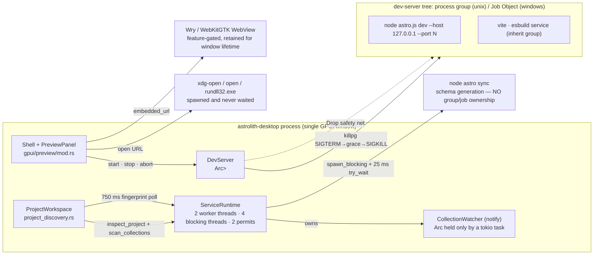

# Workspace index · watcher · Astro discovery · Preview: evidence audit

Branch `dev`, HEAD `326eeec5bcc69d90ea6af6fd50ab8f214b97e4b8`. Read-only audit; no build/test run.
Evidence levels: **Confirmed** (checked line-by-line against this repository or the pinned dependency source,
including arithmetic over declared caps), **Strong** (direct source evidence, no runtime measurement),
**Hypothesis** (needs runtime check). No wall-clock numbers are claimed.

## Scope inspected

| File | Lines | Read |
|---|---|---|
| `crates/astrolith-workspace/src/index.rs` | 1079 | full |
| `crates/astrolith-workspace/src/watcher.rs` | 762 | 1-560 + tests skim |
| `crates/astrolith-workspace/src/files.rs` | 265 | 1-140 |
| `crates/astrolith-workspace/src/paths.rs` | 252 | 1-220 |
| `crates/astrolith-workspace/src/list.rs` | 638 | 180-360 |
| `crates/astrolith-workspace/src/assets.rs` | 895 | 1-60 (no process/watcher code) |
| `crates/astrolith-workspace/src/slug_ranges.rs` | 739 | 1-30 (generated table, 734 ranges) |
| `crates/astrolith-workspace/src/operations.rs` | 1227 | symbol scan (no child/watcher code) |
| `crates/astrolith-preview/src/process.rs` | 609 | full |
| `crates/astrolith-preview/src/server.rs` | 847 | full |
| `crates/astrolith-preview/src/capabilities.rs` | 412 | 1-250 |
| `crates/astrolith-preview/src/external.rs` | 376 | 1-220 |
| `crates/astrolith-preview/src/surface.rs` | 173 | 1-100 |
| `crates/astrolith-preview/src/lifecycle.rs` | 283 | 1-200 |
| `crates/astrolith-preview/src/config.rs`, `routes.rs`, `preview.rs` | 292/303/204 | header + API |
| `crates/astrolith-gpui/src/preview/mod.rs` | 1007 | full |
| `crates/astrolith-gpui/src/preview/embedded.rs` | 297 | 1-200 |
| `crates/astrolith-gpui/src/project_discovery.rs` | 13451 | 60-130, 200-330, 600-650, 880-980, 1381-1560, 1820-1930, 2112-2162, 2990-3350, 4470-4620 |
| `crates/astrolith-gpui/src/shell.rs` | 7363 | 360-400, 600-700, 1960-2100 |
| `crates/astrolith-gpui/src/runtime.rs` | 353 | 1-130 |
| `crates/astrolith-astro/src/{discovery,config,pattern}.rs`, `schema/*`, `components/*` | 556/1070/517/+ | delegated slice; spot-checked `discovery.rs:270-520`, `generation.rs:240-340,520-640`, `pattern.rs:94-123` |
| `notify-8.2.1` (`inotify.rs`, `fsevent.rs`, `windows.rs`) | — | relevant functions |
| `.github/workflows/ci.yml`, `mise.toml` | 32 / 133 | full |

Host context: `fs.inotify.max_user_watches=524288`, `max_user_instances=1024`, `max_queued_events=16384` (Confirmed, read).

## Top risks (ranked)

1. **A single symlink, missing collection directory, duplicate slug, `+++` frontmatter, or
   `fs.inotify.max_user_watches` exhaustion makes the project unopenable or empties the navigator** (IDX-3, WCH-1).
2. **Every watcher batch is a full project re-index plus a second full directory walk plus a component
   walk**, all on a 2-permit blocking lane that the 750 ms schema poll also uses (IDX-1, WCH-3, AST-5).
3. **macOS: each registration restarts the FSEvents stream** (N thread create/join cycles at open) and
   events in each gap are lost (`since_when = SinceNow`, never advanced) (WCH-1, XPL-2).
4. **Preview route tracking is convention-only** (`/<collection>/<id>`); projects with custom page
   routes open 404s, and no HMR state is observed (PRV-5).
5. **`node astro sync` (schema generation) is a second, unowned child process**: it has no process group /
   job object, is killed by direct `child.kill()` only, and occupies 1 of 2 blocking permits for up to 30 s (AST-4).

## A. Process ownership



Ownership notes:
- Exactly **one OS watcher per app**: `notify` is a dependency of `astrolith-workspace` only
  (`crates/astrolith-workspace/Cargo.toml:13`); no other crate in the tree depends on it, so preview,
  LSP and the editor add no duplicate OS watchers.
- The dev server owns its **whole process group** on Unix (`process_group(0)`, `process.rs:237`) and a
  **Job Object with `KILL_ON_JOB_CLOSE`** on Windows (`process.rs:247-256`, `process.rs:473-540`).
- `astro sync` is spawned by the *blocking lane*, not by `RunningProcess`
  (`crates/astrolith-astro/src/schema/generation.rs:568-576`); it is killed with `child.kill()`
  (SIGKILL to the direct child) at timeout/cancel (`generation.rs:586-600`). Nothing owns its descendants.
- The browser opener is spawned with `spawn().map(drop)` (`external.rs:44-56`) and never waited.

### Watcher / process count per state

`R` = 1 (project root, non-recursive) + one registration per directory under each collection base
+ one per content-config parent directory; `R ≤ 100_000` (`watcher.rs:27-31`). The walk that produces
`R` is repeated on every batch (`watcher.rs:292-383` via `refresh`, `watcher.rs:121`).

| State | OS watcher instances | OS watch registrations | Child processes | Steady timers |
|---|---|---|---|---|
| App started, no project | 0 | 0 | 0 | — |
| Project open, preview never started | 1 | `R` (inotify watches / RDCW handles / FSEvents roots) | 0 steady; **1 transient `node astro sync`** at open (≤30 s) | watcher watchdog 100 ms (`project_discovery.rs:88-92`), drain poll 100 ms (`:3174`), schema fingerprint 750 ms (`:1837`) |
| Preview `Starting` | 1 | `R` | 1 group leader + descendants | + readiness poll 25 ms (`server.rs:32,505`) |
| Preview `Ready` | 1 | `R` | 1 group (node + vite + esbuild service) | + exit poll 250 ms (`preview/mod.rs:527`) |
| Change burst / `git checkout` | 1 | `R` (and a full re-walk while recomputing) | unchanged | drain ~100 ms, scan (one full index) |
| Config change detected | 1 | `R` | +1 `node astro sync` while regenerating | 750 ms fingerprint |
| Project switch | 1 new (`R'`), old released asynchronously | `R'` | old group SIGKILLed; new sync child | as above |
| App quit | 0 (process exits) | — | group SIGKILLed by `abort()`; sync child killed via cancellation; opener children intentionally survive | — |

Cross-check: `R` is not "one recursive watch". `for_project` registers every directory individually
(`watcher.rs:111`, `:292-320`, `:379-433`), so the Linux/Windows cost scales with directory count, not
with collection count. LSP and terminal are separate child-process owners (out of this slice:
`crates/astrolith-lsp/src/client.rs:249`, `crates/astrolith-terminal/src/lib.rs:20`).

## B. Index (`astrolith-workspace/src/index.rs`)

### IDX-1 Full rescan on every refresh; no incremental or persisted index — **Strong**
`scan_collections` (`index.rs:299`) always starts from each collection base, walks every directory
(`index.rs:310-405`) and re-derives every entry; there is no mtime/content cache, no persistent index,
and no "changed paths only" path anywhere in the crate. Every consumer reaches it through a full
`inspect_project` + `scan_collections` pair: initial open (`project_discovery.rs:3070-3081`), watcher
batch (`:3237-3263`), operation rescan (`:4550-4571`).
Impact: cost is `O(files)` per save burst, and the same work is repeated after every quiet window.

### IDX-2 Per-entry cost: 2 `realpath` + 2 `stat` + 2 YAML passes — **Strong**
Per selected file: `fs::symlink_metadata` (`index.rs:344`), `canonical_dir`/`source_path` canonicalize
(`index.rs:499`), `read_frontmatter`/`read_data_file` canonicalize again (`index.rs:641`, `:947`),
`metadata_modified` stat (`index.rs:634-638`), then YAML is parsed twice — an event walk
(`validate_yaml_events`, `index.rs:540`) followed by `YamlLoader::load_from_str` (`index.rs:542`, `:565`).
`fs::canonicalize` on Linux resolves component-by-component, so each entry also pays `O(depth)` stats.
Impact: ~6 syscalls + 2 parses per entry; at the 100k cap that is ~600k syscalls per index pass, twice
per save burst (see WCH-3).

### IDX-3 Hard-fail policies turn one odd file into an empty navigator / unopenable project — **Strong**
These return `Err`, and `apply_index_failure` publishes an **empty** entry list while keeping buffers
(`project_discovery.rs:4528-4532`), or abort the open entirely:

| Trigger | Evidence | Effect |
|---|---|---|
| symlink anywhere under a collection base | `index.rs:349-350`; also `watcher.rs:414-416` | index empty / project open fails (watcher built before the scan, `project_discovery.rs:3074-3078`) |
| collection base missing/not a directory | `discovery.rs:461-476` → `DiscoveryOutcome::Unsupported` | "Could not open project" (`project_discovery.rs:3140-3141`) |
| two files slugify to one ID | `index.rs:389-393` (`DuplicateEntryId`) | index empty |
| TOML `+++` frontmatter | `index.rs:969-977` (`UnsupportedFrontmatter`) | index empty |
| frontmatter >1 MiB or >256k YAML events | `index.rs:30,34` | index empty |
| non-UTF-8 path component | `index.rs:519-525` | index empty |
| >100k inspected nodes / depth >64 / >100k entries | `index.rs:22-28`, `:333-346` | index empty |
| any `watch()` failure (inotify ENOSPC) | `watcher.rs:198-202` → `?` at `project_discovery.rs:3074` | **project open fails** |

Impact: these are ordinary repository states (a symlinked `latest` entry, a collection dir removed by a
branch switch, a Hugo-style TOML post, a shared slug). Astro itself tolerates all of them. The
`notify` ENOSPC path is mapped to `ErrorKind::MaxFilesWatch`
(`notify-8.2.1/src/inotify.rs:451-455`), so on hosts with the common `max_user_watches=8192` a content
tree with >8k directories cannot be opened at all.

### IDX-4 Memory — **Hypothesis** (structural estimate)
`CollectionEntry` (`index.rs:90-95`) = `Entry{EntryId{String,String}, SourcePath(String)}` + 2 `PathBuf`
+ `EntryMetadata{BTreeMap<String,MetaValue>, Option<u64>}` = ~160 B inline plus ~110 B of string heaps
plus a BTreeMap node (~200-400 B for 3-5 fields). ≈0.4-0.6 KB/entry ⇒ **40-60 MB at the 100k cap**, on
top of: `logical_ids: HashSet<EntryId>` which clones every id during the scan (`index.rs:307`, `:389`);
`EntryRow` labels (5 allocations + `to_lowercase` + `format!` per row, `project_discovery.rs:334-359`)
for every entry; and `sources: Vec<PathBuf>` rebuilt per publication (IDX-6). `Arc<Vec<...>>` clones in
`publish_entries` are cheap (`project_discovery.rs:3352-3364`), the row rebuild is not.

### IDX-5 The navigator rebuilds and re-sorts all entries on every keystroke, on the UI thread — **Confirmed (source)**
`perform_search` calls `rebuild()` synchronously (`project_discovery.rs:615-625`); gpui-component invokes
it from `InputEvent::Change` with **no debounce** (`gpui-component-0.8.1/src/list/list.rs:288-305`).
`rebuild` filters and sorts (`project_discovery.rs:225-313`) with a comparator that allocates on every
comparison: `display_title` → `to_owned`, then `to_lowercase`, twice per comparison
(`list.rs:225-231`, `:288-330`). Then `entry_row` builds 5 strings per row.
Impact at 10k entries: ~10k × 7 allocations for rows plus ~1.4M allocating comparisons per keystroke.

### IDX-6 Component index rebuilt with an unused full path list on every publication — **Strong**
`load_components` maps every entry to `root.join(source)` (`project_discovery.rs:2123-2127`) but
`scan_component_imports` consumes only `MAX_COMPONENT_IMPORT_FILES = 256` (`:911-917`, `:918-930`).
The component walk itself is bounded (2048 files / depth 32 / 1024 dirs / 8192 entries / 256 KiB,
`components/discover.rs:17-28`) and runs on each `apply_discovered_index` (`:2112-2138`), i.e. per
watcher batch.

### IDX-7 Ignore rules differ per subsystem — **Strong**
- index: `name.starts_with('.') || "node_modules" || ".git"` (`index.rs:491-497`)
- watcher: identical (`watcher.rs:540-543`)
- Build tree: explicit list including `target`, `dist`, `build`, `.astro`, `.next`, … (`files.rs:15-30`)
- No `_`-prefix rule anywhere (`index.rs:491`, `pattern.rs:94-117`), while Astro's glob loader excludes
  `_`-prefixed files by default ⇒ phantom entries — **Hypothesis** (needs a real project check).

## C. Watcher (`astrolith-workspace/src/watcher.rs`)

### WCH-1 One watcher, one registration per directory; the backend differences are load-bearing — **Strong**
`CollectionWatcher::for_project` (`watcher.rs:111`) builds registrations by walking each collection base
with `read_dir` (`watcher.rs:379-433`) and then calls `watcher.watch(path, NonRecursive)` per path
(`watcher.rs:198-202`). Backend cost from the pinned crate source:
- Linux/inotify: one `inotify_add_watch` per directory; exceeding `max_user_watches` returns
  `ErrorKind::MaxFilesWatch` (`notify-8.2.1/src/inotify.rs:442-455`).
- Windows: each registration = `CreateFileW` handle + semaphore + one outstanding 16 KiB
  `ReadDirectoryChangesW` buffer (`BUF_SIZE`, `notify-8.2.1/src/windows.rs:40,163-230,279-311`) ⇒ 1000
  dirs = 1000 handles and ~16 MB of in-flight buffers; 100k dirs (the app's own cap) = ~1.6 GB.
- macOS: one FSEvents stream for all paths, but `watch()` = `stop(); append_path(); run()`
  (`notify-8.2.1/src/fsevent.rs:298-302`), and `stop()` joins the runloop thread (`:314-331`).
  `CollectionWatcher::start` therefore performs **R stream restarts and R thread create/joins** at
  project open. `since_when` is fixed to `SinceNow` (`:289`, used at `:421`), so every restart's gap
  loses events silently — no `needs_rescan` is synthesized.
- macOS callback is `O(registrations)` per event: it iterates the whole `recursive_info` map
  (`notify-8.2.1/src/fsevent.rs:551-566`). With `R≈1000` and a 5k-event checkout that is 5M path checks
  inside the FSEvents callback thread.

### WCH-2 Burst behavior: 64-slot channel, 100 ms quiet window, 100 ms poll, then a *full* rescan — **Strong**
- callback: drops non-relevant events; `try_send` into `sync_channel(64)`; `Full` sets the overflow flag
  (`watcher.rs:178-190`, `:187-189`, capacity `:23`).
- `drain()` returns a batch **only** after ≥100 ms without new input (`watcher.rs:226-266`, window `:25`),
  so a continuous checkout suppresses index updates until it pauses, and any overflow turns into
  `needs_rescan = true` (`:248-252`).
- the consumer polls every 100 ms and, on `changed || needs_rescan`, runs `inspect_project` +
  `watcher.refresh` + `scan_collections` (`project_discovery.rs:3168-3181`, `:3237-3263`).
Impact: `git checkout` / `bun install`-adjacent bursts produce repeated full rescans (each with a full
directory walk and YAML re-parse) with no intermediate UI feedback; `bun install` itself is cheap only
because `node_modules` is never registered (`watcher.rs:410`, `:540`).

### WCH-3 `refresh()` re-walks all collection trees on every batch — **Strong**
`watcher.refresh(&manifest)` (`project_discovery.rs:3267`, and `:4560` for operation rescans) →
`project_registrations` → `add_tree` for each base (`watcher.rs:121-171`, `:292-345`, `:379-433`).
So each change pays **two** walks of the content tree (one to plan registrations, one to scan entries)
plus one component walk (IDX-6). `refresh` can also fail after the scan planned successful registrations;
that error is only logged (`project_discovery.rs:3267-3269`).

### WCH-4 `config_changed` is computed but never consumed — **Strong**
`WatchBatch::config_changed` (`watcher.rs:28`, set at `:519-521`) has no consumer: the poll loop reads
only `batch.changed || batch.needs_rescan` (`project_discovery.rs:3183-3184`). Discovery runs on every
batch anyway, so the field is dead surface (tests use it).

### WCH-5 Event filter is extension-based for data changes and path-only for create/remove — **Strong**
`Modify(Data)` requires `md|mdx|js|mjs|ts|json` (`watcher.rs:514-517`, `:545-551`); `Create`, `Remove`,
`Modify(Name)` accept any non-ignored path (`:509-513`). Consequences: saving an `.astro` page is
invisible to the index; creating/deleting a PNG inside a collection dir triggers a full project rescan;
any `Modify(Data)` on a `.json` outside collections (but inside a registered config parent) triggers
discovery + rescan.

### WCH-6 The watcher's lifetime is a 100 ms tokio poll loop — **Strong**
`ServiceWatcher::new` spawns a tokio task that sleeps 100 ms until the project `Cancellation` fires, then
drops the `Arc<CollectionWatcher>` (`project_discovery.rs:80-96`); `Drop` only aborts that task (`:97-101`).
So destruction of the OS watcher is deferred to the runtime's abort scheduling (up to one tick), and there
are two independent 100 ms loops per open project (watchdog + drain poll). Comment acknowledges the split
("Tokio owns the native watcher's final drop", `project_discovery.rs:79`).

### WCH-7 No duplicate watchers, but editor external-change detection rides the same batch — **Strong**
The batch also fingerprints every open/in-flight session by re-reading up to 8 MiB each
(`project_discovery.rs:3246-3252`) and compares against the session's `disk_fingerprint`
(`:3322-3329`). With the 32-session limit (`:3523-3525`) that is up to 256 MiB of reads per batch.

## D. Astro discovery (`astrolith-astro/src`)

### AST-1 No project code is executed during discovery — **Strong**
tree-sitter TypeScript only (`Cargo.toml:12-13`, `config.rs:245-256`, `props.rs:164`, `imports.rs:852`,
`helpers.rs:261`). The only Node invocations are schema generation
(`schema/generation.rs:546-581`) and tooling validation (`validation_tooling.rs:214-219`).

### AST-2 Per-open discovery cost is bounded — **Strong**
Reads `package.json`, `node_modules/astro/package.json`, `astro.config.*`, `src/content.config.*` /
`src/content/config.*`, and the MDX package, all through `read_bounded` with a 1 MiB cap
(`discovery.rs:205-221`, `:283-318`, `:358-397`, `:412`). No content walk; bases are only recorded.
Costs that do scale with project size: one canonicalize per collection/data collection
(`discovery.rs:224-237`, `:461`), plus the component walk (IDX-6).

### AST-3 Version gate is the *installed* package, `[5,6,7]`, and unknown ⇒ project won't open — **Strong**
`SUPPORTED_ASTRO_MAJORS = &[5,6,7]` (`discovery.rs:19`); version is read from
`node_modules/astro/package.json` (`:312-318`) and the declared range is only equality-checked across
`dependencies`/`devDependencies` (`:305-310`). Any other installed major, or a missing `node_modules`,
becomes `DiscoveryOutcome::Unsupported` with a single joined string
(`:338-349`) ⇒ the UI reports "Could not open project: …" (`project_discovery.rs:3140-3141`). There is
no "too new" vs "unknown" distinction.

### AST-4 `astro sync` is spawned on every project open and holds a blocking permit — **Confirmed (source)**
`load_collection_schemas` (`project_discovery.rs:1820`) → `SchemaFreshness::reconcile` returns
`Regenerate` on first sight (`generation.rs:391-411`) → `generate_collection_schemas` →
`node <astro entry> sync` (`generation.rs:95-130`, `:546-581`). The run: stderr to a temp file (no pipe
deadlock, `:562-566`), `try_wait` every 25 ms **on a `spawn_blocking` thread** (`:590-600`), 30 s
deadline (`:34`), SIGKILL to the direct child only. Because `runtime::blocking` takes one of two
semaphore permits *before* `spawn_blocking` (`runtime.rs:47`, `:105-126`), a slow sync halves the
blocking capacity used by index scans, session loads, saves' recovery clears and asset copies.

### AST-5 Schema freshness poll runs forever at 750 ms and re-reads all schema files — **Strong**
`project_discovery.rs:1834-1857` polls `schema_fingerprint` every 750 ms through the same blocking lane;
the fingerprint reads the full content of **every** `*.schema.json` in `.astro/collections` with no
file-count bound and a 1 MiB per-file cap (`generation.rs:36-40`, `:290-334`; `MAX_COLLECTION_SCHEMAS =
512` bounds only the loading path, `:642-646`) and reads `astro.config` twice per poll (once via
`astro_src_dir` `:245-253`, once in the hashing loop `:322-330`). Steady-state: ≥80 blocking-lane
acquisitions per minute per open project, even when nothing changes.

### AST-6 Schema model is derived from Astro's emitted JSON Schema, not Zod — **Strong**
`parser.rs:49-78` normalizes Draft7/2020-12 documents (depth cap 64, `parser.rs:12`); supported:
`$ref`, `enum`, `const`, `anyOf/oneOf` (single branch / all-date / nullable), type arrays with `null`,
`date`/`date-time`, `unix-time`, objects, single-`items` arrays; unsupported constructs become
`FieldKind::Unsupported{reason}` + diagnostic (`parser.rs:216-220`, `:290-390`). `image()`/`reference()`
are recovered by a second static pass on the content config source (`helpers.rs:59-86`, `:379-433`).

### AST-7 Diagnostics are strings at the discovery layer — **Strong**
`ProjectManifest::diagnostics: Vec<String>` (`discovery.rs:190`, `:217-219`); the shell joins them into
one status line (`project_discovery.rs:4520-4524`). Structured diagnostics exist only below, in
`schema/model.rs:149-156` and `schema/validation.rs:30-40`. Impact: no severity/position, and an
`Unsupported` outcome collapses every diagnostic into one sentence with `"; "`.

### AST-8 Per-call parser/regex construction — **Strong**
`tree_sitter::Parser::new()` per parse (`config.rs:246`, `props.rs:164`, `imports.rs:852`,
`helpers.rs:261`); `regex::Regex::new` inside `validate_pattern` (`schema/validation.rs:216-242`).
No memoization. AST caps: 100k nodes / 128 depth (`config.rs:8-9`, `props.rs:20-22`, `helpers.rs:25-27`).

## E. Preview (`astrolith-preview/src`, `gpui/preview`)

### PRV-1 Spawn and tree ownership — **Strong**
`RunningProcess::spawn` sets `stdin(Stdio::null())`, pipes both streams, `kill_on_drop(true)`, and on Unix
`process_group(0)` (`process.rs:221-238`). Stop sequence: `SIGTERM` to the group → `timeout(grace)` →
`SIGKILL` → reap → settle drains with a 2 s bound (`process.rs:331-355`, `:372-381`, `:45`). `wait()` and
`terminate()` also `signal_tree_force()` afterwards to catch descendants that inherited the pipes
(`process.rs:314-330`, `:358-371`). `Drop` re-signals the group and aborts the drains
(`process.rs:429-447`).
Caveats: (a) a descendant that calls `setsid` leaves the group and is unreachable — **Hypothesis**
(Astro 7's auto-backgrounding is exactly that, which is why `--ignore-lock` is passed, `server.rs:645-654`);
(b) on Windows the Job Object is assigned *after* `spawn` (`process.rs:245-251`), so a fast grandchild
spawned in that window escapes; (c) Windows has no graceful path — `TerminateJobObject` for both
"graceful" and force (`process.rs:412-426`), so Astro never gets a chance to clean up.

### PRV-2 Readiness is stdout/stderr text parsing at 25 ms; no TCP probe — **Strong**
`POLL_INTERVAL = 25 ms` (`server.rs:32`); the loop reads `combined_text()` and looks for the first
`http://127.0.0.1|localhost` token (`server.rs:437-505`, `:719-741`), normalizing to `127.0.0.1` and
accepting Astro's auto-incremented port. Consequences:
- allocation cost: each poll clones both captures (≤1 MiB each) and `strip_ansi` allocates another copy
  (`process.rs:307-313`, `server.rs:698-736`). Worst case ≈4 MiB of allocation per poll at 40 Hz
  (≈160 MB/s) for up to 30 s — **Strong** (code arithmetic; typical output is tiny).
- a project that prints any local URL earlier (a plugin banner) is declared ready then — **Hypothesis**.
- no readiness probe against the port, so "ready" means "Astro printed the line", not "accepting
  connections" — **Hypothesis** (ordering is Astro-internal).

### PRV-3 Port selection is bind-then-drop; conflict classification is best-effort — **Strong**
`available_port()` binds `127.0.0.1:0`, reads the port, drops the listener (`server.rs:687-693`) — a TOCTOU
window before `node … --port N`. If the port is taken, Astro increments and the readiness parser picks the
real port, so the server still starts; `DevServerError::PortInUse` is only produced when the process
**exits** and the output matches `EADDRINUSE`/"port … in use" (`server.rs:462-482`, `:747-760`).

### PRV-4 Crash detection exists; there is no automatic restart — **Strong**
While `Ready`, `watch_exit` polls `backend.poll_exit()` every 250 ms (`preview/mod.rs:522-573`), which
locks the server mutex and calls `try_wait` (`server.rs:567-603`). A non-zero exit becomes
`Failed("… exited unexpectedly (…)")`; recovery is the user pressing the "Retry" button
(`preview/mod.rs:604-613`, label at `:918`). There is no backoff, no auto-restart, and the polling continues while the
window is hidden or the user has left Preview mode.

### PRV-5 Route tracking is convention-only; no HMR observation — **Strong**
Production mapping is `RouteMapping::from_collections(collection → collection)`
(`project_discovery.rs:1921-1929`), i.e. `/<collection>/<id>` with `index` folded and segments
percent-encoded (`routes.rs`, `config.rs:128`). `RouteMapping::from_content_config` exists but is used
only by tests (`config.rs:199-208`, `:226`). Nothing reads `src/pages`, so a project whose pages live at
`/blog/[...slug].astro` (or any custom route) opens a 404. There is no dev-server
websocket/HMR subscription anywhere; the embedded view is retargeted purely by URL inequality
(`embedded.rs:57-70`), so a content edit only shows up by reloading.

### PRV-6 External launch leaks one zombie per launch (Unix) — **Strong**
`SystemOpener::spawn` returns `Command::spawn(...).map(drop)` (`external.rs:44-56`); the `Child` is never
waited, so a short-lived `xdg-open` exits and stays a zombie until AstroLith exits. The command is built
argv-only with `{url}` substitution (`external.rs:85-124`), avoiding shell re-parsing — deliberate and
correct for entry ids containing `&`.

### PRV-7 Embedded WebView is build- and host-gated, and CI never compiles it — **Confirmed (source)**
Capability = feature ∧ host: Linux X11 only; Wayland (even with `DISPLAY`), headless and `Other` are
`ExternalOnly` (`capabilities.rs:145-149`, `:200-233`, `:126-143`). The shell computes it once at startup
(`shell.rs:367-371`) and downgrades the preference (`:388-394`). The WebView is built lazily and retained
for the window lifetime; `set_url(None)` hides without freeing (`embedded.rs:57-70`, `:141-166`).
CI runs `cargo build/test/clippy --workspace` with **no feature flags** (`mise.toml:14-17,30-31`,
`.github/workflows/ci.yml:31-32`), so the `#[cfg(feature = "embedded-webview")]` branch
(`embedded.rs:72-100`) is never compiled on any platform.

## F. Cross-platform

### XPL-1 Platform code inventory — **Strong**
`#[cfg(unix)]`/`#[cfg(windows)]` only in `process.rs` (process group / job object) and `paths.rs:185`
(`same_path` case-insensitivity). Everything else is `cfg!` runtime branching:
`capabilities.rs:93-103,126-143,205-233`, `external.rs:105-124`, `files.rs:241`.
`nix` and `windows-sys` are correctly target-gated (`astrolith-preview/Cargo.toml:16-27`), and the
Windows `unsafe` is confined to `windows_job` with a crate-level `deny` (`Cargo.toml:30-36`).

### XPL-2 Windows dev-server behavior is untested — **Strong**
`#[cfg(all(test, unix))] #[path = "server_tests.rs"]` (`server.rs:845-847`) and the shell-script fixture
helper is `#[cfg(unix)]` (`test_support.rs:22`). CI does compile the Windows target
(`ci.yml:15-17`) but no preview test exercises spawn/readiness/stop there, so the Job Object path, the
missing graceful stop and the spawn→assign race are compile-checked only.

### XPL-3 macOS assumptions — **Strong** (from `notify` source, not from running)
See WCH-1: per-path registration ⇒ R stream restarts and R thread joins at open; `O(R)` filtering per
event in the callback; events during each restart gap are lost with no `needs_rescan`. The
`CollectionWatcher` API and its tests are backend-agnostic (`watcher.rs:571-762` run on the host backend),
so CI on `macos-15` would execute them but the tests only assert small tempdirs.

### XPL-4 Linux assumptions in the preview/workspace layers
- `xdg-open` for all non-macOS/non-Windows unix (`external.rs:115-118`) — BSD/illumos hosts without
  `xdg-open` fail at launch, with the error surfaced and a fallback offered (`preview/mod.rs:738-747`).
- `paths.rs:15-22` blocks `/usr`, `/etc`, … by the *first* normal component (`:97-103`), and Windows
  names (`windows`, `program files`, …) by the first component too (`:104-113`), so `D:\windows\proj` is
  refused — cosmetic but surprising.
- Wayland detection is env-only (`capabilities.rs:126-143`); a Wayland session started without
  `WAYLAND_DISPLAY` but with only `DISPLAY` is classified X11 and offered the embedded view
  (documented intent, `capabilities.rs:131-137`).

## G. Lifecycle on project switch and quit (code quoted)

### LIF-1 Project open/switch teardown — **Strong**
`open_project` cancels the previous generation's work and drops every owner:
`project_discovery.rs:2996-3037`
```rust
self.cancellation.cancel();
self.cancellation = Cancellation::default();
let Some(next) = self.generation.checked_add(1) else { … };
self.index_request = 0;
self.published_index_request = 0;
self.index_task = None;
…
self.watch_task = None;
self.schema_task = None;
self.watcher_owner = None;   // ServiceWatcher::drop → tokio task abort → Arc<CollectionWatcher> drop
```
The new watcher is created *inside* the same blocking job, before the first scan
(`project_discovery.rs:3070-3081`):
```rust
let outcome = inspect_project(&request)…;
match outcome {
  DiscoveryOutcome::Ready(manifest) => {
    let watcher = CollectionWatcher::for_project(&manifest).map_err(|e| e.to_string())?;
    let entries = scan_collections(&manifest, &cancellation).map_err(|e| e.to_string())?;
    Ok((manifest, entries, ServiceWatcher::new(watcher, cancellation.clone())))
```
Note the ordering: a `watch()` failure aborts the whole open *after* discovery succeeded (`:3074`),
while a scan failure also aborts it — but a scan error there surfaces as "Could not open project",
whereas the same error later only empties the index (`IDX-3`).

### LIF-2 Preview retargeting — **Strong**
`sync_preview` (`shell.rs:1969-1997`) passes the current `(project, root, mapping)`; the panel reuses a
server only for the same **root** (`lifecycle.rs:62-74`, `preview/mod.rs:427-470`). Any other root:
```rust
TargetChange::Attach | TargetChange::Retarget => {
    let backend = Arc::new(AstroPreviewBackend::new(project.clone(), root.clone()));
    self.attach(backend, project, root, mapping, cx);
}
```
`attach` calls `detach` first (`preview/mod.rs:472-489`), and `detach` (`:490-510`) drops the tasks and
calls `backend.abort()`:
```rust
pub(crate) fn abort(&self) {
    if let Ok(mut slot) = self.cancellation.lock() && let Some(c) = slot.take() { c.cancel(); }
    if let Ok(mut server) = self.server.try_lock() { server.abort(); }
}
```
Impact: project switch is a **SIGKILL** of the dev server (no `stop()`/grace). If a start is in flight the
mutex is held, so `try_lock` fails and termination relies on the cancellation check inside the 25 ms
readiness loop (`server.rs:437-440`), which does call `process.terminate()`.

### LIF-3 Index generation ordering — **Strong**
`begin_index_request`/`accepts_index_result` (`project_discovery.rs:4476-4493`) give each rescan a token;
a result publishes only if `token >= published_index_request` (`:3304-3317`, `:4581-4605`). Watcher scans
claim their token *before* the blocking work (`:3226-3232`), so an operation rescan issued afterwards
supersedes them. `open_project` resets both counters, which is safe because every publisher also checks
`generation`/`project_id` (`:3090-3092`, `:3194-3196`, `:3207-3211`). Residual risk: a started blocking scan cannot be
interrupted (`runtime.rs:105-108` comment), so after a switch the old job keeps its permit until the old
cancellation is observed — bounded by the per-node `check_cancelled` calls (`index.rs:311`, `:325`).

### LIF-4 Application quit — **Strong**
```rust
let preview_owner = preview.downgrade();
App::on_app_quit(cx, move |cx| {
    let _ = preview_owner.update(cx, |preview, _| preview.abort());
    async move {}
}).detach();                       // shell.rs:665-670
```
That path is synchronous: `DevServer::abort` drops `RunningProcess` (`server.rs:552-560`), whose `Drop`
`killpg(..., SIGKILL)` + `start_kill` runs inline (`process.rs:429-447`). The watcher needs no action —
the process exit closes the inotify/FSEvents/RDCW handles, and `ProjectWorkspace::drop` cancels the
project cancellation (`project_discovery.rs:933-936`). The browser opener is deliberately not killed
(`external.rs:1-8`). The service runtime then shuts down with a 2 s bound (`runtime.rs:28-33`).

## Open questions / not inspected

- No runtime measurement was performed (build cache in use): scan wall-clock for a synthetic 1k/10k/100k
  collection tree, blocking-lane queueing under a burst, and the macOS FSEvents restart cost remain
  **Hypothesis**.
- Whether Astro 5/6 print the ready URL before the listener accepts connections, and whether `astro sync`
  leaves esbuild grandchildren behind when SIGKILLed (AST-4) — needs a live project.
- Whether `_`-prefixed content files are indexed by this scanner but ignored by Astro's glob loader
  (IDX-7) — needs a fixture project.
- The `--ignore-lock` branch only runs for installed Astro ≥ 7 (`server.rs:645-654`); Astro 5/6 behavior
  under agent-like environments is unverified.
- LSP client process ownership, terminal PTY lifecycle, and the `astrolith-gpui` editor/save paths are
  separate audits; only their existence as extra child-process owners is noted here.
- `assets.rs` (copy semantics, collision suffixes, date prefixes) and `operations.rs` (create/rename/
  duplicate/trash) were symbol-scanned only: neither spawns processes nor registers watchers; both rely
  on the full-rescan path audited in IDX-1.
