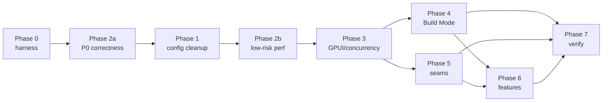

# Optimization and refactoring roadmap

Audit date: 2026-11-05, baseline `dev` @ `326eeec`. This plan is dependency-aware and
evidence-linked. Nothing here has been executed; each phase is independently shippable,
independently revertible, and must end with `mise run check` plus the listed E2E artifacts.

Line references and full reasoning live in the sibling documents:
`architecture-audit.md`, `performance-audit.md`, `build-mode-audit.md`,
`config-cleanup.md`, `feature-gap-analysis.md`, `reference-comparison.md`,
`e2e-verification-plan.md`, and `evidence/`.

## 0. Executive ordering (why not 0→1→2→…)

The prescribed phase order is baseline → config/debt → perf → GPUI → Build Mode →
architecture → features → verify. Two things force an exception:

1. Three **P0 correctness defects** (`DOC-02`, `DOC-03`, `DOC-01`) sit in the save/recovery
   path and are cheap and isolated. Shipping them behind a configuration cleanup delays
   data-loss fixes for no engineering reason.
2. The render findings (`PERF-01/02/03`) are prerequisites for any *credible* Build Mode work,
   because the terminal currently forces a full `Shell` render at up to 62.5 Hz.

**Execution order**

```
Phase 0 (baseline + harness)
  └─> Phase 2a (P0 correctness hotfixes) ──┐
        └─> Phase 1 (config + debt cleanup)│
              └─> Phase 2b (low-risk perf) ┘
                    └─> Phase 3 (GPUI + concurrency)
                          └─> Phase 4 (Build Mode)
                                └─> Phase 5 (architecture seams)
                                      └─> Phase 6 (features + reliability)
                                            └─> Phase 7 (before/after verification)
```

Phase 5 can start in parallel with Phase 4 once Phase 3 lands (different files, one
integration owner per seam). Phase 6 must not start before Phase 4, because several feature
fixes are rewrites of Build Mode paths.

## 1. Consolidated issue registry

Severity: **P0** data loss / severe crash / critical blocker · **P1** major performance or
reliability · **P2** important architecture or maintenance · **P3** low priority.
Evidence: **C** confirmed (measured/reproduced in this audit), **S** strong (direct source),
**H** hypothesis.

### 1.1 Correctness and data safety

| ID | Title | Subsystem | Sev | Ev | Location | Fix | Cost | Risk | Deps |
|---|---|---|---|---|---|---|---|---|---|
| DOC-01 | Every own save marks the document "changed on disk" (fingerprint captured once at load, never updated) | save/watcher | **P1** | S | `session.rs:171`, `project_discovery.rs:3325` | Update `disk_fingerprint` on `confirm_saved`/`rebase_persisted`; derive it from the persisted content | S | S | Phase 2a |
| DOC-02 | A save conflict is unresolvable; the documented remedy (close+reopen) deletes the recovery record | save | **P0** | S | `save_coordinator.rs:462-468`, `project_discovery.rs:3743-3842` | Add an explicit "reload from disk / keep mine / save as copy" resolution; keep the recovery record until the caller decides | M | M | — |
| DOC-03 | Recovery restore adopts the current disk as baseline and discards the record's revision, so the first autosave can overwrite a newer on-disk edit | recovery | **P0** | S | `project_discovery.rs:4284`, `buffer.rs:177-190` | Restore the record's revision; if disk differs from the record, enter conflict, not clean | S | S | DOC-01 |
| DOC-04 | One global `pending_after_save` slot silently drops a queued rename/duplicate/trash/close | save | P1 | S | `project_discovery.rs:777, 5553, 5693, 5823` | Per-path map keyed by canonical source | S | S | — |
| DOC-05 | Saves are not size-checked, so a document can be persisted past the 8 MiB read cap and then never reopened (and reads as "changed on disk" forever) | save | P1 | S | `save.rs:186-235` vs `project_discovery.rs:3560` | Refuse to save past the cap with a typed error, or raise the read cap for self-written files | S | S | DOC-01 |
| DOC-06 | Two load-admission policies; `open_project_source` bypasses the memory budget | load | P2 | S | `project_discovery.rs:2786-2795` vs `3528-3536` | One admission function | S | S | Phase 5 |
| DOC-07 | Loaded-source budget counts only `original_text`; real footprint ≈5× | memory | P2 | S | `project_discovery.rs:3528-3536` | Count the actual retained bytes (or a documented multiplier) | S | S | — |
| DOC-08 | Two full copies per undo/redo; 500-entry history holds document-sized strings | history | P3 | S | `session.rs:1817-1836` | Apply the inverse in place; `VecDeque` | S | S | — |

### 1.2 Performance

| ID | Title | Sev | Ev | Location | Fix | Measured basis |
|---|---|---|---|---|---|---|
| PERF-01 | Writer surface renders every block; no viewport windowing | **P1** | C | `writer_surface.rs:466-536, 793-796` | Visible-range block iteration driven by scroll offset ÷ measured heights; keep the caret block | resize workload: 90 frames not finished in 33 min at 100 % CPU, 1.3 MB / 8k blocks (>22 s/frame lower bound); `SHELL_OPEN` 56.6 ms @1 MiB |
| PERF-02 | `Shell::render` (window root) does project-sized work every frame | **P1** | S | `shell.rs:3116-3193` | Move menu/availability/prose-style into change handlers; make the renderer read cached values | structural |
| PERF-03 | Preview mode clones the whole visible document every `Shell` frame | **P1** | S | `shell.rs:3173-3190` | Borrow (`&str` / fingerprint) instead of `clone()` | structural |
| PERF-04 | Per-edit pipeline: 6 full copies + 2 full diffs + token Vec | **P1** | C | `session.rs:1330-1378`, `tokens.rs:52` | Incremental splice via `EditorState` change range → source offset; incremental counts | 16.0 ms @1 MiB |
| PERF-05 | `entry_count()` walks all entries; search re-sorts everything per keystroke | P2 | C | `project_discovery.rs:6230, 381-388, 609-620` | Cached count; debounced search | structural |
| PERF-06 | Writer paints the document twice (hidden full-size editor) | P2 | S | `writer_surface.rs:590-597` | Render the hidden editor only for hit-testing/IME, or merge the two viewports | structural |
| PERF-07 | Font resolution scans all installed families per frame | P2 | S | `theme/typography.rs:61-113` | Resolve once per settings change | structural |
| PERF-08 | File tree flattens every visible row on expand/collapse | P3 | S | `file_browser.rs:311-390` | Incremental row splice | structural |
| PERF-09 | 62.5 foreground wakeups/s per live terminal, even hidden | **P1** | S | `terminal/mod.rs:236-266` | Event-driven wakeup from the reader thread (or a 100 ms idle backoff when the dock is hidden) | arithmetic |
| PERF-10 | Whole terminal grid rebuilt as one element per cell per frame | **P1** | S | `terminal/mod.rs:345-414, 606-628` | Run coalescing first (cheap), then one custom element | up to 100k elements |
| PERF-11 | Parser mutex == render mutex; no backpressure | **P1** | S | `lib.rs:125-141`, `terminal/mod.rs:353-398` | Double-buffered screen snapshot; per-tick byte budget | structural |
| PERF-12 | Every watcher batch = 2–3 full tree walks on a 2-permit lane | **P1** | S | `project_discovery.rs:3237-3268` | Path-carrying batch + one shared walk | structural |
| PERF-13 | Per-entry index cost: 2 canonicalize + 2 stat + 2 YAML parses | P2 | S | `index.rs:499,540,641,947` | One canonicalize, one metadata read, one parse | structural |
| PERF-14 | Every batch re-reads and re-hashes every open document | P2 | S | `project_discovery.rs:3248-3256` | Compare mtime+len first; hash only on change | structural |
| PERF-15 | Preview readiness re-parses up to 4 MiB every 25 ms | P2 | S | `preview/src/server.rs:437-505` | Incremental line scan + TCP probe | structural |
| PERF-16 | Schema freshness polls forever at 750 ms (same defect as `WS-09`) | P2 | S | `project_discovery.rs:1837` | Watcher-driven invalidation (the watcher already exists) | structural |
| PERF-17 | `[profile.release]` absent while packaging ships release builds | P3 | S | `Cargo.toml` | `lto`, `codegen-units`, `strip` | — |
| PERF-18 | Long-session growth unmeasured; structural suspects: retained sessions, `lsp.pending`, per-field entity churn | P3 | H | `client.rs:389`, `shell.rs:3124-3152` | Measure RSS over 8 h before changing anything | none yet |

### 1.3 Build Mode (LSP, terminal, integration)

| ID | Title | Sev | Ev | Location | Fix |
|---|---|---|---|---|---|
| BM-01 | `set_source_view` replaces the whole editor text, clearing the pinned editor's layout cache and internal undo stack | P2 | S | `session.rs:1414-1468` | Keep `SourceHistory` as the only undo; preserve scroll/caret explicitly |
| BM-02 | One LSP process per open Build document; restart on tab switch | **P1** | C | `session.rs:1530-1600, 1612-1622`; `project_discovery.rs:3666-3676` | Registry keyed by (project generation, language), refcounted |
| BM-03 | Graceful LSP shutdown unreachable; children `SIGKILL`ed | **P1** | S | `client.rs:255, 339-345, 479` | Thread shutdown through the registry owner; bound the wait |
| BM-04 | No restart/crash recovery/user-visible LSP failure state | P1 | S | `session.rs:1587-1594` | Surface state + one retry with backoff |
| BM-05 | Document URIs uncanonicalized | P2 | S | `editor/lsp.rs::uri_for` | Canonical path |
| BM-06 | No LSP request timeout | **P1** | C | `client.rs:211-229` | `tokio::time::timeout` per request |
| BM-07 | No `$/cancelRequest` | **P1** | C | workspace grep | Send on abandon |
| BM-08 | `pending` grows for unanswered ids | P1 | C | `client.rs:389, 431` | Reap on timeout |
| BM-09 | Diagnostics ignore `uri` and `version` → other files' errors painted on the active document | **P1** | C | `session.rs:1577`, `lsp.rs:87-116` | Filter by URI, drop stale versions |
| BM-10 | Cross-file definition columns converted against the source document | P2 | S | `lsp.rs:206-208`, `position.rs:72-101` | Convert per line range against the target text |
| BM-11 | Capabilities discarded; providers ungated; no semantic tokens | P2 | C | `client.rs:518-590`, `session.rs:1601` | Store and gate |
| BM-12 | Server-initiated requests answered with placeholders | P2 | S | `client.rs` server-request arm | Answer `workspace/configuration` from settings |
| BM-13 | Three body copies per frame; O(n) front-drain | P3 | S | `framing.rs`, `client.rs` | In-place frame buffer |
| BM-14 | `didChange` always full text | P3 | C | `client.rs:717-725` | Defer (see reference comparison) |
| BM-15 | Completion requested per keystroke with a UI-thread full-text copy | P1 | C | `lsp.rs:129` | Debounce/trigger-character gating |
| BM-16 | Terminal kill signals the shell pid only; no `killpg`, no reap | **P1** | S | `lib.rs:277-293` | Session/process-group kill (mirror `preview/src/process.rs:396-405`) |
| BM-17 | `kill()` joins the reader on the UI thread | **P1** | S | `lib.rs:277-293` | Close master first, join on the service runtime, timeout |
| BM-18 | Shell spawned eagerly on project open | P2 | C | `shell.rs:498-506` | Spawn on first Build/terminal use |
| BM-19 | No quit/close hook for the terminal | P2 | S | `shell.rs:362-369` | Explicit shutdown before teardown |
| BM-20 | Shell without `-l`/`-i` | P2 | S | `lib.rs:76-92` | Spawn a login-interactive shell (documented) |
| BM-21 | Exit status fabricates a code; green dot after exit | P3 | S | `lib.rs:38-44`, `terminal/mod.rs:428` | `Option<u32>` + state-aware dot |
| BM-22 | Resize from a pixel estimate | **P1** | S | `terminal/mod.rs:277-287` | Measure the font advance; cache per family/size |
| BM-23 | Terminal uses the non-existent family `"monospace"` → proportional glyphs in fixed cells | **P1** | S | `terminal/mod.rs:29-31, 425` | `cx.theme().mono_font_family` |
| BM-24 | No font measurement at all | **P1** | S | same | Derive cell width/height from the text system |
| BM-25 | Whole grid rebuilt per frame | see PERF-10 | | | |
| BM-26 | Parser/render share one mutex | see PERF-11 | | | |
| BM-27 | DECCKM ignored (arrows broken in vim/less/fzf) | P2 | S | `terminal/mod.rs:652-741` | Read `application_cursor()` |
| BM-28 | No bracketed paste / mouse reporting; `Ctrl+V` unreachable | P2 | S | `terminal/mod.rs:321-341, 544-591` | Bracketed paste + paste chord; mouse deferred |
| BM-29 | Selection is viewport-only | P3 | S | `terminal/mod.rs:60-79` | Scrollback coordinates |
| BM-30 | `ToggleTerminal` can enter Build and hide the dock | P2 | S | `shell.rs:2188-2194` | Idempotent toggle semantics |
| BM-31 | `TogglePreview` toggles the terminal in Build | P2 | S | `shell.rs:1684-1712`, `commands.rs:1071` | Mode-aware label/target |
| BM-32 | Focus stays on a hidden terminal after leaving Build | **P1** | S | `terminal/mod.rs:100-113`, `shell.rs:1907-1913` | Hand focus to the editor on unmount |
| BM-33 | Two independent dev servers; no terminal→preview bridge | **P1** | S | `lib.rs:169-185`, `preview/src/server.rs:359-431` | Either adopt a configured port/URL from the terminal, or start the server through the terminal |
| BM-34 | Preview server keeps running after preview hides | P2 | S | `preview/mod.rs:325-333` | Explicit stop on leaving Preview (or document the retention) |
| BM-35 | Two filesystem scans per saved edit in Build; ignore lists disagree | P2 | S | `project_discovery.rs:4516, 1116-1123`; `files.rs:15-28` vs `watcher.rs:540-543` | One listing, one ignore policy |
| BM-36 | Diagnostics disappear on leaving Build | P2 | S | `session.rs:1466` | Keep the last diagnostic set per path |

### 1.4 Workspace, Astro, preview

| ID | Title | Sev | Ev | Location | Fix |
|---|---|---|---|---|---|
| WS-01 | Full rescan on every watcher batch; no incremental index | **P1** | S | `project_discovery.rs:3237-3268`, `index.rs:299` | Path-carrying batch + targeted reindex |
| WS-02 | Per-entry index cost | P2 | S | `index.rs:499,540,641,947` | See PERF-13 |
| WS-03 | One odd file (symlink, missing collection base, duplicate slug, TOML frontmatter, ENOSPC) fails the whole project or empties the navigator | **P1** | S | `index.rs:349-350, 389-393, 969-977`; `watcher.rs:198-202`, `discovery.rs:461-476` | Per-collection diagnostics; skip the offending entry, degrade one collection, never the project |
| WS-04 | Watcher batch triggers 2–3 walks | P1 | S | see PERF-12 | One walk |
| WS-05 | Ignore rules differ between watcher and scanner | P2 | S | `files.rs:15-28` vs `watcher.rs:540-543` | One shared predicate |
| WS-06 | Preview routes are convention-only; custom page routes 404 | P2 | S | `project_discovery.rs:1921-1929` | Use `from_content_config` (exists, used only in tests) |
| WS-07 | Readiness by output text, no TCP probe | P2 | S | `preview/src/server.rs:719-741` | Probe the parsed URL before reporting ready |
| WS-08 | Preview server not stopped when preview leaves the screen | P2 | S | `preview/mod.rs:325-333` | Explicit stop |
| WS-09 | Schema freshness poll runs forever | P2 | S | `project_discovery.rs:1837` | Watcher-driven |
| WS-10 | `astro sync` child has no process-group ownership and holds a blocking permit up to 30 s | P2 | S | `schema/generation.rs:568-600` | Reuse the preview process supervisor |
| WS-11 | `xdg-open` children are not reaped | P3 | S | `preview/src/external.rs:44-56` | Reap with a short wait |

### 1.5 Configuration

| ID | Title | Sev | Ev | Fix |
|---|---|---|---|---|
| CFG-01 | Version no longer identifies the schema; migrations trigger on key presence | P2 | S | One versioned `upgrade.rs` (see `config-cleanup.md`) |
| CFG-02 | Six unreachable `!writable` guards | P3 | C | Delete |
| CFG-03 | Chained backups; `Reset All` leaves backups/corrupt files | P2 | S | One backup per upgrade; reset removes them |
| CFG-04 | No parent-directory fsync after rename | P2 | S | Add |
| CFG-05 | Oversized config is read-only, not quarantined | P2 | S | Quarantine |
| CFG-06 | Downgrade→upgrade silently drops theme | P3 | S | Import-if-absent |
| CFG-07 | Unsupported v1 warns forever | P3 | S | Warn once |
| CFG-08 | Dead schema fields (`telemetry_enabled`, project `display_name`/`last_opened_at`, `interface_scale` tombstone) | P3 | S | Delete |
| CFG-09 | Defaults duplicated across core/theme | P2 | S | Single source |
| CFG-10 | Preferences placeholder shows the retired scale (14) | P3 | S | Fix |

### 1.7 Architecture and state ownership

| ID | Title | Sev | Ev | Location | Fix |
|---|---|---|---|---|---|
| ARCH-01 | `project_discovery.rs` god module: 78-field entity, 111 notify sites, 7 concerns, 6.4k test lines | P2 | S | `project_discovery.rs:696-830` | Extract along the documented seams (moves only) |
| ARCH-02 | Centre `document` panel has two writers (`Shell` and `ProjectWorkspace`) with a three-way exclusive state | P2 | S | `shell.rs:221,2965`; `project_discovery.rs:2799,3542,3737` | One writer; `SessionActivated` event |
| ARCH-03 | Three layout authorities (`settings.layouts`, `global_layouts`, `project_scope`) guarded by hand | P2 | S | `shell.rs:267-273, 1485-1491` | One authority plus a derived view |
| ARCH-04 | `Shell` observes the whole project, so all 111 notify sites run preview/entry/builder work | P2 | S | `shell.rs:523-528` | Subscribe to the specific events |
| ARCH-05 | Document panel state machine split across two modules; no test for the interleaving | P2 | S | `panels.rs:176-195` | Covered by ARCH-02 |
| ARCH-06 | Frontmatter field entities rebuilt on any reference/schema republication, discarding in-progress input | P2 | S | `shell.rs:3124-3152`, `project_discovery.rs:1958-1971` | Keep entities; update values in place |
| ARCH-07 | Watcher poll acquires a blocking permit and dispatches work every 100 ms even when idle | P2 | S | `project_discovery.rs:3172-3190` | Event-driven wakeup |

### 1.8 Features, delivery, docs

| ID | Title | Sev | Ev | Fix |
|---|---|---|---|---|
| FEAT-01 | No application menu is rendered on Linux | **P1** | S | Either add an in-window menu bar, or document menu-less operation and make palette/keys the canonical path |
| FEAT-02 | `embedded-webview` built by no task/CI/package | **P1** | C | Add a gated build task + CI job, or scope the docs to developer-only |
| FEAT-03 | `TogglePreview`/`ToggleTerminal` share one panel | P2 | S | Mode-aware commands |
| FEAT-04 | `ToggleTerminal` may enter Build and hide the dock | P2 | S | Idempotent toggle |
| FEAT-05 | `Shell.file_status` never rendered → silent failures | P2 | C | Render it (status bar) |
| FEAT-06 | README advertises seven palettes that do not exist | P2 | S | Fix docs |
| FEAT-07 | Windows CI cannot compile the test suite | P2 | C | Gate POSIX-only tests |
| FEAT-08 | Build identity never injected; two divergent fallbacks | P3 | C | Inject via build script/CI |
| FEAT-09 | Release manifest signs artifacts the client ignores | P3 | C | Align |
| FEAT-10 | M00 spikes ship in the release binary | P3 | S | Feature-gate |
| FEAT-11 | Unused direct deps (`lsp: serde`, `terminal: tracing`) | P3 | C | Remove |
| DOCS-01 | Eleven documented behaviours contradict the code | P2 | S | Rewrite the affected sections (`feature-gap-analysis.md` §5) |
| DOCS-02 | `artifacts/e2e/` is undocumented and unignored | P3 | C | Document + gitignore, or commit manifests only |

## 2. Phases

### Phase 0 — Baseline and regression protection

**Scope.** Make every later claim measurable and every fix provable.

**Prerequisites.** None (this audit is its input).

**Tasks**
1. Commit this audit set and the baseline artifacts (`check.log`, `perf.log`).
2. Build the E2E runner and manifest schema from `e2e-verification-plan.md` §3
   (`scripts/e2e/run.mjs`, `artifacts/e2e/<id>/manifest.json`), with `artifacts/e2e/*/` mostly
   gitignored except `manifest.json` + text logs.
3. Native measurement harness: `tracing` spans for app launch → first frame, first-frame →
   interactive, workspace open, file open; a `--bench`-style flag that writes a JSON summary
   (no new dependency: `tracing-subscriber` is already there).
4. Add a CI perf job running the four existing release workloads and storing the numbers as an
   artifact.
5. Record baselines for the nine "not measured" rows in `performance-audit.md` §9 on Linux/Wayland.

**Files.** `scripts/e2e/*`, `mise.toml` (tasks), `.github/workflows/ci.yml`,
`crates/astrolith-gpui/src/runtime.rs` (instrumentation only), `apps/desktop/src/main.rs`.

**Expected benefit.** No production behaviour change. Every later phase inherits reproducible
evidence.

**Risks.** Instrumentation overhead in release builds — gate it behind an env var.
**Rollback.** Delete the additions.
**Acceptance.** `E2E-00` runs end-to-end on a clean checkout and produces a manifest with real
timings; CI job green; the four existing workloads produce identical shapes to the baseline log.

### Phase 2a — P0 correctness hotfixes (executed first)

**Scope.** `DOC-01`, `DOC-02`, `DOC-03`, `DOC-04`, `DOC-05`.

**Prerequisites.** Phase 0 harness (so the fixes can be proven on a real profile).

**Tasks**
1. `DOC-01`: update `disk_fingerprint` when a save is confirmed/re-based; add a regression that
   saves and asserts `externally_changed == false` after the watcher batch.
2. `DOC-02`: a conflict resolution action set (reload from disk, keep mine as `<name>.local.md`,
   overwrite after explicit confirmation); keep the recovery record until the user resolves.
3. `DOC-03`: restore the record's revision and detect "disk changed since the record" as a conflict.
4. `DOC-04`: per-path `pending_after_save`.
5. `DOC-05`: typed save-time size error.

**Files.** `session.rs`, `project_discovery.rs`, `save_coordinator.rs`, `document/{save,recovery,buffer}.rs`.

**Expected benefit.** Removes the only data-loss paths found. Makes the change indicator honest.

**Risks.** Conflict UX is a user-visible change; the "keep mine as a copy" path can create stray
files — require a project-relative path and collision handling.
**Rollback.** Each item is a separate commit; revert individually.
**E2E.** `SAVE-01`, `SAVE-05`, `SAVE-02`, `SAVE-09`, `RECOVERY-01/02`, `EXTERNAL-01`.
**Acceptance.** No document can be lost by following the UI's own instructions; conflict can be
resolved without closing the tab; recovery after a kill -9 does not overwrite a newer disk file.

### Phase 1 — Configuration and technical-debt cleanup

**Scope.** `CFG-01…10`, `FEAT-11`, `FEAT-10`, `DOCS-01` (config-related sections only).

**Prerequisites.** Phase 2a (the save/recovery work also touches `project_discovery.rs`; avoid
parallel branches in that file).

**Tasks.** Exactly the deletion list in `config-cleanup.md` §4; then the `upgrade.rs` replacement;
then dead fields; then the docs corrections listed there.

**Files.** `settings/{store,migrate}.rs` → `settings/{store,upgrade}.rs`, `core/preferences.rs`,
`theme/{metrics,typography}.rs`, `preferences/{mod,appearance}.rs`, `README.md`,
`docs/technical/*`.

**Expected benefit.** ~750 lines removed, one on-disk path instead of two, one schema version,
one backup per upgrade, durable preference writes.
**Risks.** Migration regressions are invisible until an upgrade path is exercised — the
`CFG-E2E-*` suite from `config-cleanup.md` §6 is the gate. Deleting the writing-typography
migration changes the default for a user who never opened Preferences.
**Rollback.** The old file is untouched by `upgrade.rs` failure paths; revert the commit series
and the next launch re-runs the old migrations (the backup file is still valid JSON).
**E2E.** `CFG-E2E-01…10`.
**Acceptance.** Clean install produces zero backup files; a v2 file upgrades once with one
backup; second launch writes nothing; corrupt file quarantined; future version read-only;
`Reset All` leaves no `*.pre-*`/`*.corrupt`.
**Performance check.** Settings load time unchanged (blocking lane, <1 ms measured via
instrumentation in Phase 0).

### Phase 2b — Low-risk performance improvements

**Scope.** `PERF-03`, `PERF-05`, `PERF-07`, `PERF-14`, `PERF-15`, `PERF-16`, `PERF-17`,
`DOC-07`, `WS-11`.

**Prerequisites.** Phase 0 harness; Phase 2a merged (same files).

**Tasks**
1. Borrow instead of clone in `Shell::render` (PERF-03) — one-line signature change.
2. Cache `entry_count` and the collection list; debounce library search (PERF-05).
3. Resolve the prose font once per settings/theme change (PERF-07).
4. Watcher: compare mtime+len before hashing (PERF-14).
5. Preview readiness: incremental line scan + a real TCP connect before "ready" (PERF-15).
6. Replace the 750 ms schema poll with watcher-driven invalidation (PERF-16) — depends on WS-05.
7. Add `[profile.release] lto="thin", codegen-units=1, strip="symbols"` (PERF-17) and record
   binary size before/after.

**Files.** `shell.rs`, `project_discovery.rs`, `theme/typography.rs`, `preview/src/server.rs`,
`Cargo.toml`.

**Expected benefit (measured after):** `SHELL_OPEN` frame unchanged (that is Phase 3), but
**every non-document frame** stops copying the document, idle blocking dispatches drop by ~10/s
(PERF-16), and preview readiness stops allocating MiBs.
**Risks.** Debounced search changes perceived latency; mtime granularity can miss rapid
same-size edits — keep the hash as a fallback when mtime is within 1 s.
**Rollback.** Each change is independent.
**E2E.** `PERF-E2E-01` (frame time with terminal output while in Preview mode), `PERF-E2E-02`
(idle CPU with project open).
**Acceptance.** No behavioural regression in `mise run check`; `SHELL_OPEN` numbers do not
regress; the Preview-mode frame cost is no longer O(document) — demonstrated by the workload with
two document sizes.

### Phase 3 — GPUI, rendering and concurrency

**Scope.** `PERF-01`, `PERF-02`, `PERF-04`, `PERF-06`, `PERF-09`, `PERF-10`, `PERF-11`,
`PERF-12`, `PERF-08`.

**Prerequisites.** Phase 2b (PERF-03 removed the cross-panel clone that would confound the
measurements).

**Tasks**
1. **Writer windowing** (PERF-01): compute a visible block range from `ScrollHandle` ÷ measured
   heights, keep the caret block, render only that range; retain the full geometry map only for
   the visible range plus the caret. Do not adopt `ListState`.
2. **Shell render diet** (PERF-02): move `refresh_menus`/`availability`/`ProseStyle` into the
   handlers that change them; render reads cached fields.
3. **Incremental edit** (PERF-04): map the editor's change range through the projection and
   `String::replace_range` into the source; whole-document diff remains the fallback; keep the
   `refused` latch and its byte-exactness test.
4. **Terminal output** (PERF-09/10/11): reader-thread wakeup (a `tokio::sync::Notify` or an
   `async-signal`-free channel) instead of a 16 ms poll; run-coalesced cell painting; double-buffer
   the screen snapshot so the parser and painter do not share a lock; per-tick byte budget.
5. **One walk per batch** (PERF-12, coordinated with Phase 5's `WS-01`).
6. Hidden-editor cost (PERF-06) and file-tree splice (PERF-08) last, only if still measurable.

**Files.** `editor/{session,writer_surface,writer_chrome}.rs`, `shell.rs`,
`astrolith-terminal/src/lib.rs`, `terminal/mod.rs`, `project_discovery.rs`.

**Expected benefit (targets to verify, not promises):** writer edit p50 ≤ 4 ms at 1 MiB (from
16.0); `SHELL_OPEN` frame ≤ 16 ms at 1 MiB (from 56.6); resize workload on a 1.3 MB entry
completing 90 frames in < 5 s (from "not finished in 33 min"); hidden-terminal idle wakeups → 0;
terminal elements per frame → O(rows × runs).
**Risks.** Caret/selection geometry is the highest-risk area in the codebase; one integration
owner, and every step gated on the existing headless selection/undo tests plus a new
windowed-render test that asserts the caret block is always rendered.
**Rollback.** Keep the old all-block renderer behind a debug flag for one release; the incremental
edit path keeps the whole-document fallback permanently (that is the rollback).
**E2E.** `PERF-E2E-03` (1 MiB typing latency), `PERF-E2E-04` (1.3 MB resize workload),
`B-E2E-03` (terminal flood), plus `mise run test:projection-perf:release`,
`test:shell-perf:release`, `test:editor-perf`.
**Acceptance.** Numbers recorded before/after in the same manifest; frame p95 ≤ 16.7 ms for a
1 MiB document on the Phase 0 reference machine; no selection/undo regression.

### Phase 4 — Build Mode optimization

**Scope.** `BM-02…BM-36`, `WS-10`, `WS-06`, `WS-07`.

**Prerequisites.** Phase 3 (render cost bounded), Phase 2a (save correctness).

**Tasks, in order**
1. **Diagnostics correctness** (BM-09, BM-10): URI + version filtering, per-line coordinate
   conversion. This is a wrong-data bug; do it first regardless of the rest.
2. **LSP registry** (BM-02/03/04/05): one client per (project generation, language) with
   refcounted open documents, shared with diagnostics routing; canonical URIs.
3. **Request hygiene** (BM-06/07/08/15): timeouts, `$/cancelRequest`, pending reaping,
   completion gating on trigger characters.
4. **Capabilities** (BM-11/12): store server capabilities, gate providers, answer
   `workspace/configuration`.
5. **Terminal process life** (BM-16/17/18/19/20): process-group kill modelled on
   `astrolith-preview/src/process.rs`, non-blocking teardown on the service runtime, explicit
   shutdown before entity teardown, lazy spawn, login shell.
6. **Terminal correctness** (BM-22/23/24/27/28): measured cell metrics from the theme's mono face,
   DECCKM, bracketed paste.
7. **View semantics** (BM-30/31/32): mode-aware commands, idempotent toggle, focus handoff.
8. **Integration** (BM-33/34/35/36): preview/terminal bridge, stop-on-leave, one filesystem walk,
   retained diagnostics per path.

**Files.** `editor/{session,lsp}.rs`, `astrolith-lsp/src/{client,position}.rs`,
`astrolith-terminal/src/lib.rs`, `terminal/mod.rs`, `shell.rs`, `project_discovery.rs`,
`astrolith-preview/src/{server,process}.rs`.

**Expected benefit.** Correct diagnostics; one server (not N) per language; no tab-switch process
churn; terminal survives build floods; no orphaned shells; "run in terminal → see in preview"
works.
**Risks.** The LSP registry changes process ownership; a leaked server is invisible in tests
except through the fake-server spawn counter. Terminal teardown changes shutdown ordering.
**Rollback.** Registry behind a config flag for one release; terminal kill path keeps the old
signal as a fallback after the group kill fails.
**E2E.** `B-E2E-01…05` from `e2e-verification-plan.md`.
**Acceptance.** Two `.ts` tabs → exactly one `typescript-language-server`; diagnostics published
for file B never appear in file A; `Ctrl+C` in `vim`-like apps works; project switch leaves no
`Z`/orphan processes; `yes` for 60 s keeps UI frame p95 under budget.

### Phase 5 — Architecture seams

**Scope.** `ARCH-01…07`, `DOC-06`, `PERF-13`, `WS-01/02/03/05`, `WS-10`.

**Prerequisites.** Phase 4 (Build Mode owns the LSP/terminal/tree call sites that move).

**Tasks**
1. Extract `project_discovery.rs` along the seams in `architecture-audit.md` §4.1, in this order:
   recovery (C) → load admission (D) → save lifecycle (A) → watcher/index (B) → operations (E).
   No new entity types; `ProjectWorkspace` stays the owner.
2. Single writer for the centre `document` panel: `ProjectWorkspace` emits
   `SessionActivated { path }`; `Shell` is the only writer (ARCH-02/05).
3. Collapse the three layout authorities into one (ARCH-03).
4. One selection-space conversion helper (reference Z-6).
5. Path-carrying watcher batch + targeted index (WS-01/02), per-collection diagnostics (WS-03),
   shared ignore predicate (WS-05), `astro sync` under the process supervisor (WS-10).

**Files.** `project_discovery.rs` (split), `layout/state.rs`, `shell.rs`, `editor/session.rs`,
`astrolith-workspace/src/*`, `astrolith-astro/src/schema/generation.rs`.

**Expected benefit.** The save/watcher/recovery cluster gets a test surface; per-save cost drops
from a whole-project rescan to a per-path update; one odd file no longer blocks a project.
**Risks.** Moving 13k lines invites merge conflicts and behavioural drift. Each extraction must be
a pure move with tests unchanged, one commit per module, and no behaviour change in the same
commit.
**Rollback.** Pure moves are revertible; behavioural changes (watcher paths, diagnostics) are
separate commits.
**E2E.** `WS-E2E-01` (500-entry fixture: one save → one entry re-read), `WS-E2E-02` (symlink /
duplicate slug / TOML project opens with diagnostics).
**Acceptance.** No behavioural diff in `mise run check`; watcher batch with one changed path
re-reads one entry (instrumented count); hard-fail scenarios degrade one collection, not the
project.

### Phase 6 — Functionality and reliability

**Scope.** `FEAT-01…10`, `DOCS-01`, `DOC-08`, `BM-04/21/29`.

**Prerequisites.** Phase 4 (Build Mode items) and Phase 5 (seams) so the feature work does not
collide with moves.

**Tasks**
1. `FEAT-01`: decide menu strategy — an in-window GPUI menu bar (works on every platform), or
   documented menu-less operation with palette/key parity. **Decision required from the user**;
   the audit's recommendation is the in-window bar because 73 commands already have labels,
   availability and a group model, and the Linux platform stores but never draws native menus.
2. `FEAT-02`: gated build task + CI matrix entry for `embedded-webview`, or docs scoped to
   developer-only.
3. `FEAT-03/04/05`: command semantics, status bar surface.
4. `FEAT-07`: gate POSIX-only tests so the Windows job can run.
5. `FEAT-08/09/10/11`, `DOCS-01`, `DOCS-02`.
6. Terminal/emulation leftovers (`BM-21`, `BM-29`), LSP restart UX (`BM-04`).

**Expected benefit.** Documented workflows become reachable; CI covers the platforms it claims.
**Risks.** An in-window menu bar is new UI surface and must respect the theme and accessibility.
**Rollback.** Feature flags per item.
**E2E.** `UI-E2E-01` (every menu-only action reachable by menu *and* palette), `PKG-E2E-01`.
**Acceptance.** Every command reachable by at least two paths; docs match the build; Windows CI
green.

### Phase 7 — Final performance and regression verification

**Tasks.** Re-run every Phase 0 measurement on the same machine, same profile, same workloads;
record a before/after table; run the full E2E matrix; verify process cleanup after quit; verify
memory after 8 hours idle and after 50 mode cycles; delete any temporary instrumentation; update
`docs/refactor/ARCHITECTURE.md` and the user docs.

**Acceptance.** All measured targets in `performance-audit.md` §8 either met and recorded, or
explicitly renegotiated with numbers. No open P0/P1 without a documented reason. Every E2E
scenario in `e2e-verification-plan.md` has a manifest.

## 3. Dependency graph



Hard dependencies worth naming: `DOC-03 → DOC-01` (recovery compares fingerprints);
`BM-09 → BM-02` (URI routing needs the registry); `PERF-04 → PERF-01` (both touch the writer
surface and its geometry, one owner); `WS-01 → PERF-12` (one walk, one batch); `FEAT-05 → DOCS-01`
(status bar text is part of the documentation).

## 4. What this roadmap deliberately does not do

- It does not propose a rewrite of `project_discovery.rs` — only extraction, one module at a time.
- It does not introduce a rope, a MultiBuffer, an extension system, a service layer, a trait
  hierarchy, or a new dependency (the only possible new dependency is `tokio::sync::Notify`,
  already present via `tokio`'s `sync` feature, and optionally `ignore` for gitignore parsing —
  not required by any phase).
- It does not touch the domain rules that already work: complete-source authority, lossless
  frontmatter patching, static Astro discovery, atomic saves, process-group preview ownership.
- It does not add speculative caching; every perf item is attached to a measured or
  source-proven cost.
