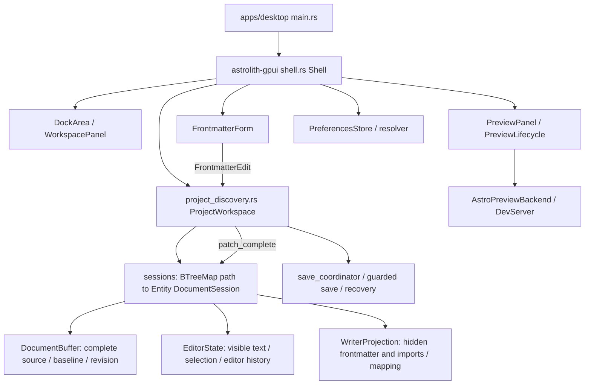

# 当前架构、保留矩阵与迁移边界

审计基线：2026-11-04，`244f3ee`，Rust workspace `0.1.0`。本文区分源码事实与拟议设计，不以旧计划或原型演示作为实现证据。

## 1. 已读取的事实来源

`README.md`、`AGENTS.md`、`Cargo.toml`、`Cargo.lock`、`mise.toml`、`docs/user/`、desktop 入口及下表模块。基线只保留用户文档，README/用户指南仍链接已删除的 `docs/technical/` 文档；M0 新增兼容索引，不恢复旧计划或虚构旧验收结论。

主原型：`astrolith-web-mock/src/App.tsx`、`src/index.css`，以及 `components/{top-bar,workspace-sidebar,writing-view,build-view,preview-view,external-preview,inspector,preferences-dialog}.tsx` 和 `components/ui/{button,input,tabs,dialog}.tsx`。本轮按源码分析布局与状态，未执行浏览器截图比对或原生窗口视觉验收。

## 2. 依赖与组件能力

| 项目 | 实际版本/证据 | 迁移含义 |
| --- | --- | --- |
| Rust / Node / Bun | `mise.toml`：1.99.1 / 26.12.1 / 1.4.4 | 继续通过 mise 任务；Cargo build/test/clippy 使用 `--locked` |
| GPUI Kit facade | `Cargo.toml`：`gpui-kit = "=0.8.1"` | 不升级依赖来迁就新文档 |
| Component / Base / Assets | `Cargo.lock`：0.8.1 | 通过 facade 引用；不新增直接框架依赖 |
| GPUI engine | `Cargo.lock`：`gpui-pre` 0.3.10；Kit 默认上游后端 | lock 中出现 gpui-fast 不等于应用选择 Fast |
| UI | 现有 `TitleBar`、`DockArea`、`DockSkin`、`EditorState`、`CommandState`、原生表单与 Sheet | 先组合已有组件，不逐个移植 React |
| 浮层 | pinned `gpui-component/src/popover.rs` 与 `gpui-base/src/popover.rs` | 已核对 controlled `open`、`on_open_change`、`PopoverState`、outside dismissal、焦点恢复；嵌套 Select/DatePicker 仍需交互验证 |
| 编辑器 | pinned `gpui-base/src/input/editor/`、`input/base/state.rs` | 行号/折叠/诊断接口存在，但应用当前 Writer 关闭代码辅助；API 存在不等于已集成 LSP |
| Astro 高亮 | pinned Kit Cargo features 有 `tree-sitter-astro` | 项目仅使用默认 features；需要核对启用范围和锁文件变化，不能宣称已有 Astro 高亮 |

本机 pinned source 位于 Cargo registry 的 `gpui-kit-0.8.1`、`gpui-component-0.8.1`、`gpui-base-0.8.1`；可移植审查应通过当前 `CARGO_HOME/registry/src` 定位，不硬编码开发者绝对路径。
Context7 已 resolve `/longbridge/gpui-kit` 并查询 retained state / Root / overlay focus 文档；当前文档仅为辅证，安装源码优先。参考 [Coding Guides](https://gpui-kit.com/docs/coding-guides.md) 与 [Design Guides](https://gpui-kit.com/docs/design-guides.md)。

## 3. 当前所有权与数据流

- `apps/desktop/src/main.rs` 初始化日志、Kit 与窗口，调用 `astrolith_gpui::open`，不应承担领域逻辑。
- `shell.rs::Shell` 保留 document、navigator、frontmatter、preview、preferences sheet、命令面板及 Dock 实体。当前左右 Dock 为 Library 和 Details，Preview 是按需挂载的底部 Dock。
- `project_discovery.rs::ProjectWorkspace` 管理项目代际、索引、watcher、active path、保留 sessions、恢复、保存与文件操作。它和 `shell.rs` 都较大；按责任迁移，避免同时做全文件拆分。
- `editor/session.rs::DocumentSession` 权威完整源为 `buffer`，Editor 只显示 `projection.visible`。输入经 diff/mapping 回写完整源。模式切换不能用 `show_source` 取代 session；该入口会创建 readonly Editor。
- `FrontmatterEdit` 经 Shell subscription 到 `ProjectWorkspace::apply_frontmatter_edit`，在最新源码上执行 lossless patch，再通知表单刷新；不是把表单旧快照写到磁盘。
- `runtime.rs` 使用 2 个 Tokio workers、4 个 blocking threads、2 个 blocking slots。沿用任务取消和结果身份校验；render 不读磁盘、不启动服务。
- `PreviewPanel` 保留 backend、surface、generation/lifecycle 和任务。`AstroPreviewBackend` 包装共享 DevServer；当前服务状态与面板实体保留在 Shell 中，不因底部 Dock 隐藏销毁。

## 4. v0.1.0 功能保留矩阵

矩阵中的“直接复用”是初步候选判断，不是冻结实现的承诺。实施前必须按 v0.2.0 目标重新评估；不合理、低效或妨碍目标的代码应重构或重写，同时保留有效能力和数据正确性。全部主 UI 必须迁移到 mock 的视觉体系；组件实体/交互机制可复用，旧 palette、serif 默认、Dock 外观和 chrome 不作为保留目标。

| 当前能力与源码 | 现状/限制 | v0.2.0 迁移方式 | 风险与验收 |
| --- | --- | --- | --- |
| Astro 5/6/7 discovery：`astrolith-astro/src/{discovery,config,pattern}.rs` | 保守静态发现，不执行任意配置推断 | 直接复用；供三模式同一项目使用 | 不可解析配置仍显示诊断；fixtures 验证 |
| 索引/监听：`astrolith-workspace/src/{index,watcher}.rs` | 有界刷新、同源合并、nested collections | 直接复用；导航改外观 | 旧代际不能覆盖新项目/dirty buffer |
| 文件导航：`project_discovery.rs`、workspace `list.rs` | collection/目录层级、映射标题、过滤/排序、counts | Writing 按需，Build 默认导航；保留筛选与路径身份 | 不是任意项目文件树；新导航必须真实接入 |
| 多文档 session：`editor/session.rs`、`project_discovery.rs` | 打开文件保留 editor/history，现用 document rail overflow 导航 | 模式共享同一 session registry；Build 加真实标签条 | 不重建 editor、不丢 dirty/selection/history |
| 读写：`file.rs`、document `buffer.rs`、`save.rs` | 项目条目可编辑；任意 Open file readonly，8 MiB/50,000 行上限 | 保留安全读写逻辑；项目内 `.astro` 开发文件编辑为必交付新增能力 | 不误称已有任意源码编辑 |
| Markdown/MDX/YAML：document `parse.rs`、`projection.rs`、`serialize.rs` | 隐藏 FM/imports，无损映射；不安全分隔时显示完整源并告知 | 复用完整源与映射；Build complete-source 展示需事务桥 | UTF-8、CRLF、隐藏字节、拒绝路径 |
| 光标/选区/Undo/Redo：`editor/session.rs`、pinned EditorState | 正文编辑/格式/replace 有 editor history | 保留 retained editor；新增统一完整源事务 | **FM-only 隐藏区域补丁未进入可见 editor history**；需 M4a |
| 写作：`editor/{writing_modes,writer_chrome,selection_toolbar}.rs` | sentence focus、typewriter、Markdown 装饰、计数与自动隐藏 | 复用机制；Writing 采用更安静布局，配置字体/行高 | 当前 focus 是句子，不能称为段落 focus；IME 要真机 |
| 格式/查找：`commands.rs`、`editor/formatting.rs` | find/replace、go-to-line、bold/italic/link/headings/comments | 原命令继续可达；模式按钮不抢编辑快捷键 | 保留一次操作一次 undo 与 key context |
| Copyedit：`editor/copyedit.rs`、document `copyedit/` | 离线英文词类分析，不是通用语法服务 | 保留开关、颜色和 debounce/过时代际拒绝 | Focus/主题变化不破坏装饰范围 |
| Schema：`astrolith-astro/src/schema/` | generated schema、helpers、validation、缺失/不支持诊断 | 原模型直接复用，不缩减字段种类 | 不执行任意 schema 猜测；刷新不覆盖编辑 |
| Frontmatter：`frontmatter/{mod,fields}.rs` | 动态 text/number/integer/bool/date/enum/tags/object/image/reference/literal/raw/refusal | 保留 FrontmatterForm 及字段 entities，只迁浮层 | defaults 仅创建填充；required/description/constraints 保留 |
| 元数据写回：`apply_frontmatter_edit`、document YAML/patch | 在最新完整源 patch，保留注释、顺序、未知值 | lossless patch 复用；以完整源 transaction 承载撤销 | 不全量序列化 YAML；明确不支持的值仍拒绝 |
| MDX builder：`editor/component_builder/`、astro `components/` | 静态 props、Starlight、client directives、tracked placeholders | 原 Dialog/命令保留，中性主题适配 | 当前 undo tag 留 import 是显式语义，不能顺手改变 |
| 资产/图片：`editor/{assets,image_preview}.rs`、workspace `assets.rs` | 安全复制、链接插入、Alt-hover、图片字段 | 复用服务；浮层中继续支持 picker 和错误提示 | 逃逸/同名/超时/晚到结果；clipboard 图片仍未支持 |
| 保存：`editor/{save_coordinator,save_failure}.rs` | 原子保存、冲突、idle autosave/10 s checkpoint、blur/switch/quit | 全模式使用同一 coordinator | 浮层抢焦点触发 SaveOnBlur，不得双重保存或丢更新 |
| 恢复：document `recovery.rs`、`recover_pending` | 脏编辑恢复、失败脱敏记录 | 入口保留；新事务同步 recovery revision | 不把模式切换当作丢弃/保存成功 |
| 预览：preview crate + GPUI `preview/mod.rs` | dev server start/stop/restart/retry、route、外部默认浏览器 | 服务原样复用；presentation backend 与 server backend 分开 | 模式切换不重启 server；失败保持编辑可用 |
| 设置：core `preferences.rs`、GPUI `settings/`、`preferences/` | global v2 / project v1 / collection overrides，atomic Apply/Cancel | 复用 resolver/store，新增模式/预览/写作字段 | 保留 unknown envelope、false/0、future-version readonly |
| 主题：`theme/{mod,palettes,tokens,typography}.rs` | system/light/dark、多 palette、UI size/font、editor size/width | 以 mock Neutral 与排版 scales 替换旧外观；旧配色选项不保留为兼容 UI | 显式迁移弃用的外观字段；fallback 尽量匹配 mock 字体度量 |
| Desktop：`commands.rs`、`desktop_actions.rs`、`single_instance.rs`、`url_scheme.rs` | 菜单、palette、IDE argv、fullscreen、协议、reopen | 共用命令注册表，增加模式命令 | Ctrl+B/I 已用于 bold/italic，不照搬 mock |
| Help/日志/更新：`help.rs`、`update.rs`、observability crate | bundled help、无遥测、受构建 capability 限制的签名更新 | 保留入口和脱敏；补文档导航兼容 | 无签名发布/安装证据时不声称发布可用 |

## 5. 目标架构与迁移规则

以下类型、字段和所有权分配是基于审计的起点，不是必须沿用的结构或当前已有 API。DocumentSession、ProjectWorkspace、Shell、WriterProjection、保存与设置模型均允许重新设计；最终选择须通过适配性与效率评估。三模式共享权威文档、历史一致性、数据安全和生命周期才是约束，旧实体类型、字段与模块边界不是约束。

1. 在现有 `astrolith-core::preferences`/GPUI `layout` seam 增加 `WorkspaceMode`（Writing/Build/Preview）和每模式布局偏好。纯布局策略不持有文档文本或 EditorState。
2. Shell 保留全局 chrome、mode、transient inspector open 与所有长期实体。ProjectWorkspace 继续管理 session registry、路径与服务上下文。模式只改变组合和 editor presentation；不走文件切换或项目重开路径。
3. Writing 隐藏 Dock chrome，中心列使用 token measure；Build 复用导航、session、命令与 Dock，按保存偏好展示工具；External Preview 保留编辑区，只显示紧凑 URL/状态/操作，不分配空白网页 pane。
4. 显示完整源码不能新建独立 buffer。先设计 WriterProjection 与 complete-source 的单一事务边界；可见坐标和源码坐标分开，保留 caret/selection 映射。仅改 `.line_number(true)` 不能完成 Build 源码模式。
5. FrontmatterForm 从 right Dock 移到 controlled Popover，保留实体与 subscription；临时可见性不落盘。字段 ID 用文档身份与 schema path；不以列表下标替代身份。
6. 统一 history 的 owner 应在 DocumentSession/文档事务 seam，覆盖 body 与 FM；不能维护两个可分叉 undo 栈。先做失败回归：body edit、hidden FM edit、undo/redo、并发保存与 schema refresh。具体桥接方案在 M4a 针对 pinned editor history 实证后确定。
7. 预览选择使用单独的 presentation preference；现有 `PreviewBackend` 指 dev-server 操作，不把它改成 External/Embedded enum。进程生命周期绑定项目，presentation 隐藏不销毁进程。

不要求新建所有建议组件同名文件。主 UI 仍为 Rust + GPUI；若职责拆分或状态机制调整能更合理、高效地达到目标，可以调整 crate/module 边界或替换原状态实现，但新增依赖必须有实际必要性。不要为保持旧路径或最小 diff 牺牲合理架构，也不要引入没有实际收益的框架。

### 复用评估与替换记录

每个涉及共享基础设施的阶段，在修改前记录受影响实现、具体缺陷、v0.2.0 需要的行为、选择复用/优化/重构/重写的理由，以及回归边界。已有测试用于理解行为，不能把偶然实现细节当产品契约。

重点评估完整源与可见投影的复制/diff 成本、history 事务边界、实体所有权、通知/重绘粒度、异步取消与过期结果、文件索引与监听批次、终端输出背压、服务阻塞和持久化写放大。发现性能疑点先测量代表性文档/项目，再选择必要改动；不凭代码外观宣称优化有效。

替换时先覆盖关键行为与错误路径，再迁移调用方并删除旧实现。允许有界的过渡适配，但必须有退出步骤；不长期保留两份权威状态。内部 API 和 alpha 配置结构可调整，有效用户数据及功能设置需要明确迁移，不以兼容旧内部实现为目标。

## 6. 设置与平台迁移

评估 `GlobalPreferencesV2` / `ProjectPreferencesV1` 与 store 是否适合新目标；允许重构字段、作用域和版本。简单增量可用 serde defaults，需要重构则实现明确迁移，不能为维持旧结构而堆叠字段。用户有效数据、未知字段处理与 future-version 防覆盖等安全语义须有方案和测试；旧类型和序列化实现不必保留。

新增计划：body font/line height、persisted focus/typewriter、default workspace mode、各模式布局、presentation backend、preferred browser argv、Open on Enter。已有 editor size/width 不重复定义。global 提供默认，project 可覆盖模式与布局；collection 原有覆盖语义继续不变。

旧 PanelLayout 仅用于识别并迁移旧配置，不恢复旧三栏构图；首次升级按 mock 初始化新模式布局，后续恢复新格式的模式偏好。Writing 初始关闭工具，旧 Inspector dock visibility 不转为自动浮层。旧 palette/旧默认 serif 与外观字段迁移为 mock Neutral 和排版默认，不保留兼容旧 UI 的切换入口；不删除用户原配置备份或文档数据。窗口尺寸变化后 clamp。模式切换不重置 default mode 设置；后续启动恢复优先项目 last mode，再 global default。

`embedded-webview = []` 当前只是空 feature，仓库没有真实嵌入实现。`capabilities.rs` 对 feature+X11/macOS/Windows 可返回 Embedded，**这不证明可渲染**。真实 Embedded 是必交付；M5 必须实现可运行 adapter 和实际 surface availability/reason，再启用设置，不能靠空 feature 或全平台 unavailable 宣称完成。Wayland（即使有 DISPLAY）永远保持 external；不修改显示服务器环境。

## 7. 必交付新增能力与所有权

- Astro 开发文件编辑：在 `ProjectWorkspace` 的真实项目文件导航中打开 `.astro` 源码，以 DocumentSession/DocumentBuffer 复用 dirty、history、save/conflict/recovery；源码不使用 Markdown frontmatter 投影。文件类型识别与内容集合身份分离。
- 交互终端：M2c 新增项目绑定的 terminal service/state 和 GPUI 原生终端视图。服务持有 PTY/子进程和有界输出，视图负责输入、ANSI 呈现、选择/复制与 resize；隐藏 Dock/换模式不杀会话，关闭/切项目/退出按明确策略清理。具体 PTY/终端库在实施时核对文档、锁定版本并论证依赖。
- Embedded：M5b 必须在至少一个明确支持的真实原生平台交付运行证据，保留实例并与现有 dev server 共享生命周期；Wayland 的受限平台 fallback 不构成整个功能的替代交付。

## 8. 风险排序

最高风险是统一 Undo/Redo、Writer/Source 投影切换、保存中的代际一致性。其次为浮层嵌套焦点与 IME、偏好迁移、主题适配与缩放。真实 WebView、`.astro` 开发文件服务和交互 Terminal 属于必交付新增能力，需独立可编译里程碑。完整 LSP 可另行扩展，但基础真实源码高亮和已有诊断不能用演示替代。Terminal 必须有 PTY、真实 shell 输入输出、resize、退出码与清理，不以 dev-server 日志或 IDE launch 代替。

现有 Help 链接测试在未改源码前失败，具体记录见 [ACCEPTANCE.md](ACCEPTANCE.md)。本次只补审计文档与文档兼容入口；所有功能差距仍留在后续里程碑，不在 M0 修代码。
