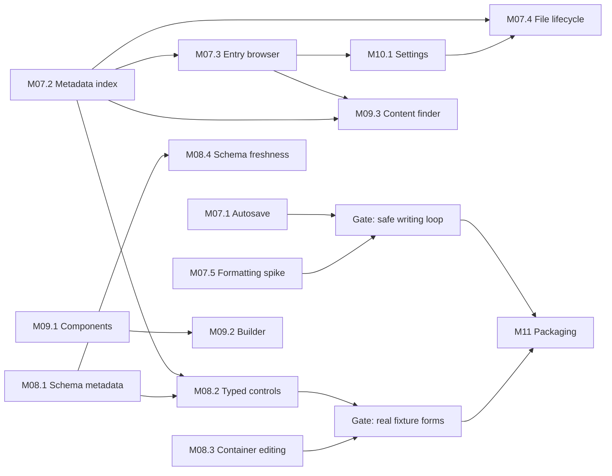

# Astrolith — Post-M06 Plan: Reference Comparison and Next Milestones

**Status:** proposal. Implementation requires user approval.
**Date:** 2026-10-31
**Basis:** Astrolith at `c003fa8`; reference project `dannysmith/astro-editor` at `413de88` (2026-10-30).
**Relationship to the original plan:** continues after M06. It expands and supersedes the alpha-only scope of M07 in `2026-10-28-astrolith-implementation.md`. M06.2 (embedded WebView) remains blocked on non-Wayland platform evidence and is not re-opened here.

The original product specification is still absent. This document derives scope from the implemented M00–M06 code, the original plan, and the reference project. It does not reconstruct the missing specification.

---

## 1. Current Astrolith state (verified in-tree)

| Area | Implemented today | Evidence |
| --- | --- | --- |
| Shell | GPUI Kit dock layout, light/dark/system theme, command palette, native menu bar, shortcuts, panel persistence | `crates/astrolith-gpui/src/{shell.rs,commands.rs,layout/,theme/}` |
| Project | Static Astro 5/6/7 discovery, literal `glob()` collections (md/mdx/yaml), bounded watcher, project generations | `crates/astrolith-astro/src/{config.rs,discovery.rs,pattern.rs}`, `crates/astrolith-workspace/src/{index.rs,watcher.rs}` |
| Editor | Retained per-document sessions, tabs, undo history, IME-capable GPUI Kit editor, Markdown highlighting | `crates/astrolith-gpui/src/editor/session.rs`, `layout/panels.rs` |
| Frontmatter | JSON Schema normalization (draft-07 and 2020-12), `image()`/`reference()` helper recovery, schema generation via `astro sync`, scalar form editing with lossless single-field patches, local validation | `crates/astrolith-astro/src/schema/`, `crates/astrolith-gpui/src/frontmatter/` |
| Persistence | Lossless parse/serialize, revisioned buffer, conflict-aware atomic save, one-writer-per-path, recovery store, startup recovery, exit flush | `crates/astrolith-document/src/` |
| Preview | Project-local Astro dev server lifecycle, route resolver, external browser, capability detection, Preview panel | `crates/astrolith-preview/src/`, `crates/astrolith-gpui/src/preview/` |
| Quality | Headless workspace tests, frozen Astro 5/6/7 fixtures, `mise run check`, three-OS CI workflow | `mise.toml`, `.github/workflows/ci.yml`, `fixtures/` |

The strongest assets relative to the reference are **save safety** (conflict detection, no overwrite, recovery across restarts) and **live Astro preview**. The largest gaps are **writing workflow** (autosave, file management, entry browsing) and **frontmatter form depth** (typed controls, arrays, references, images).

---

## 2. Reference product model

`astro-editor` is a Tauri 2 + React 19 + CodeMirror 6 application. Rust owns every filesystem operation; React renders and holds editing state. Its product philosophy is writer-mode only: no preview, no git/publishing, no code editing.

Its relevant mechanics:

- **Schema source:** generated `.astro/collections/*.schema.json` is authoritative; the Zod config is read only to recover `image()` and `reference()`. It also falls back to a Zod-only schema when JSON is missing.
- **Frontmatter:** all Zod types become controls, including arrays (tag input), nested object groups, reference dropdowns (including references to `file()` JSON data collections), image pickers with drag-and-drop copy into assets, descriptions, defaults and constraints. Unknown fields are never discarded and are shown as plain inputs after schema fields.
- **File manager:** collections, subdirectories, title/date/MDX/draft badges, filename+title filtering, draft-only filter, and sorting by default date, title, filename, last modified, every schema date field and `order`.
- **File actions:** new file with schema defaults, rename, duplicate, delete, reveal in file manager, copy path, open in IDE.
- **Writing loop:** autosave two seconds after typing stops, plus a forced save after ten seconds of continuous typing; save before switching files; failed-save recovery files.
- **MDX authoring:** discover components in a configurable directory, statically extract props for Astro/React/Vue/Svelte, insert MDX tags; bundled Starlight component metadata; content finder inserts internal links using per-collection URL patterns.
- **Preferences:** global, per-project and per-collection settings with three-tier fallback: content/assets/components directories, absolute-vs-relative image paths, default file type, title/date/description/draft field mappings.
- **Distribution:** signed macOS builds, Linux/Windows packages, updater, documentation site. macOS is officially supported; Linux and Windows are best-effort.

The reference deliberately has **no preview** and **no tabs**. Astrolith keeps both; these are not parity targets.

---

## 3. Feature comparison

Legend: **Ahead** = Astrolith stronger; **Parity** = equivalent outcome; **P1** = blocks a usable writing workflow; **P2** = valuable, not blocking; **Deliberate** = will not be copied.

### 3.1 Project and file navigation

| Capability | astro-editor | Astrolith | Verdict |
| --- | --- | --- | --- |
| Static collection discovery | `glob()` loaders, md/mdx; Astro 5 officially | Astro 5/6/7, literal globs, YAML data, negative patterns, diagnostics | **Ahead** |
| Dynamic/unsupported config | Falls back or ignores | Explicit diagnostics, no evaluation | **Ahead** (safety) |
| Collection/entry listing | Grouped by collection and subdirectory | Flat list labelled `collection / path` | **P1** |
| Entry metadata | Title, date, MDX + draft badges | None | **P1** |
| Filter / draft filter | Filename + title search, drafts-only toggle | None | **P1** |
| Sorting | Default date, title, filename, modified, schema dates, `order` | None | **P1** |
| New file | From collection/subdirectory with schema defaults | None | **P1** |
| Rename / duplicate / delete / reveal / copy path | Yes | None | **P1** |
| Open in external IDE | File, collection, project | None | **P2** |
| Multiple projects / recent list | Project registry with per-project settings | One project per run, global preferences only | **P2** |
| External change handling | Watcher + dirty-buffer protection | Watcher + fingerprint status + conflict-aware save | **Parity/Ahead** |

### 3.2 Editor and writing loop

| Capability | astro-editor | Astrolith | Verdict |
| --- | --- | --- | --- |
| Markdown source editing | CodeMirror 6, custom highlighting/typography | GPUI Kit editor, Markdown highlighting, retained undo/IME | **Parity** |
| MDX editing | Source preserved, JSX imports hidden, MDX badge | Source preserved, always Markdown grammar | **P2** |
| Tabs / retained sessions | Single open file | Multiple retained tabs | **Ahead** |
| Autosave | 2 s idle + 10 s max interval, save on switch | Manual save only; recovery debounce | **P1** |
| Save safety | Atomic write, dirty-wins, failed-save recovery files; no crash recovery | Conflict detection, atomic write, durable recovery, startup restore, exit flush | **Ahead** |
| Formatting shortcuts | Bold/italic/headings/lists/link insertion | None | **P1** |
| Focus mode / typewriter | Sentence dimming, centred cursor | None | **P2** |
| Copyedit parts-of-speech | Colour-coded NLP highlights | None | **Deliberate** |
| Image hover preview | Alt-hover preview for relative/absolute paths | None | **P2** |
| Typography | iA Writer Duo, adaptive size, hanging headings | Zed-inspired system theme | **Deliberate** |

### 3.3 Frontmatter and schema

| Capability | astro-editor | Astrolith | Verdict |
| --- | --- | --- | --- |
| JSON Schema dialects | Astro 5 draft-07 + 6/7 2020-12 | Same, tested against all three fixtures | **Parity/Ahead** |
| Helper recovery | Regex/brace parser; `image`, `reference`; nested limitations | Tree-sitter parser; wrappers, aliases, schema functions, collection selection; diagnostics | **Ahead** |
| Form field order | Schema order, title first | Alphabetical, title not first | **P2** |
| Scalar controls | Text/number/boolean/date/enum/email/URL | Generic text for text/number/integer/date/image/reference; native boolean and enum buttons | **P1** |
| Descriptions / constraints / defaults | Descriptions, defaults, min/max/length/pattern hints | Required + default in model; no descriptions/constraints; defaults not pre-filled | **P1** |
| Nested objects | Grouped, indented sections | Flattened with dotted paths | **Parity** (presentation gap P2) |
| Arrays | Tag input for text arrays; other arrays raw YAML | All arrays read-only | **P1** |
| Records / containers | Raw YAML fallback where unsupported | Read-only refusal | **P1** |
| References | Single dropdown, multi-select, data-collection targets | Plain text input; target collections known | **P1** |
| Images | Thumbnail, picker, drag-drop copy with naming/rules, clear | Plain text input | **P1** |
| Unknown fields | Shown, preserved, plain inputs | Not shown; preserved by lossless document | **P2** |
| No-schema fallback | Existing frontmatter keys shown as text | Inspector reports no schema | **P1** |
| Unsupported unions/literals | Coerced to text in some cases | Explicit read-only refusal, no coercion | **Ahead** (safety) |
| Schema refresh | Watches config and `.astro/collections` | Generates only on project open; no schema watch | **P1** |
| Validation | Constraints shown, not enforced; Astro build is final | Local validation engine + `astro sync` tooling validation; not surfaced in UI | **Parity/P2** |

### 3.4 MDX authoring, preview and platform

| Capability | astro-editor | Astrolith | Verdict |
| --- | --- | --- | --- |
| MDX component discovery | Configurable dir, four frameworks, local props/defaults/JSDoc | None | **P2** |
| Component builder/insertion | Form + MDX snippet with tab stops/slots | None | **P2** |
| Internal link finder | Cross-collection search, URL patterns, `{slug}` | None | **P2** |
| Dev server preview | Explicit non-goal | Server lifecycle + external browser + optional embedded capability | **Ahead** |
| Native menus/dialogs/shortcuts | Tauri menus, macOS-centric | GPUI menus, dialogs, cross-platform shortcuts | **Parity** |
| Packaging/releases/updates | Signed macOS, Linux/Windows packages, updater, docs site | CI build/test only; no artifacts, installer, updater or user docs | **P1 for alpha** |

---

## 4. Defects and mismatches found by the comparison

These are current-code facts, not missing roadmap items.

1. **Schema forms go stale.** `ProjectWorkspace::load_collection_schemas` runs only on project open (`project_discovery.rs`). `start_watcher` consumes `WatchBatch.changed` but never regenerates schemas, and `.astro/collections` is not registered by `CollectionWatcher::for_project`. Editing `content.config.ts` or regenerating schemas leaves the inspector on an old schema until the project is reopened. The reference watches both.
2. **Typed controls are mapped but not rendered.** `fields.rs` produces `Number`, `Integer`, `Date`, `Image`, `Reference`, `Text` variants, but `build_rows` renders every non-boolean, non-enum editable field as one Markdown-language `Editor`. Date has no picker, numbers are unvalidated text, references are free text, images are free text.
3. **No autosave or save-before-switch.** Saves are manual (`Save` command only). The recovery store protects content, but switching tabs/projects or quitting requires deliberate saves. The reference saves on idle and before switching.
4. **Entry browser carries no content metadata.** `EntryList` shows `collection / source path` and has no search, sort, draft, title or date. The index stores identity and path only.
5. **No file lifecycle.** There is no command or service to create, rename, duplicate, delete, reveal or copy paths. A project can only edit files that already exist.
6. **Schema field order is alphabetical.** `normalize_schema` sorts fields for determinism. The reference preserves declaration order and pins the configured title field first.
7. **No form when the schema is missing.** `FrontmatterForm` renders `No frontmatter schema is available`; the reference shows existing YAML keys as plain fields. Astrolith's lossless model already preserves them, so this is presentation, not data risk.
8. **Descriptions and constraints are dropped.** `Field` has only `name`, `required`, `default`, `kind`. `min`/`max`/length/pattern/`description` never reach the form.
9. **Containers are read-only.** `ControlKind::{Array,Record,Object-as-container}` refuse editing. Text arrays and simple objects are the common writer cases.
10. **Schema generation assumes an installed project.** `astro sync` runs only on open and requires project-local Node/Astro. Failure leaves forms unavailable without a fallback.

Known P2 limitations already recorded in milestone notes remain: per-keystroke whole-document re-parse, helper collection-selection heuristic, Astro tooling validation not surfaced, native save/recovery evidence pending.

---

## 5. Scope decisions

### Adopt

- Autosave with conflict-safe semantics and save-on-switch/close.
- Entry metadata, search/filter/sort, drafts, and full file lifecycle.
- Schema freshness, field ordering, descriptions/constraints/defaults, typed controls, tables.
- Array and simple object/record editing with the same lossless, refuse-not-guess posture.
- Reference and image pickers backed by the project index.
- Unknown-field fallback form.
- MDX component builder and content link finder.
- Project registry, per-project/collection settings, IDE integration.
- Packaging, user documentation and a release gate.

### Adapt

- **Autosave:** 2 s idle, 10 s maximum interval, disabled or paused on conflict/external change, serialized with manual save, recovery retained. Never auto-resolve a conflict.
- **Validation:** show constraints and Astro diagnostics, but do not silently block writes. Writer-mode default is save-and-report; a strict mode is out of scope.
- **Images:** copy into a configurable assets directory with deterministic naming; relative paths by default. Reject non-contained paths.
- **Preview:** remains a first-class Astrolith feature; do not adopt the reference's preview non-goal.

### Defer or reject

- Copyedit parts-of-speech highlighting (NLP dependency, low core value).
- iA Writer fonts and adaptive typography (design language is Zed-inspired).
- Bundled Starlight component metadata (maintain a generator only if the MDX builder ships).
- Telemetry, auto-updater, deep links, agent bridge (not required for the writer loop or alpha).
- Embedded Wayland WebView (blocked, M06.2).
- Code editing, git, publishing and deployment (outside writer mode).

---

## 6. Next milestones

Milestones are ordered by user-visible risk. M07 and M08 are the minimum shippable writing loop; M09–M11 follow.

### M07 — Safe writing loop and file management (P1)

#### M07.1 — Autosave policy

**Files**
- Create: `crates/astrolith-gpui/src/editor/autosave.rs`
- Modify: `crates/astrolith-gpui/src/project_discovery.rs`, `crates/astrolith-gpui/src/settings.rs`, `commands.rs`

**Interfaces**

```rust
pub struct AutoSavePolicy {
    pub idle: Duration,       // default 2 s
    pub max_interval: Duration, // default 10 s
}

pub enum AutoSaveDecision {
    Idle,
    SaveNow,
}

pub fn decide(
    dirty: bool,
    since_last_edit: Duration,
    since_last_save: Duration,
    policy: AutoSavePolicy,
) -> AutoSaveDecision;
```

Rules:
- Schedule from the existing `SessionChanged` event. Never touch the filesystem from `render`.
- Save through the existing snapshot/`save_snapshot`/`confirm_saved` path, not a second writer.
- Pause while a save is in flight, while the document is loading, and after `SaveOutcome::Conflict` until the user acts.
- Keep the recovery record current while dirty; clear it only on confirmed save.
- On failure, keep dirty, surface the error, and retry on the next idle window with a bounded backoff.
- Save on tab switch, project switch (already guarded) and quit through the same coordinator.

**Tests**
- Policy boundaries (idle, max interval, clean document, conflict latch).
- Edit during an in-flight save leaves the newer revision dirty.
- Conflict pauses autosave and does not overwrite.
- Failure keeps dirty and writes recovery.
- Switching tabs fails when the outgoing save fails; no silent loss.

**Acceptance:** typing and waiting 2 s writes the file; continuous typing saves within 10 s; a conflict never overwrites; native smoke on Linux Wayland.

#### M07.2 — Entry metadata index

**Files**
- Create: `crates/astrolith-workspace/src/metadata.rs`
- Modify: `crates/astrolith-workspace/src/index.rs`, `lib.rs`, `watcher.rs`

**Interfaces**

```rust
pub struct FieldMapping {
    pub title: String,       // default "title"
    pub date: String,        // default "date"
    pub description: String, // default "description"
    pub draft: String,       // default "draft"
}

pub struct EntryMetadata {
    pub title: Option<String>,
    pub date: Option<FrontmatterDate>,
    pub draft: bool,
    pub description: Option<String>,
    pub slug: Option<String>,
    pub modified: Option<SystemTime>,
}

pub fn extract_metadata(source: &str, mapping: &FieldMapping) -> EntryMetadata;
```

- Parse only the frontmatter block with the existing lossless parser; never read whole bodies for the list.
- Bounded per-entry read (existing 8 MiB cap), tolerant of malformed YAML; failures produce empty metadata plus a diagnostic.
- Index metadata in the same off-thread scan, incrementally on watcher batches.
- The interface accepts mapping from day one; M10 supplies the settings UI.

**Tests:** plain and quoted titles, coerce dates, naive dates, missing/wrong-typed fields, `draft: "true"` vs `true`, Unicode titles, nested paths, malformed frontmatter, mapping overrides, large files.

**Acceptance:** every indexed entry exposes title/date/draft; rescan cost stays bounded.

#### M07.3 — Entry browser

**Files**
- Create: `crates/astrolith-gpui/src/browser/mod.rs` (pure sorting/filtering), `browser/view.rs`
- Modify: `project_discovery.rs` (replace `EntryList`)

**Behavior**
- Collections and subdirectories as groups; entries show title (fallback filename), date, MDX badge, draft badge.
- Filter box matches filename and title, case-insensitive; drafts-only toggle.
- Sort menu: Default (configured date, newest first, undated first), Title, Filename, Last Modified, every schema date field, numeric `order`.
- Preserve selection and scroll while the index refreshes; keep panels mounted.

**Tests:** pure comparator/filter table tests covering ties, missing dates, drafts, Unicode, duplicates; headless selection across a refresh.

**Acceptance:** 1,000-entry fixture remains responsive; no UI-thread reads.

#### M07.4 — File lifecycle

**Files**
- Create: `crates/astrolith-workspace/src/files.rs`
- Modify: `astrolith-gpui/src/commands.rs`, `project_discovery.rs`, `crates/astrolith-core`

**Interfaces**

```rust
pub struct NewEntryRequest {
    pub collection: String,
    pub directory: Option<SourcePath>,
    pub extension: EntryExtension, // Md | Mdx
    pub initial_frontmatter: Option<String>,
}

pub fn create_entry(...) -> Result<CreatedEntry, FileOpError>;
pub fn rename_entry(...) -> Result<RenamedEntry, FileOpError>;
pub fn duplicate_entry(...) -> Result<CreatedEntry, FileOpError>;
pub fn delete_entry(...) -> Result<(), FileOpError>; // OS trash, confirmation fallback
```

- Validate containment against the collection base; reject traversal, symlink escapes and collisions.
- New files get schema defaults, a title placeholder and today's date; frontmatter is generated by the lossless serializer, not string concatenation.
- Rename updates identity, open session path, collection mapping and the entry index; refuse when dirty unless the user explicitly saves first.
- Delete moves to OS trash when available; always confirms; never deletes a dirty buffer silently.
- Operations run on the blocking lane and publish a new index revision; watcher events must not fight the local mutation.

**Tests:** defaults, extension choice, collision counters, traversal/symlink refusal, rename session retarget, delete-dirty guard, duplicate of nested entries, index/watcher reconciliation.

**Commands:** New entry, Rename, Duplicate, Delete, Reveal, Copy path — registered once and shared by menu, palette and keys.

**Acceptance:** create, write, rename, duplicate and delete entries against a fixture project without leaving stale tabs or index rows.

#### M07.5 — Formatting commands and editor capability spike

**Files**
- Create: `docs/technical/editor-capabilities.md`, `crates/astrolith-gpui/src/editor/formatting.rs`
- Modify: `commands.rs`, `editor/session.rs`

**Spike first (gate):** verify in the pinned GPUI Kit sources and a real window:
- selection and cursor replacement with undo grouping;
- cursor-change/scroll APIs needed for typewriter mode;
- decoration/inline-style APIs needed for focus mode and image hover;
- MDX grammar availability.

Implement only what the spike proves. Formatting transformations (bold, italic, heading 1–4, list toggle, link wrap) must be pure functions over `(text, selection)` and unit-tested. If focus mode/image hover have no supported API, record the limitation and defer; do not fork the editor.

**Tests:** pure transformations, undo behavior in a headless editor, IME composition regression.

**Acceptance:** shortcuts modify the documented range; one undo restores; no IME regression.

---

### M08 — Frontmatter parity (P1)

#### M08.1 — Schema metadata and field order

**Files:** `crates/astrolith-astro/src/schema/{model.rs,parser.rs,tests.rs}`

- Extend `Field` with `description: Option<String>`, `constraints: FieldConstraints { min, max, min_length, max_length, pattern }`, and `default`.
- Preserve `properties` declaration order (enable `serde_json/preserve_order` or parse into an ordered map); remove the alphabetical sort.
- Add schema-level `title_field` selection later in M10; the form pins a configured title first.
- Keep diagnostics deterministic without re-sorting fields.

**Tests:** both dialects, constraint mapping, order stability across `cargo test -p` and `--workspace`, unsupported constructs still diagnosed.

#### M08.2 — Typed native controls

**Files:** `crates/astrolith-gpui/src/frontmatter/{fields.rs,mod.rs}`

- Number/integer: numeric input with min/max/step.
- Date: GPUI Kit `DatePicker` (`gpui-component/src/time/date_picker.rs`), storing YAML date strings.
- Enum: select/combobox instead of a button row for large enums.
- Reference: searchable combobox from the metadata index, writing the entry id; single and array-of-references.
- Image: thumbnail preview, path edit, picker, clear; copy/normalize rules live in M08.6.
- Description: multi-line textarea driven by schema description.
- Show required marker, help text and constraint hint under each field.
- Astro tooling validation and constraint diagnostics are displayed, but saving is not blocked by default.

**Tests:** control selection per kind, reference labels (title/name/slug/id fallback), date round-trip, min/max rejection in the pure parser, no text coercion for unsupported kinds.

#### M08.3 — Container editing

**Files:** `crates/astrolith-document/src/{parse.rs,serialize.rs}`, new `crates/astrolith-document/src/yaml/` module

- Add byte-span support for block sequences of scalars, then block sequences of simple mappings.
- Provide `set_sequence`, `insert_item`, `remove_item` operations that splice only the affected block, preserving comments and untouched keys.
- Flow collections, anchors, tabs, complex keys and unsupported structures keep the current explicit refusal.
- Complex arrays/records fall back to a validated raw-YAML editor that refuses to write invalid YAML, rather than dropping the field.

**Tests:** round-trip equality, inserted item formatting, comment preservation around the edited block, refusal paths, CRLF, nested sequences.

#### M08.4 — Schema freshness

**Files:** `crates/astrolith-astro/src/schema/generation.rs`, `crates/astrolith-gpui/src/project_discovery.rs`, `crates/astrolith-workspace/src/watcher.rs`

- Watch `content.config.*` and `.astro/collections/` (register the directory even if created later).
- Debounce and regenerate off-thread; apply only when the project generation and index revision still match.
- Preserve the current form when regeneration fails; surface a stale/failed diagnostic and a `Regenerate schemas` command.
- Do not clobber in-progress field edits; the form refreshes on the next document load or explicit refresh.

**Tests:** config-change triggers one generation, schema-watch triggers reload, stale result rejected after project switch, failure keeps the previous schema, malformed schema file is diagnosed per collection.

#### M08.5 — Unknown fields and no-schema fallback

- Render frontmatter keys absent from the schema after schema fields, alphabetically, as plain text or text-array controls.
- When no schema exists, render existing keys instead of the current placeholder.
- Never discard unknown keys; the lossless document remains the source of truth.

**Tests:** unknown fields preserved through edits, no coercion of quoted values, empty/no frontmatter, invalid YAML message.

#### M08.6 — Image insertion

**Files:** `crates/astrolith-workspace/src/assets.rs`, frontmatter Image control, editor paste/drop handler

- Copy picked/dropped files into the configured assets directory; lowercase, dash, strip unsafe characters, prepend date, add `-N` on collision.
- Insert Markdown image or link with a path relative to the source file; absolute mode is a setting.
- Validate source size and type; refuse paths outside the project.
- Drag/drop in the editor is gated on the M07.5 capability spike; the image field picker does not depend on it.

**Tests:** naming, collisions, Unicode, relative path computation, rejection of directories/oversize files.

---

### M09 — MDX authoring and links (P2)

#### M09.1 — Component discovery and props

- New `crates/astrolith-mdx/src/{discover.rs,props.rs}` using tree-sitter (TypeScript/TSX, Vue, Svelte grammars), no project execution.
- Read a configurable components directory; support Astro frontmatter props, React typed params/`FC<Props>`, Vue `defineProps`, Svelte `export let`/`$props()`.
- Resolve local interfaces, aliases, string enums, `keyof typeof`, intersections and `extends`; ignore inherited DOM attributes; extract defaults and JSDoc.
- Unresolved props become text fields; parse failures still list the component.
- Fixture components for every framework and prop kind; golden tests.

#### M09.2 — Component builder and insertion

- Command opens a builder for the current MDX file; form fields per prop.
- Generate MDX syntax: quotes, braces escaping, `\n` for newlines, required empty props as tab stops, slot components as blocks with surrounding blank lines.
- Insert at cursor with one undo step; refuse in `.md`.
- Tests for snippet generation and slot/block rules.

#### M09.3 — Content finder

- Search all collections by title/filename; Enter opens, Cmd/Ctrl+Enter inserts a link.
- Per-collection URL pattern with `{slug}` resolving to the `slug` field or entry id; default relative file path.
- Tests for pattern expansion, missing slug, escaping, and cross-collection search.

---

### M10 — Project settings and integrations (P2)

#### M10.1 — Project registry and scoped settings

- Persist recent projects and last opened entry; safe switch under the existing dirty guard.
- Three-tier settings: global, project, collection. Fields: content dir, assets dir, MDX components dir, absolute image paths, default file type, title/date/description/draft mappings, link URL pattern.
- Validate configured paths against discovery; a bad override is a diagnostic, not a crash.
- Settings UI in a Preferences window; migration from the current flat preferences file with the existing `version` field.
- Tests: fallback precedence, migration, invalid paths, corrupt settings preservation.

#### M10.2 — IDE integration

- Single executable command (no shell), validated path, open file/collection/project.
- Commands appear only when configured.
- Tests: command parsing rejection (`&&`, flags), containment, spawn failure reporting.

#### M10.3 — Data collections as reference targets

- Parse `file()` loaders pointing at JSON arrays; expose items with `id`/`slug` and a display name to reference pickers.
- Keep YAML data entries editable as raw text; do not add a schema form for them yet.
- Tests: JSON array shape, missing ids, malformed JSON, non-array refusal.

---

### M11 — Distribution and alpha (P0 for shipping)

#### M11.1 — CI matrix and packaging

- Keep build/test on Linux, macOS and Windows; add packaging per OS (Linux `.deb`/AppImage, macOS `.app`/`.dmg`, Windows MSI or portable zip).
- Build with `--locked`; run `mise run check` on every platform.
- Native GUI smoke on at least one runner per OS where the runner provides a display; otherwise document manual evidence.
- No updater or signing in the first alpha unless explicitly approved.

#### M11.2 — User documentation

- Installation per platform, Mise setup, task reference, Astro compatibility matrix (5/6/7 with documented limits), data safety/recovery, preview configuration, known platform limits.
- Publish from `docs/` or a small static site; no marketing site.

#### M11.3 — Alpha gate

- All P0 tests pass; no known silent data loss.
- Create/edit/rename/delete/save/recover round-trip on a real Astro fixture.
- Linux Wayland native smoke; external browser preview updates after save.
- Artifact starts on each supported target.
- Documented unsupported features and remaining defects.

---

## 7. Sequencing and gates



- **G1 — Safe writing loop:** autosave, file lifecycle and formatting work natively; no silent loss.
- **G2 — Real fixture forms:** every schema field in `astro5`/`astro7` fixtures is representable (editable or explicitly refused); unknown fields survive.
- **G3 — Alpha:** M11 gate.

Ordering constraints:
- M07.1 and M07.2 can proceed in parallel.
- M07.3 and M07.4 depend on M07.2.
- M08.2 depends on M08.1 and M07.2 (references).
- M08.3 is independent and may run in parallel, but must not delay G1.
- M09.3 and M10.1 depend on M07.2.
- M11 depends on G1 and G2.

---

## 8. Risks

| Risk | Impact | Mitigation |
| --- | --- | --- |
| GPUI Kit editor lacks decoration/cursor hooks | Focus mode, image hover, typewriter infeasible without a fork | M07.5 spike first; defer unsupported features; never fork |
| Autosave + conflict interact badly | Overwriting external changes or losing revisions | Pause on conflict, reuse revisioned save coordinator, dedicated tests |
| YAML sequence editing corrupts formatting | Data loss | Extend the lossless model with spans; refuse unsupported shapes; round-trip tests |
| Metadata scan cost on large projects | Slow opening/refresh | Frontmatter-only bounded reads, incremental watcher updates, perf fixture |
| Schema regeneration races edits | Lost form edits | Generation/index guards, refresh only on document load or explicit command |
| Reference/image controls write wrong values | Broken content | Typed patch contract, validators, id-only writes, path containment |
| MDX prop extraction complexity | Misleading forms | Static, best-effort extraction; unresolved props as text; golden fixtures |
| Cross-platform native evidence missing | Unsupported claims | Keep acceptance evidence separate; CI matrix is not native proof |
| M06.2 remains blocked | No embedded preview on Wayland | External preview remains the supported path |

---

## 9. Verification protocol

Every task ends with:
1. Focused unit tests for new pure logic.
2. `mise run check` (doctor, fmt, lint, build, workspace tests, fixtures).
3. `mise run test:fixtures` where discovery/schema behavior changes.
4. A bounded native smoke when the GUI surface changes; headless tests are not native evidence.
5. One conventional commit per task.

Milestone gates additionally require:
- A real Astro fixture edit/save/recover round-trip.
- Review of no-UI-thread-I/O and no-blocking-I/O invariants.
- Updated progress note under `docs/technical/`.

---

## 10. Evidence

Reference repository at `413de88`:

- `README.md` — feature list and supported Astro versions.
- `docs/developer/architecture-guide.md` — Tauri/React split, state, boundaries.
- `docs/developer/schema-system.md` — JSON schema + Zod helper merge, nullable handling, known gaps.
- `docs/developer/editor.md` — autosave, dirty-wins, round-trip requirement.
- `docs/developer/mdx-components.md` — static prop extraction and insertion rules.
- `website/src/content/docs/frontmatter/field-types.mdx` — control matrix, constraints, references, images.
- `website/src/content/docs/file-management/overview.mdx` — sidebar, badges, context menu, new files.
- `website/src/content/docs/file-management/drafts-filtering-and-sorting.mdx` — filters and sort options.
- `website/src/content/docs/editor/overview.mdx` — autosave timing and typography.
- `website/src/content/docs/preferences.mdx` — three-tier settings.
- `website/src/content/docs/getting-started/philosophy.mdx` — writer-mode scope and non-goals.

Astrolith evidence is cited inline in section 1 and section 4.

---

**End of post-M06 plan (proposal).**
