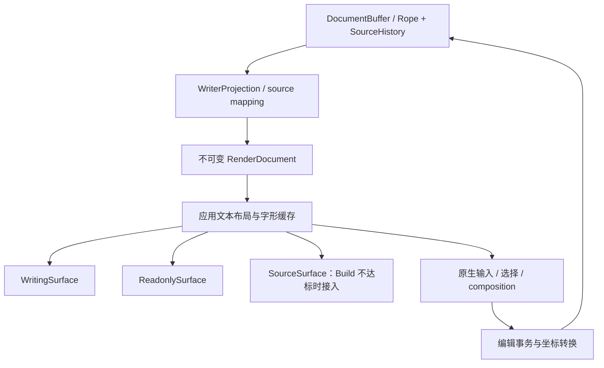

# 编辑器性能优化实施方案

- 日期：2026-11-06。
- 基线提交：`8c9d7f3`（依赖升级）、`c54783f`（新版本性能诊断）。
- 依赖基线：GPUI Kit/base/component 0.9.0、gpui-pre 0.3.11，全部使用发布包。
- 状态：M0–M4 已实施并产出原生证据（见 [M0/M1 结果](editor-performance-m0-m1-results.md)、[M2 结果](editor-performance-m2-results.md)、[M3 结果](editor-performance-m3-results.md)、[M4 结果](editor-performance-m4-results.md)）；Writing 与 Preview 已切换到自有布局，Build 仍走现有实现。M5 已按触发条件评估并保留现有输入桥（见 [M5 决策](editor-performance-m5-decision.md)）。M6 已完成 stock Editor 评估并实现、验证 `SourceSurface` 的帧预算；因 LSP 浮层、折叠与搜索等能力仍未接入，Build 默认继续使用 stock Editor（见 [M6 决策](editor-performance-m6-decision.md)、[SourceSurface 结果](editor-performance-m6-source-surface-results.md)）；M7 未开始。
- 目标环境：首先解决用户实际运行的 `mise run dev` 与 Hyprland/Wayland 场景；release 和其他平台单独验收。

## 1. 决策与范围

### 1.1 推荐路线

保留 GPUI Kit 的窗口、Dock、菜单、设置和普通控件。先做 GPUI Fast 与生命周期修正的低成本验证；仍未达标时，文档内容区逐步采用应用自己的文本布局层，直接使用 GPUI 文本系统。进入该深迁移分支后，Writing 与只读 Preview 共用布局、字形与命中几何。

实施顺序为：

1. 固化可重复基线，先对公开 feature 启用的 GPUI Fast 做 A/B，并验证 dev 字体栈优化的收益。
2. 修正节点生命周期与无效刷新，先减少现有路径的重复工作。
3. 如果 GPUI Fast 与生命周期修正仍未达标，再验证长段落内部虚拟化与 GPUI 原生文本绘制的可行性。
4. 让 Writing、Preview 逐步退出 Kit 的 `TextView` / `editor_host` / `InlineFlow` 热路径。
5. 在渲染稳定后决定并实施 Writing 输入模型迁移，使用已有 Rope、SourceHistory 与原生输入协议。
6. 对 Build 做独立验收；现有 Editor 达标则保留，不能达标则实现共用布局内核的源码视图。

**先验证后端与生命周期收益；需要深迁移时，先替换富文本渲染路径，再处理输入内核。** Writing 目前没有挂载 Kit Editor 控件，Preview 也没有；仅替换 Build 的 Editor，不能消除另外两个模式的热点。

### 1.2 约束

- 不恢复 `vendor/`、`[patch.crates-io]`，不修改 Cargo registry 源码。
- 使用当前锁定版本公开 API。Context7 用于查文档，最终以对应版本 registry 源码为准。
- 保持 Markdown/MDX 源码、frontmatter、import、换行形式与保存语义；排版优化不得插入实际换行或重新序列化正文。
- 不以降级字体、移除样式、关闭 IME、隐藏光标或减少功能作为默认性能方案。
- 不改造真实 Astro 浏览器预览、终端、LSP 服务架构、项目索引和冻结的兼容性 fixture；Build 视图迁移必须保留其现有接入行为。
- 本方案遵守现有文档大小边界：`MAX_DOCUMENT_BYTES = 8 MiB`；不顺带提高保存上限。
- 已完成的 Rope 快照、局部 source splice、SourceHistory、局部字数统计、后台解析合并和模式模型保留继续复用。

### 1.3 完成的定义

性能达标、编辑语义正确、原生交互验收通过，三项同时成立才算完成。Writing/Preview 可以先作为独立里程碑交付；如果 Build 仍不达标，整体性能任务仍保留未完成项。

移除 `EditorState` 不是性能完成条件。它是消除重复编辑状态的后续架构步骤，必须有独立的收益与功能验收，不能代替渲染热点修复。

## 2. 已确认的事实与待验证项

详见 [0.9.0 性能诊断](editor-bottlenecks-0.9.md)。以下数值来自同一个 102,420-byte 混合 CJK/emoji 长段落，三个模式分别启动原生进程；采样包含 profiler 开销。

| 模式 | 已确认热点 | 主线程采样证据 | 最慢 CPU 布局样本 |
| --- | --- | --- | --- |
| Writing | Inline 布局缓存交接与缓存表扫描；范围查询 | `retain_styled_text` 61.11%；混合布局的 `slice_ranges` 7.14%；最热指令定位到 `inline.rs:481` 的 `HashMap::retain` | 610.066 ms |
| Preview | 重复合并已累计的高亮范围、样式复制与分配 | `combine_highlights` 20.93%；混合渲染分支存在逐子节点重合并 | 6,176.236 ms |
| Build | 可见源码行内部仍整体整形 | 已解析出的字体解析、查找和整形函数约占 47.19% | 2,548.843 ms |

应用侧还存在两个确定的放大因素：

- `WriterSurface::render` 每帧创建 Paragraph/BlockNode，交互与布局身份不能稳定保留；光标闪烁也会通知该面。
- 当前虚拟化主要以 block 为边界。一个可见的超长 block，仍然包含大量屏幕外行和样式片段。

以下事项需要验证，不能提前当成结果：

- 字体栈 dev 优化级别从默认值提高到 3，能改善多少冷整形开销。
- 修正节点保留后能减少多少工作；这不会自动消除上游缓存表扫描。
- 超长双向文本、无空格文本和远端随机跳转，在限定布局预算下能多快获得准确几何。
- 新布局的缓存内存、跨平台字体回退与原生输入协议的实际行为。

历史报告中的 patched、unpatched、0.8.1、0.9.0 数值应分别保存，不能拼成一次受控 A/B。

### 2.1 GPUI Fast：先验证，再决定重写规模

**结论：有帮助的候选，但在 Astrolith 中尚未实测。** 当前诊断数据全部来自默认 gpui-pre 后端。GPUI Fast 优化 GPUI 的保留式视图、布局节点与文本测量复用，以及滚动层；它不是新的 Markdown 编辑器。

截至本次核对，锁文件已包含兼容的 gpui-fast 0.1.13，GPUI Kit 0.9.0 的公开 `gpui-fast` feature 会统一切换启用的 Kit 层。接入不需要恢复 vendor、git patch、额外直接依赖或修改应用 import。

| 场景 | 预期价值与验证重点 |
| --- | --- |
| 不变窗口、独立 caret overlay、未变化的周边面板 | 优先验证，减少重复 render/layout/prepaint/paint 的机会最大 |
| warm 滚动和稳定视图复用 | 验证保留布局与滚动缓存是否减少本应用工作量，不能套用官方 gallery 的百分比 |
| 首次复杂段落、内容/字体/宽度变化 | 新内容与失效布局仍需准备；不能假设消除冷排版、范围合并或整行 shaping |
| Hyprland fullscreen/tiled、focus、拖动 | 必须独立测；保留模式对 refresh/resize 有适用边界，不能根据 idle 成绩推断缩放已解决 |

本项目已采样的缓存表清扫与累计高亮合并位于 gpui-base，而不是 gpui-pre 的底层 Taffy 重建。切换 Fast 后仍会编译同一版高层文本算法；避免重复执行可能有收益，但不能把算法热点视为已修复。

A/B 必须满足：

1. 保持同一 source、Kit 版本、字体、窗口/缩放、fixture、构建配置和动作序列；cold 与 warm、dev 与 release 分开。
2. 对等优化：当前 profile 给 gpui-pre 配置了 opt-level 3，却没有给 gpui-fast 配置同等优化。比较时必须对齐实际后端与相同字体栈的优化级别，记录新增编译时间。
3. 分离构建产物，记录 lockfile、feature 图以及运行时 `gpui_kit::GPUI_FAST`；图中仍有上游 package 不等于正在用默认类型，Kit 的 feature 是全图叠加选择。
4. 开启可选嵌入 WebView 时同步启用其 `gpui-fast` feature，并验证 overlays、focus 和输入。不能把两套 GPUI 类型混用。
5. 审查 `Rc<RefCell<_>>`、Cell、timer、geometry 和 prepaint 写入的失效通知。Fast 依赖跟踪不能自动感知所有内部可变状态；少通知会留下旧画面，多通知会抵消保留收益。
6. 先测当前结构，再在 M1 拆分内容与 caret/overlay 后复测。Fast 不能替代清理每帧变化、每帧无条件通知的状态。
7. 上游仍将 Fast 标为 experimental；只按本应用的功能、IME、resize、稳定性与资源数据作采用决定，不提前切默认后端。

**决策门：** 如果 Fast + M1 已通过本方案全部性能与行为目标，可以保留现有高层组件，记录达标范围并停止无收益的深迁移。若只改善 warm/idle，就保留已验证收益，M2–M4 继续处理仍不达标的冷长块场景。Fast 是否采用与是否自有文档布局是两个可分别决定的问题。

依据：[Kit 0.9 接入文档](https://gpui-kit.com/docs/getting-started/#use-gpui-fast)、[Fast 保留模式设计](https://github.com/longbridge/gpui-fast/blob/main/docs/retained-mode.md)、[项目说明](https://github.com/longbridge/gpui-fast)。`compat/README.md` 中旧式 patch 示例不是本项目 0.9.0 的接入方式。实际发布版行为仍须核对锁定源码与原生 A/B。

## 3. 性能目标与计量口径

下表是**实施目标，不是当前已达到的指标**。以同一设备、字体、缩放、窗口尺寸与构建配置验收；达不到时保留失败记录与具体阻塞项。

| 指标 | 初始验收目标 | 计量边界 |
| --- | --- | --- |
| 普通输入的 source 事务处理 | p95 ≤ 4 ms | 输入适配到 source/history/count 更新；不冒充显示延迟 |
| 输入到第一个正确可见反馈 | p95 ≤ 50 ms | 提交字符或 IME preedit 的可见反馈；另测完整富文本收敛 |
| warm 滚动、局部编辑、模式切换后的帧 CPU | p95 ≤ 16.7 ms，p99 ≤ 33 ms | request-layout → prepaint → paint；不含 compositor presentation |
| 模式命令处理 | p95 ≤ 4 ms；可见模式变化 ≤ 50 ms | 分别记录命令排队、handler 与下一次正确绘制 |
| Hyprland 连续缩放 | 帧 CPU p95 ≤ 16.7 ms，p99 ≤ 33 ms | 三种模式分别测；不出现 ≥ 100 ms 的已知同步工作段 |
| 冷打开 | 100 ms 内出现可用文档视口；目标 250 ms 内完成首屏准确排版 | 将文件读取、解析、字体准备、首屏分别计时；允许屏幕外逐步细化 |
| 光标闪烁/主题仅改色 | 不重新解析、合并全文样式或重塑整段字形 | 用计数器与采样证明工作未发生 |
| 缓存生命周期 | 文档关闭后可归属的布局缓存释放；重复循环不持续增长 | 统计应用缓存账本与 RSS；RSS 不要求立即回到相同字节 |

这些目标首先用于指定 fixture 的冷启动与稳定阶段，不能推导出任意 Unicode 输入都满足 16 ms。单次 GPUI shaping 调用不能被时间预算中途打断，必须同时限制合法 shaping 单元的大小。

p95/p99 必须来自全部事件/帧的有界直方图或完整样本，不能仅统计旧探针中大于 8 ms 的慢帧。冷文件打开以窗口可接收的 entry 激活请求为零点；冷进程的创建窗口、GPU 初始化和首帧时间另列，不从报告中省略。

比较 dev 与 release 时分别出表。不能只用 release 的改善来宣称 `mise run dev` 已解决，也不能把带 profiler 的帧时间作为无 profiler 的最终性能值。

## 4. 目标架构与状态所有权

下图描述进入深迁移分支后的目标。若 Fast + M1 已完整达标，保留现有实现并记录决策，不为符合图示而重写。

图中名称是**拟议职责**，不是现有 API 声明。先在现有 feature 内实现，职责稳定后再决定文件与类型边界，不预先建立空 crate 或通用编辑器框架。

| 所有者 | 负责 | 不负责 |
| --- | --- | --- |
| `astrolith-document` | 权威源码、事务、历史、纯文本索引、投影与 source map、解析和样式区间规范化 | GPUI Entity、字体系统、窗口几何 |
| `DocumentSession` | 文档身份、服务接入、修订号、模式/视图协调、保存与恢复入口 | 每帧重新构造整份文档或对全文布局 |
| 不可变阅读模型 | block、语义结构、文字、规范化样式、源映射、链接/图片等元数据 | 可变选择、滚动、光标 timer |
| 应用布局层 | 断行索引、可见 visual rows、字形、范围查询、命中几何、缓存预算 | 编辑权威文本或保存文件 |
| Writing 输入状态 | anchor/focus、composition、输入协议、编辑命令 | 第二套权威全文与第二套 undo |
| Preview 选择状态 | 只读选择、链接激活、复制、键盘阅读导航 | 修改 source、注册可编辑输入行为 |
| 视图状态 | 各模式自己的滚动锚点、页宽、活动选择与 viewport epoch | 用像素偏移替代文档位置 |

### 4.1 线程与 GPUI 阶段

- Worker：纯 Rope/字符串索引、Markdown/MDX 解析、样式规范化、source map、初始高度估计。
- UI 线程：GPUI 字体解析/整形入口、Entity 更新、窗口几何、命中、绘制与原生输入注册。
- gpui-pre 0.3.11 的 `Window::text_system()` 返回 `Rc<WindowTextSystem>`。不能把它作为 Send 对象交给 worker，也不能凭异步函数签名假定 shaping 已离开 UI。
- `request_layout` 声明尺寸约束；`prepaint` 使用当前 bounds 放置已准备的行、补做受预算限制的 shaping 并建立命中/IME 几何；`paint` 复用同一份行布局绘制。
- 不在 `paint` 内补做解析、样式合并或整段整形。绘制背景、字形、装饰和命中必须使用相同修订的几何。

### 4.2 样式与语义模型

新增阅读模型应优先适配现有 `WysiwygDocument`、`RichText`、`SourceSegment` 与 Markdown AST，而不是立刻另写一个 parser。

必须先补齐 Writing 与 TextView 的语义差异矩阵：标题、强调、行内代码、引用链接/图片、列表、引用、代码块、表格、脚注、HTML/MDX 和未知节点。当前 Writing 模型的能力不能直接视为 Preview 的完整替代。

样式在 worker 上一次性规范化为有序、非重叠 run，明确嵌套样式的优先级。使用事件排序/扫描合并，避免每个子节点重新合并全部前缀。颜色等纯绘制属性与影响字体度量的属性分开管理。

未知节点保留原始 source 范围并沿用已明确的安全展示策略；不得为通过性能测试而静默丢弃内容或把完整 Markdown 降成无样式文本。

## 5. 核心难点：长 block 内部虚拟化

### 5.1 分开语义块与排版单元

一个 Markdown 段落仍是一个语义块；内部可以有很多 visual rows、文本 run 和 shaping 单元。

- 排版单元的拆分不得写回 source，也不得重新切割 Markdown 后再解析。
- 段落内只为可见行及有限 overscan 创建绘制工作，不为每个屏幕外片段创建 Entity 或 Kit Inline。
- 代码块按源码行和必要的行内窗口处理；列表标记、引用边线属于块语义；表格保留行列结构，不按字符串页粗切。
- 图片、行内原子对象保留对象身份与 source 范围；尺寸确定后仅使相关排版区域失效。

### 5.2 准确几何与渐进计算

“只画可见行”不等于可以免费找到任意段落的第 N 行。实际断行依赖字体、字形 advance、宽度、tab、代码背景 inset 与双向文本上下文。

实施要求：

1. worker 建立纯文本边界、换行候选与 source 索引；字体相关断行在 UI 布局阶段完成。
2. 保留按 block/width/style 修订的断行检查点和已测量区域；同一视口优先复用已有结果。
3. 先处理视口、活动 caret/composition 附近，再细化屏幕外内容。初始高度使用估计值，不先测量整份文档。
4. 不假定任意字节位置可成为独立 shaping 起点。必须在合法字素、字体 run 和必要上下文边界上切分，保留连字、阿拉伯连接、组合字符、bidi 与 tab 的正确行为。
5. 冷打开、Ctrl+End、查找跳转与拖动到远端必须有独立实验。没有有效检查点时不能承诺 O(1) 获得准确位置；需要允许逐步计算并优先准备目标区域。
6. 待计算区域不能伪造准确 hit-test/IME bounds。保留最新已验证视口；目标几何完成后作为一致快照发布，期间仍处理命令和输入事务。
7. 不通过额外插入可见硬换行来制造“独立段落”。如果增量断行算法不能在正确性与预算间同时成立，M2 不通过，先修算法再接入产品。

超长单词、代码/URL、CJK 无空格、bidi 段落和组合序列是可行性验证的必测项，不能只用有空格的英文段落证明完成。

### 5.3 UI 工作预算

初始调试预算取每次可调度布局工作约 4 ms，单个恢复任务不超过约 8 ms；以实测调整。时间预算与输入规模上限同时使用，不能在一次长 shaping 调用之后才发现超时。

若预算不足，结束当前批次并安排后续帧。过时的 width/style/document epoch 结果直接丢弃；快速缩放只保留最新待处理宽度，不能排队处理每个历史尺寸。

overscan 初始限制为视口前后各半屏。增加 overscan 必须给出滚动时命中率与内存收益，不能扩大成全文布局。

### 5.4 高度索引与滚动锚点

- 使用 source/block 身份定位滚动位置；锚点包含 block、源位置与视口内偏移。
- 高度索引支持局部高度更新与前缀位置查询；可以采用 Fenwick tree 等简单结构。不能每帧重建所有 block 的前缀和。
- worker 可构建纯数值的初始估计索引；UI 接收后更新已测量项。
- 宽度变化让旧精确高度降为估计，不把未访问的块直接归零。只重新测量当前需求区。
- 图片加载、字体变化和后台排版细化后，使用锚点修正 scroll offset，保持阅读位置。
- 用户主动滚走后，未变化的 caret 不得把视口拉回；输入、显式导航和 typewriter 模式分别定义跟随行为。

## 6. 坐标、选择与输入事务

### 6.1 坐标类型与转换

至少区分以下坐标，转换在命名明确的边界完成：

| 坐标 | 含义 |
| --- | --- |
| Source byte | 完整源文件的 UTF-8 字节位置，包含隐藏 frontmatter/import |
| Input byte | 当前 Writing 投影输入文本的 UTF-8 字节位置 |
| Rendered byte/cluster | 阅读模型中实际显示内容的位置 |
| UTF-16 offset | 原生输入协议的 code-unit 位置 |
| Visual position | 当前布局 epoch 下的行、glyph/cluster 与像素位置 |

第一阶段保持现有原生输入坐标语义：Input 文本仍是 WriterProjection 正文，不能未经迁移把它改成完全去掉 Markdown 标记的纯显示字符串。

转换必须处理：非线性 escape/实体、隐藏语法、emoji 的双 UTF-16 code unit、CRLF、组合字素、bidi 视觉顺序与逻辑顺序。未知或歧义范围沿用 fail-closed，拒绝错误映射，不能猜测 source 位置。

selection 保存独立的 anchor/focus 与方向；仅保存排序后的 `Range<usize>` 不足以恢复反向选择。命中、垂直移动、选择绘制、输入候选框与 caret 必须引用同一份布局几何。

### 6.2 IME 生命周期

保留现有 `EntityInputHandler` 接口与真实可见输入面，禁止重新挂透明或屏幕外 Editor 接收输入。

Writing 输入模型迁移时，composition 是临时编辑状态：

1. 保存 composition 开始时的替换范围与选择。
2. preedit 更新只生成临时合成视图；原生 text/range 查询读取这个 live 视图。
3. 预编辑文本应立即得到可见反馈，其几何计算不等待整篇 Markdown 解析完成。
4. commit 映射成一次 source 事务和一次 undo 单位；cancel 恢复开始状态。
5. autosave/recovery 不写入未提交的 preedit。窗口关闭、失焦和模式切换的提交/取消政策先与当前行为对照，再通过原生平台验证。
6. 异步解析、宽度变化或候选窗口查询到来时，保持 composition 身份；禁止旧修订结果覆盖 live 输入。

必须覆盖 `text_for_range`、选区方向、marked range、替换/预编辑、unmark、UTF-16 长度、point-to-index、range-to-bounds、原生设置选区及剪贴板入口。实现这些方法仍不等同于 fcitx5 原生验收通过。

### 6.3 编辑与只读模式

- SourceHistory 始终是 source undo/redo 的权威，不保留第二个会抢快捷键的历史栈。
- Writing 命令先生成投影 edit，再形成校验后的 source transaction；格式化、snippet、frontmatter 与正文输入共用事务边界。
- Preview 没有编辑权限和 composition，只维护阅读选择与复制。支持跨布局单元拖选、Shift 扩选与 Select All，消除现有跨页拖选限制。
- 保持现有复制策略：Preview 的普通选择返回显示文本；应用级 Select All/Copy 保留正文 source 的当前行为。若未来统一策略，应另立行为变更，不能夹在性能迁移中。
- 模式切换复用阅读模型和历史；每种模式保留自己的滚动与选择。相同输入状态不能因安装视图重复发出 source 变更。

## 7. 缓存与失效合同

### 7.1 缓存键

字形/断行键至少覆盖文档身份、稳定 block 身份、内容修订、有效宽度、字体/字重/字号、行距、tab、缩放及影响 shaping 的设置。插入前一段导致 block 下标变化，不应让未变内容丢失身份。

- block 身份由解析结果与局部变更映射维护，不能直接用当前 vector 下标。
- hash 只能加速判断；涉及复用与 source map 正确性时，还需内容/修订一致性校验。
- 有效宽度使用实际布局约束，不能粗略分桶后复用错误的断行。
- 颜色、选择、caret、链接 hover 等不改变度量的属性仅使绘制失效。

### 7.2 失效矩阵

| 变化 | 应失效 | 应保留 |
| --- | --- | --- |
| caret 闪烁 | caret overlay | 解析、样式 run、断行、字形 |
| 选择/查找/Copyedit 装饰 | overlay 范围与可见装饰 | 不变的文字布局 |
| 局部 source edit | 受影响映射、块和断行尾部；后续依赖由解析确定 | 未变块与可安全复用的前缀 |
| 宽度/缩放/影响度量的字体变化 | 对应布局 epoch 的精确断行与几何 | source、语义模型、旧高度估计 |
| 主题仅改色 | paint style | 字形与断行；若字号/字重也改变则按度量变化处理 |
| 图片得到真实尺寸 | 对象及受影响 block 的行布局/高度 | 其他 block 与图片资源缓存 |
| 模式切换 | 新视口的需求区与 overlay | 文档模型、历史、可兼容布局结果 |
| 关闭文档/切换项目身份 | 该身份的任务、几何与缓存引用 | 其他文档缓存 |

### 7.3 有界内存与释放

初始预算：活动文档的可归属字形/几何缓存目标上限 32 MiB，进程合计目标 128 MiB，并同时设置 entry 数上限。它们是启动测量用的配置边界，最终数值由 M0/M2 工作集测量确认。

计量必须说明是否包含 GPUI 字体系统、GPU 资源和 Rope 共享数据。对 opaque 对象采用保守权重加 RSS 对照，不能把逻辑文本长度当成堆占用。

淘汰按局部 LRU/队列进行，避免“每次插入都遍历全部缓存”。主线程析构也有预算；大量几何淘汰分批执行，不能在关标签或模式切换时集中释放造成新卡顿。纯 Send 模型可以交 worker 释放，GPUI 线程相关资源留在 UI 线程。

不可见文档停止 caret/layout 调度。任务使用弱 Entity、文档身份与修订验证；关闭后不复活视图、不安装过时缓存。

## 8. 分阶段实施与提交边界

所有阶段初始状态均为 **not_run**。每个可独立回滚的代码改动通过 `mise run check` 后立即提交，使用项目允许的 Conventional Commits 类型。

实施状态（2026-11-06）：

| 阶段 | 状态 | 依据 |
| --- | --- | --- |
| M0 基线、fixture、隔离驱动、后端 A/B、字体栈 profile A/B | 已完成；字体栈优化已采用 | [M0/M1 结果](editor-performance-m0-m1-results.md)、`artifacts/e2e/editor-m0-*` |
| M1 生命周期与刷新隔离 | 已完成 | 同上；准备节点复用、caret 独立层、宽度 epoch、隐藏停止 |
| M2 自有文本布局可行性 | 已完成（可行性门槛通过；产品视图未替换） | [M2 结果](editor-performance-m2-results.md)；`artifacts/e2e/editor-m2-layout-core`、`editor-m2-private-vs-kit` |
| M3 Writing 接入新布局 | 已完成；Writing 产品路径已切换 | [M3 结果](editor-performance-m3-results.md)；`artifacts/e2e/editor-m3-pre-*` |
| M4 Preview 接入共享阅读布局 | 已完成；Preview 产品路径已切换 | [M4 结果](editor-performance-m4-results.md)；`artifacts/e2e/editor-m4-pre-*` |
| M5 Writing 输入内核迁移 | 已评估：保留现有输入桥，未触发迁移 | [M5 决策](editor-performance-m5-decision.md)；`artifacts/e2e/editor-m5-gate-*` |
| M6 Build 长行决策与修复 | 评估完成；`SourceSurface` 已实现并达到帧预算，Build 产品路径仍保留 stock Editor（功能门槛未过） | [M6 决策](editor-performance-m6-decision.md)、[SourceSurface 结果](editor-performance-m6-source-surface-results.md)；`artifacts/e2e/editor-m6-pre-build-*`、`editor-m6-surface-build-*` |
| M7 解析增量化与收尾 | 未开始 | — |
| GPUI Fast 采用 | 不采用默认后端 | 长单段落 p95 277 ms，明显差于 gpui-pre 52 ms |

### M0：可重复基线与最小测量入口（必做）

**交付：** 文档性能 fixture 生成器、隔离启动/动作脚本、计数与时间日志、对应 manifest，并产出 gpui-pre / gpui-fast 的明确对照结论。

- 固定两份历史 fixture，再加入无样式长行、复杂脚本、复杂 Markdown 与 8 MiB 边界场景。
- 执行第 2.1 节后端 A/B，不直接修改默认后端。后端接入/profile 调整与渲染器迁移分别提交。
- 为 source transaction、解析队列、样式规范化、shaping、viewport rows、hit-test、mode queue/handler、layout/prepaint/paint 分段计量。
- 将动作发起、UI 收到/处理、首个正确绘制三个时间点分开；外部 Hyprland 驱动和应用时钟须校准。仅在 UI handler 内计时不能发现之前的排队阻塞。
- 增加“新建 Paragraph/布局节点数、shaping 字节数、可见/总 fragment 数、缓存命中/淘汰/扫描数”的诊断计数。默认关闭；日志不记录正文、剪贴板或 preedit。
- 现有 `mise run dev` / `mise run dev:release` 分别运行；温热轮次与冷进程严格区分。
- 对实际采样中的字体栈依赖做 dev opt-level 3 的受控 A/B，保持应用优化级别、字体和 fixture 不变。收益成立才形成 profile 提交。

**验收：** 一条可复现命令能产生带条件说明的基线；CPU 采样能复核已知热点；没有通过改变工作负载“修好”指标。

**提交建议：** `test(perf): add bounded native editor workloads`；收益验证后的 profile 单独用 `build(perf): optimize measured font dependencies`。

### M1：生命周期与刷新隔离（必做，过渡收益）

**涉及：** `writer_surface.rs`、`session.rs`、`writer_surface/commands.rs`。

- 以已接受模型修订保留稳定节点/样式结果，停止每次 `render` 重新做全文样式准备。
- 将 caret/选择装饰与文字布局脏标记分开；抑制来自输入模型 blink 的无效整面通知。
- 聚合 resize 与文档更新，仅为最新 width/revision 安排任务。
- 隐藏、失焦、关文档与窗口失活时停止不必要的动画调度，恢复后先显示有效 caret。

**验收：** 光标闪烁不增加解析、样式合并和 shaping 次数；连续切换视图没有输入/focus/history 回归。必须复测超长单段落，不能因减少通知就宣布全问题解决。

**提交建议：** 节点保留与 caret 调度分别使用 `refactor(editor)`、`fix(editor)` 提交。

### M2：原生文本布局可行性验证（深迁移分支的必做门槛）

**交付：** 小范围应用私有布局实现与原生对照入口；此阶段不替换产品默认视图。

- 直接使用 GPUI `TextRun`、`WindowTextSystem::shape_line`、准备好的行布局与几何 API，不经过 Kit Inline 的 retained-layout 全局表。
- 验证第 5 节的合法分段、断行检查点、预算调度、高度估计和目标区域优先策略。
- 验证字形、选择背景、行内代码背景、不同字号、链接、双向命中、caret 与 IME bounds 一致。
- 覆盖首屏、长段落末尾、局部编辑、缩窗、远端跳转和中间 viewport；比较文字/样式正确性与 CPU/内存。

**停止条件：** 若正确断行或 bidi/context 只能靠 UI 同步处理完整长段落，M2 未通过。必须先解决局部测量与渐进几何算法，不能把整段 shaping 包进 async 方法作为替代。

**验收：** 指定长段落不再产生整段片段树和缓存表扫描；任务规模随可见区与实际失效区增长；未解决的冷定位边界有明确日志与处理方式。

**提交建议：** `feat(editor): add viewport text layout core`；不保留与正式实现重复的第二份原型。

### M3：Writing 接入新布局（深迁移分支）

- `WriterSurface` 作为控制器，复用布局核心；先保留当前 EditorState 输入桥，避免同时迁移渲染和 IME 状态机。
- 替换 `Paragraph/BlockNode` 的渲染与 `collect_leaf_geometry` 来源，几何改由自有可见行布局提供。
- 接回点击、拖选、上下移动、选择工具条、链接/图片命中、Focus/Typewriter、Copyedit、snippet 和原生输入。
- 对解析尚未收敛的局部编辑提供 live 可见反馈。保留已有过时坐标拒绝策略，避免点击跳 EOF。

**验收：** Writing 行为回归通过；102 KB/1 MiB 单段落和多段落通过性能目标；末尾输入、组合输入与缩放不需要屏幕外原生文本元素才能定位。

**提交建议：** 布局接入、几何/输入接入、旧 RichFlow 清理分成可验证提交；默认切换只在完整行为门槛通过后发生。

### M4：Preview 接入共享阅读布局（深迁移分支）

- 复用相同不可变语义模型、样式 run 与字形结果；保留独立阅读选择、focus 和滚动锚点。
- 完成语义差异矩阵与大表格、脚注、代码、HTML/MDX 的相应布局支持。
- 支持跨布局单元选择和复制、引用链接/图片、键盘导航、Select All/Copy。
- 停止按 8 KiB source page 实例化 TextView；语义支持与性能达标后移除页面模型、页面订阅及相应 list 高度修复逻辑。
- Writing ↔ Preview 不重复解析同一已接受 source 修订；样式不同的度量仍使用正确布局键。

**验收：** 三个模式之间全部六个有向切换测过；Preview 长单块不进入 `combine_highlights` 的累计前缀重合并路径；没有以丢失 Markdown 功能换取速度。

**提交建议：** `feat(preview): share native document layout`，随后独立删除过时的 PreviewPages/TextView 路径。

### M5：Writing 输入内核迁移（条件执行，独立功能里程碑）

**触发：** 渲染路径已稳定（通过 Fast + M1 达标，或完成 M3/M4），且重复 EditorState 状态、后台高亮/DisplayMap 工作或长期维护复杂度有可测成本；如果当前桥已达标，先记录保留决定，不为移除类型重写输入。

**2026-11-06 评估结果：未触发，保留现有输入桥。** 1 MiB 单块下 pinned 输入更新（含 DisplayMap 簿记与内部 undo）最大 0.72 ms，低于应用 source 事务 p95 3.83 ms，未观测到后台高亮或渲染期整形；重复文本按 8 MiB 上限有界。证据与重开条件见 [M5 决策](editor-performance-m5-decision.md)。

- 提取纯输入/事务模型与投影坐标索引，使用已有 DocumentBuffer/SourceHistory。
- 实现第 6 节的 composition 状态机、方向选择、命令与平台输入协议。
- 统一来自键盘、粘贴、格式化、snippet、frontmatter、undo/redo、外部 reload 的事务入口与事件顺序。
- Writing 移除内部 EditorState、DisplayMap、高亮与内部 undo 的冗余实例；表单输入和 Build 的 EditorState 不受此步骤影响。

**验收：** 原生 IME/focus/剪贴板和辅助功能测试完成；一次 composition 恰好一次 source undo；保存/冲突/恢复字节语义通过。不能仅凭普通字母能输入就替换默认输入内核。

**提交建议：** 纯输入状态机、事务接入、原生适配和旧状态删除分别提交。

### M6：Build 长行决策与修复（验收必做，替换有条件）

先在 M0 的 profile A/B 基础上复测 stock Editor：冷长行、末尾输入、水平滚动、folding、缩窗、tab、多字体与缩放。

**2026-11-06 评估结果：仍然不达标。** 多块文档满足帧预算（1.1 MB 多块 p95 2.78 ms、p99 17.14 ms；
96 KB/2,956 块 p99 13.44 ms），但 1 MiB 单行 `prepaint` p95 2,744 ms，102 KB 单行在进入 Build、末尾输入与
等宽字体变化时出现 110–123 ms 同步整形帧。公开 API 没有水平视口裁剪或行渲染器钩子；软换行对照仍产生
2.64 s 首次整行测量。因此走“仍不达标”分支，接入 `SourceSurface`；证据、归因与实施边界见
[M6 决策](editor-performance-m6-decision.md)。

**2026-11-06 SourceSurface 实施：帧预算通过，功能门槛未过。** debug build 的
`ASTROLITH_SOURCE_SURFACE=1` 选择新 surface；1 MiB 单行帧 CPU 从 p95 2,744 ms 降到 3.19 ms
（p99 4.80 ms），102 KB 单行 p99 从 116.20 ms 降到 0.72 ms，`shaping_bytes` 最大 6.9–7.9 KiB。
LSP 浮层、折叠、搜索等仍由 Kit `Input` 元素承载，因此默认 Build 继续使用 stock Editor；
能力接入完成前 M6 不关闭。证据与限制见
[SourceSurface 结果](editor-performance-m6-source-surface-results.md)、`artifacts/e2e/editor-m6-surface-build-*`。

- **达到指标：** 保留 stock Editor，记录依赖与性能边界；不进行无收益的源码编辑器重写。
- **仍不达标：** 接入 `SourceSurface`，以源文本文字和高亮 run 使用共用布局核心；实现纵向可见行以及超长行内部的有界整形/水平命中。
- horizontal 裁剪必须保留字素、bidi、连字与 shaping 上下文，不能用屏幕左边界切任意字节。
- 先验证公开 API 是否足以保留当前输入/LSP 行为。若需要自有输入内核，则将 M5 能力扩展到 Source，而不是重新挂不可见 Editor。
- 必须保留现有语言高亮、方向选择、自动括号/缩进、folding、查找、diagnostics、completion/hover、导航与格式化的既有能力。先盘点当前测试/行为，不用“以后再补”替代验收。

**验收：** Build 性能与功能同时达标。保留旧 Editor 时仍须满足同一测试集；未通过则整体任务不能关闭。

### M7：解析增量化评估与最终收尾（验收必做，增量 parser 有条件）

- 重新采样端到端输入、解析等待、布局、模式切换与关闭文档。
- 如果 whole-document worker parse 的 CPU、队列等待或富文本收敛延迟仍超标，再实现受 edit 范围影响的块级增量解析；对 fence、列表、引用定义、MDX/HTML 等跨块依赖设置正确传播边界。
- 单一巨大块依然可能需要整块重解析。保留 latest-only、取消检查与 live 输入反馈，不宣称已获得任意情况下的常数时间解析。
- 如果解析不再是主要问题，保留现有 worker parser，不增加新的 parser 框架或依赖。
- 清理旧渲染器、过渡 flag、无用订阅、重复历史和被替代的测试辅助代码；更新能力文档与原生证据。

**验收：** 全部性能/行为矩阵和缓存生命周期通过；没有常驻的双全文渲染、隐藏输入面或无法解释的后台扫描。

## 9. 文件与模块改动地图

下列新路径是实施建议，按真实职责逐步建立；不要求一次创建全部文件。

| 当前或拟议位置 | 改动职责 |
| --- | --- |
| `crates/astrolith-document/src/buffer.rs` | 保持权威 Rope、事务与修订；输入迁移时按需补充局部索引接口 |
| `crates/astrolith-document/src/wysiwyg.rs` | 阅读模型适配、source map；以测试驱动补齐确需支持的语义 |
| `crates/astrolith-document/src/projection.rs` | 保持 hidden-source 边界与映射，不复制第二份转换逻辑 |
| `crates/astrolith-document/src/render_document.rs`（拟议） | 需要独立稳定职责时，承载纯语义阅读 IR 与规范化 run |
| `crates/astrolith-document/src/input.rs`（M5 拟议） | 无 GPUI 依赖的 composition、选择、事务状态 |
| `crates/astrolith-gpui/src/editor/text_layout/`（拟议） | UI 线程布局、行索引、shape/cache、几何与绘制 |
| `editor/writer_surface.rs` | 从整块节点构造转为 Writing 控制器与视口需求 |
| `editor/writer_surface/input.rs` | 保留输入桥，后续接纯输入模型和同一几何 |
| `editor/writer_surface/commands.rs` | 复用命令语义，逐步退出依赖 EditorState 的变更实现 |
| `editor/rendered.rs` | 迁移为只读共享布局视图，移除 source pages 与 TextView 子视图缓存 |
| `editor/session.rs` | 统一修订、原点、服务与事务；缩小无效观察/通知范围 |
| `editor/source_viewport.rs` | stock Editor 保留时沿用；SourceSurface 接入后删除被替代的修正 |
| `layout/panels.rs`、`shell.rs` | 仅调整视图接入、focus 与模式协调，不加入布局算法 |
| `scripts/` 与 `mise.toml` | M0 确需保留的有界基准入口；先明确任务，再增加任务名 |

任何新增依赖须说明具体问题、为何现有 GPUI/Rope/Unicode 工具不足、版本与跨平台影响。先解决算法和生命周期，再考虑换容器或引入并行库。

## 10. 测试与原生验证矩阵

### 10.1 最小必要自动化测试

| 层级 | 覆盖内容 |
| --- | --- |
| Domain TDD | source/input/rendered/UTF-16 转换；非线性范围拒绝；样式 run 合并；composition commit/cancel；source undo 与 CRLF/隐藏字节 |
| 布局与几何 | 字素/连字/bidi；断行连续性；行尾/末尾命中；缩放失效；估计高度收敛与锚点；部分选择背景 |
| GPUI 集成 | 真正可见的输入 handler、焦点、点击/拖选、方向选择、快捷键、模式切换、空文档、样式与图片变化、只读限制 |
| 服务回归 | autosave、冲突、recovery、外部 reload、snippet、frontmatter、LSP/Build 能力的现有重要边界 |
| 性能工作量检查 | blink 不增加 parse/shape；固定视口不随全文 fragment 数产生同等原生元素；缓存预算、任务合并、关闭释放 |

不为配置、getter/setter、临时计时探针或实现细节写永久单元测试。性能工作量断言与原生延迟测量分开；headless 字体/窗口平台不能证明真实硬件帧时间。

### 10.2 场景 fixture

- 空文件、1 字符、30 KiB 普通文章。
- 历史 1,112,000-byte 多段落文件，验证已恢复的普通长文性能不倒退。
- 历史 102,420-byte CJK/emoji/强调/行内代码单段落；无样式版本作为对照。
- 1 MiB 单段落/单源码行，以及 8 MiB 支持边界的负载与取消/关闭测试。
- 阿拉伯语/希伯来语混排、组合附加符、ZWJ emoji、旗帜、tab、CRLF、长 URL/无空格单词。
- 引用链接/图片、嵌套列表、代码 fence、长代码块、表格、脚注、HTML/MDX、异步得到尺寸的图片。

### 10.3 原生场景及证据

| ID | 动作 | 必须观察 |
| --- | --- | --- |
| editor-01 | 各模式冷打开与稳定后滚动 | 首次反馈、首屏准确时间、CPU 阶段、cache/fragment 数 |
| editor-02 | Writing/Build/Preview 全部六个有向切换，至少各 30 次 | 排队时间、handler、正确可见帧、选择/滚动/history 连续性 |
| editor-03 | Hyprland tiled ↔ fullscreen，各模式至少 20 对；再做持续 resize | viewport epoch 合并、caret 跟随、阅读锚点、p95/p99 |
| editor-04 | fcitx5 中文/日文预编辑、候选选择、取消、失焦及切模式 | 可见 preedit、候选位置、原生选区、一次 undo、未提交内容不保存 |
| editor-05 | 光标到长文末尾、Ctrl+End、查找跳转、跨长块拖选 | 准确几何与可交互性，不依赖预先浏览全文 |
| editor-06 | 字体/字号/主题/缩放变化、图片加载、跨显示器缩放 | 正确失效、行距/高亮/候选几何和 scroll anchor |
| editor-07 | 重复打开/关闭与多文档切换；先短循环，再 30 分钟长运行 | 布局缓存释放、RSS 趋势、后台任务/timer 停止、关闭延迟 |
| editor-08 | Windows/macOS 的输入/剪贴板/缩放 smoke | 平台输入和 focus；未执行的平台明确标记 not_run |
| editor-09 | 使用真实 Astro fixture/server 验证 Build 编辑、诊断、completion/hover 和格式化等已实现能力 | 文档修订/URI、请求与结果、保存及服务生命周期；discovery stub 不算此项证据 |

沿用 [E2E artifacts 合同](e2e-artifacts.md)：`artifacts/e2e/<test-id>/manifest.json`、命令、环境、fixture 生成参数/校验值、时间戳、metrics、观察结果与限制。新增但未执行的场景保持 `not_run`，不能预填 passed。

原始 trace、大图和进程机器状态不提交；用 manifest 引用本机证据位置。自动程序调用 handler、原生物理键盘输入、候选窗口观察分别记录，不能相互代替。

## 11. 执行与回滚规则

- 每阶段采用能独立编译、测试和回滚的提交；不要在同一提交里混合渲染替换、IME 状态机迁移、依赖升级和大量格式化。
- 开发期允许一个短期、内部的渲染选择开关，用于 A/B 和回滚。它不进入普通用户设置；不同时挂载两套完整视图。
- 新旧路径可在测试中对同一 snapshot 比较 source/显示内容/几何，正式渲染只激活一条路径。
- 发布前必须完成该路径的语义矩阵。不能用“遇到复杂长块就回退整块 TextView”掩盖性能未完成。
- 回滚只切换视图/适配实现，不转换或重写磁盘文件、历史与恢复数据。
- 保留 M0 的最小诊断入口；大规模临时探针移除。新性能数据替换结论时保留历史环境与基线归属。

推荐执行依赖：`M0 → M1 → 达标决策门 → M2 → M3 → M4`。M2–M4 仅针对前置方案仍未达标的场景；M0 的字体 A/B 可先降低 Build 冷启动成本；M5 在渲染稳定后按条件执行；M6 决定是否需要 SourceSurface；M7 对实际剩余热点收尾。

M2 是投入后续大规模迁移前的技术可行性门槛。先产出长段落算法与原生证据，再据此估算后续工期，不承诺尚未验证的完整编辑器重写交付日期。

## 12. 最终验收清单

- [ ] 使用发布版 GPUI Kit/GPUI，无 vendor 或 registry 修改。
- [ ] 已记录 GPUI Fast 的原生 A/B、采用/保留默认后端决定及实际运行后端。
- [ ] Writing/Preview 的长单块达到同一性能目标；进入深迁移分支时退出 Kit Inline 的全局 retained-layout 表与累计高亮重合并。
- [ ] 长 block 的工作量与延迟受控；进入自有布局分支时，内部可见行、冷定位、bidi 与复杂脚本准确性通过。
- [ ] caret、选择和纯改色不重新解析或整段 shaping。
- [ ] 六向模式切换、Hyprland resize、文档末尾输入和跨单元选择通过。
- [ ] IME preedit/commit/cancel、focus、候选位置、clipboard 与 source undo 原生验收完成。
- [ ] Preview 语义、图片/链接和复制策略保留；Build 既有能力无静默缩水。
- [ ] cache 与任务生命周期受控，关闭与长运行无持续增长。
- [ ] dev 与 release 分别有无 profiler 的性能表；原生未验证项明确列出。
- [ ] 每个实施提交通过 `mise run check`；相关可选功能与平台改动有额外检查。
- [ ] 旧路径、过渡开关、重复全文状态与无用辅助代码已清理。

## 参考与现有证据

- [0.9.0 调用链与 CPU 采样](editor-bottlenecks-0.9.md)。
- [依赖升级与验证边界](dependency-refresh.md)。
- [去 vendor 后的行为与性能边界](published-gpui-dependencies.md)。
- [Rope/source splice 与后台解析](rope-snapshot-performance.md)。
- [现有编辑器能力](editor-capabilities.md)与 [E2E 证据合同](e2e-artifacts.md)。
- GPUI Kit 指南与 [text-system 文档](https://gpui-kit.com/docs/text-system)：用于职责和阶段划分；实际 API 验证以锁定 registry 为准。

现有 `docs/audits/optimization-roadmap.md` 保留为历史审计，不将其中已修复问题重新计入本方案。本文件仅覆盖当前已采样的文档编辑/阅读渲染与相关输入、视口问题。
